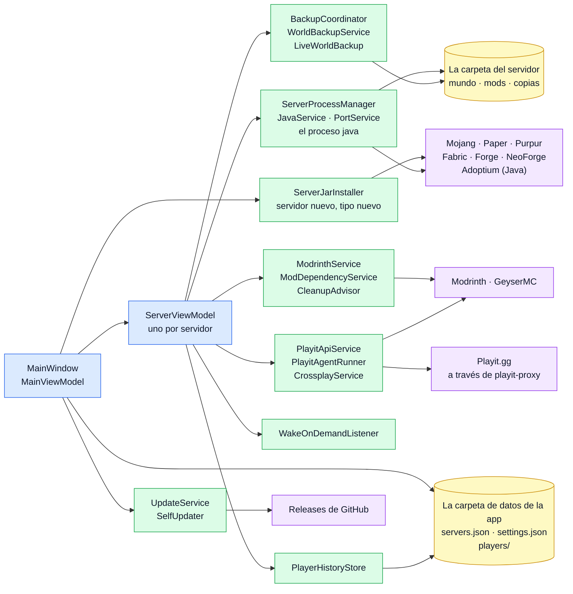
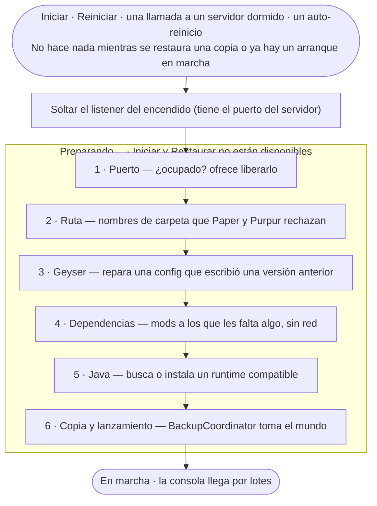

# Arquitectura

> Prefer English? Read the [English version](architecture.md).

MC Server Launcher es una app de escritorio en **Avalonia / .NET 9** que sigue el patrón **MVVM**
(con [CommunityToolkit.Mvvm](https://learn.microsoft.com/dotnet/communitytoolkit/mvvm/)) y el tema
Fluent de [Avalonia](https://avaloniaui.net/) (multiplataforma). Gestiona uno o varios servidores de Minecraft sin
archivos `.bat`, ventanas de consola ni editar configuración a mano.

## Vista general

Cómo encajan las piezas. Una flecha se lee *usa*, y cada caja nombra las clases reales que hacen ese
trabajo, así que cada nombre es algo que se puede buscar. El azul es la ventana, el verde los servicios,
el amarillo lo que se guarda en disco y el morado Internet. Las secciones siguientes explican las piezas
una a una.

El primer mapa partió del que [GitDiagram](https://gitdiagram.com/juanp-g/mc-serverlauncher) generó por su
cuenta; se completaron las conexiones que dejó fuera y se comprobó cada flecha contra el código. Lo que
pasa al arrancar un servidor tiene su propio mapa en [Arrancar un servidor](#arrancar-un-servidor).

## Capas

El proyecto (`McServerLauncher/`) está organizado por responsabilidad:

| Carpeta | Responsabilidad |
|---|---|
| `Models/` | Datos puros: configuración persistida (`ServerConfig`), ajustes (`AppSettings`), enums (`ServerState`, `PlayitState`). Dos subcarpetas guardan las formas que vienen de fuera: `Modrinth/` (lo que devuelve la API) y `Store/` (lo que enseña la tienda, independientemente de su origen). |
| `Services/` | Toda la lógica sin interfaz: procesos, archivos, red, Java, Playit, puertos, etc. Cada servicio es una clase pequeña y centrada. |
| `ViewModels/` | El estado y los comandos a los que se enlaza la interfaz (`MainViewModel`, `ServerViewModel`, uno por panel: `ServerModsViewModel`, `ServerBackupsViewModel`, `ModDetailsViewModel`, y uno por sección de la ventana: `TunnelsViewModel`, `SettingsViewModel`). Estado enlazable y `RelayCommand`s, no controles de Avalonia. |
| `Views/` | Las ventanas, los diálogos y las secciones de la ventana principal en `.axaml` (XAML de Avalonia), y su code-behind ligero. |
| `Localization/` | El sistema de traducción (`Localizer` + la extensión de marcado `{loc:Loc}`). |
| `Behaviors/` | Comportamientos adjuntos: `AutoScrollBehavior` (la consola sigue la última línea), `ResetScrollBehavior` (una lista vuelve arriba cuando su contenido se *sustituye*, no cuando se añade), el color del MOTD en `MinecraftMotd` y el Markdown en `MarkdownBody`. |
| `Controls/` | Controles propios: `Sparkline` para las mini-gráficas de CPU/RAM, `MarqueeText` para los nombres que se deslizan cuando no caben, y las marcas que viajan por los menús (`SlidingIndicator`, `TabUnderline`, `SelectionMarker`). |
| `Styles/` | `Shared.axaml`: los estilos que necesita más de una vista (`Border.card`, `Border.tile`, el texto de las estadísticas, los botones secundarios…), y `Motion.axaml`: todo el movimiento de la app. Los dos se incluyen desde `App.axaml`. |
| `Resources/` | `Strings*.resx` (traducciones), `app.ico` y los dos archivos de datos de la tienda (`store-tags.json`, `store-summaries.json`). |

> **Los conversores de valores viven en `ViewModels/`** — no existe una carpeta `Converters/`. Son
> seis: `BoolOpacityConverter`, `HexBrushConverter` (de un hex de los ajustes a un brush),
> `ConsoleBrushConverter` y `ConsoleHighlightConverter` (el color de una línea de consola y el
> resaltado de lo buscado), `NoticeBrushConverter` (el fondo del aviso de instalación) y
> `WholeNumberConverter` (un ajuste `int` hacia un `NumericUpDown`, cuyo valor es un `decimal?` que es
> nulo mientras la caja está vacía).
>
> **Los view models pequeños** cuelgan de esos: `PlayerHistoryViewModel` (anota lo que hacen los
> jugadores desde la consola del servidor y muestra a todos los que han pasado por él, con su ficha;
> lo construye `ServerViewModel` como `History`), `TunnelRowViewModel` y `TunnelSuggestionViewModel`
> (una línea de la tabla de Túneles y de su panel de «cosas que puedo arreglar»),
> `CleanupSuggestionViewModel` (una fila del panel de limpieza), `ConnectionStepViewModel` y `ProbeRow`
> (un tramo de la prueba de conexión y una fila de su tabla técnica), `ConsoleKindFilter` (un tipo de
> línea de consola como interruptor con contador), `InstalledModFilter` (lo que coincide con el
> buscador de la lista de instalados), `ServerIconImage` (el único sitio donde `server-icon.png` se
> vuelve a leer como imagen), `BulkObservableCollection` (las listas de la consola, que lanzan un solo
> `Reset` en vez de un evento por línea), `AddressRetry` (cuánto esperar entre las primeras
> búsquedas de la dirección del túnel) y `AppSection` (lo que llena la ventana junto al menú lateral).
>
> La mitad sin interfaz de cada decisión de color se deja fuera de `ViewModels/` a propósito, para
> que un ajuste que se serializa a `settings.json` no tenga que saber que Avalonia existe:
> `ConsoleColors` / `ConsolePalette`, `NotificationPalette` / `NotificationBrushes` y
> `ServerTypeCatalog` / `ServerTypeBrushes` son tres casos del mismo reparto — los hex en
> `Services/`, los brushes en `ViewModels/`.

> **`ServerConfig` avisa de sus cambios, y los view models comparten la instancia.** Él y
> `NotificationSettings` son los dos tipos de `Models/` que lo hacen: a los dos se les escribe
> mientras otra cosa los está enseñando —una instalación de loader, la semilla leída de la consola,
> la configuración de un servidor al guardarse—. Eran objetos planos, con el argumento de que un
> modelo que se guarda no debería depender de MVVM; ese argumento no sobrevive a mirar que `Models/`
> y `ViewModels/` son carpetas de un mismo ensamblado, así que la dependencia ya estaba, y lo que la
> regla compraba de verdad era una familia de fallos. Nada de lo derivado de la config se recalculaba
> nunca: convertir un servidor cambiaba el disco y dejaba a la app describiendo lo que la carpeta
> había dejado de ser, hasta reiniciarla.
>
> **Esto no cambia `servers.json`.** System.Text.Json por reflexión escribe propiedades públicas;
> las generadas conservan exactamente los nombres que tenían las auto-propiedades; `ObservableObject`
> solo aporta eventos, que no se serializan. El *orden* de las claves no se promete, y nadie lee el
> fichero por posición. `ServerConfigFormatTests` sujeta cada parte de eso: el conjunto exacto de
> claves, que `Type` siga siendo el entero que es el formato, que las dos rutas calculadas con
> `[JsonIgnore]` sigan fuera, y que un fichero escrito por una versión anterior siga abriéndose.
>
> No le pongas nunca a ninguna de las dos un `Clone` hecho con `MemberwiseClone`: copia el delegado
> `PropertyChanged`, así que la copia lanza cambios a los suscriptores del original.
> `NotificationSettings.Clone` es campo a campo, y `AppSettings` —que sí usa `MemberwiseClone`— se
> deja a propósito como objeto plano —ese `MemberwiseClone` guarda una copia con los secretos
> cifrados—: nada se enlaza a él, porque `SettingsViewModel` envuelve los campos que enseña y avisa
> él mismo de sus cambios.

> **Una sola tabla dice qué alimenta cada campo de la config.** `ServerConfigEffects` tiene una fila
> por propiedad de `ServerConfig`: qué propiedades de `ServerViewModel` y `ServerModsViewModel` hay
> que anunciar, y qué hay que rehacer que una notificación no sabe expresar —releer el puerto,
> reescanear la carpeta de contenido, cerrar la ficha de la tienda, volver a buscar, reabrir el
> listener de despertar, recargar los backups—. `ServerViewModel` se suscribe una vez a
> `Config.PropertyChanged` y aplica la fila, en el hilo de interfaz (el crossplay escribe el puerto
> Bedrock desde una continuación en segundo plano). Un campo que no enseña nadie también tiene fila,
> con el motivo escrito.
>
> **`ServerConfigEffectsTests` es lo que sujeta esto.** Toda propiedad escribible de `ServerConfig`
> tiene que aparecer exactamente una vez, y toda propiedad de view model que nombre una fila tiene
> que seguir existiendo. Un campo añadido sin fila falla el día que se escribe, y un renombrado que
> se olvide de la tabla falla en vez de anunciar un nombre que no escucha nadie. Ese es todo el
> asunto: el fallo nunca fue difícil, solo era silencioso.
>
> Persistir no es a propósito uno de los efectos; guardar se queda donde está, una vez, cuando se
> guarda la configuración del servidor.
>
> Esa configuración es una página dentro de la ventana (`ServerSettingsView`, con sus páginas en
> `Views/ServerSettings`), no un diálogo, así que no puede editar la config viva como lo hacía el
> antiguo diálogo de editar: nada modal impide al resto de la app mirarla a medio editar. Los
> controles editan una copia (`ServerSettingsDraft`) y Guardar devuelve solo los campos que
> cambiaron: la config viva se sigue escribiendo mientras tanto —una instalación de loader, la
> semilla leída de la consola— y volcar la copia entera encima lo desharía. Salir de la página con
> algo sin guardar lo impide la propia barra de guardar, no una ventana que pregunta.
>
> Lo que además se cumple en esa página:
>
> - **Una fila por página.** `ServerSettingsPages` guarda el icono, los textos y los campos y claves
>   de `server.properties` de cada página; qué campos puede editar la página sale de las filas
>   (`ServerSettingsPagesTests`).
> - **Primero los archivos, la config viva al final.** Guardar escribe `server.properties`, el icono
>   y la config de Geyser en la carpeta que dice el borrador, y solo entonces copia los campos
>   cambiados a la config viva. Un archivo que no se puede escribir deja el servidor como estaba; cada
>   archivo cuenta como guardado en cuanto se escribe (`ServerSettingsDraftTests`). Lo que hace la
>   ventana tras guardar (escribir `servers.json`, mover el listener de despertar al puerto nuevo) se
>   espera, y un fallo sale en la barra de la página, cuyo Guardar lo reintenta.
> - **Sigue a la config viva.** Un campo que cambia otra cosa con la página abierta (una instalación
>   fallida que vuelve a apagar la multiversión, el puerto Bedrock que eligió crossplay) se recoge
>   salvo que el usuario lo haya editado ahí (`ServerSettingsDraft.ChangedOutside`); la página deja
>   de escuchar al cerrarse (`Detach`).
> - **Puertos y problemas.** `PortOwners` dice qué otro servidor tiene un puerto Java o Bedrock, y
>   cada `SettingsProblem` dice de qué campo es, para que la página de Red lo enseñe bajo su caja.
> - **Un servidor encendido** reescribe `server.properties` con lo que cargó cada vez que se cambia
>   su lista blanca; `PropertiesSavedWhileRunning` vuelve a escribir lo guardado mientras tanto
>   después de ese comando.
> - **Las cajas de números** solo aceptan enteros, en cualquier idioma (`WholeNumberBoxes`): con el
>   lector por defecto, en español `1.5` GB se leía como 15.

> **Un constructor monta; `Activate()` arranca.** `ServerViewModel` y `MainViewModel` se parten en
> dos. El constructor lee —la config, la paleta de consola, los archivos del propio servidor— y no
> deja nada en marcha detrás. `Activate()` es todo lo que sale del objeto: los timers de sondeo, las
> suscripciones al `PlayitManager` / `PlayitAgentRunner` compartidos, la consulta de los túneles, el
> socket de despertar bajo demanda, la comprobación de actualizaciones. `MainWindow` llama a
> `MainViewModel.Activate()` desde `Loaded`, y eso llega a todos los servidores; uno registrado más
> tarde lo activa `Register` en el momento.
>
> `ShutdownAsync()` es el espejo exacto, y los dos se pueden llamar dos veces sin daño — `Loaded`
> vuelve a dispararse cada vez que la ventana regresa de la bandeja. Por eso se pueden construir en
> una prueba: antes del corte, construir uno arrancaba tres timers, abría un socket y llamaba a la
> red, así que nada que los tocara se podía probar salvo por sus piezas puras.

Los datos se guardan **por usuario** en `%APPDATA%\McServerLauncher\`
(`~/.config/McServerLauncher/` en Linux y macOS):

- `servers.json` — la lista de servidores y la configuración de cada uno.
- `settings.json` — ajustes globales (idioma, clave secreta del agente de Playit, última versión vista…).
  Ambos JSON se escriben de forma **atómica** (`AtomicJsonFile`): la versión anterior se conserva
  como `.bak`, y un archivo corrupto se aparta como `.bad` y se recupera desde el `.bak` cuando es
  posible (avisando al usuario al arrancar en vez de perder la lista en silencio).
- `java\` — las versiones de Java que instala la app (Temurin/Adoptium).
- `logs\` — el log de consola persistente (`launcher-yyyy-MM-dd.log`, se poda a los 14 días, 50 MB al día como mucho), y
  `crash-*.log` de `CrashLog` cuando una excepción se escapa de todo manejador (se guardan las 20 más
  recientes). Está enganchado al AppDomain, a las tareas no observadas y al dispatcher de la interfaz; en
  el dispatcher la app lo apunta y sigue, porque cerrarse dejaría sin vigilar los servidores que arrancó.
- `cache\images\` y `cache\store\` — las cachés en disco de la tienda: iconos y capturas de la
  galería (`ImageCache`, se podan a los 30 días) y las respuestas de la API (`StoreCache`). Ambas son
  prescindibles; borrarlas cuesta unas cuantas peticiones y nada más.
- `content\<serverId>\ledger.json` — lo que el panel de limpieza recuerda de los mods de cada servidor:
  cuándo se apagó cada uno, quién necesitaba cada librería y los «Ahora no» (`ContentLedger`).
- `playit-agent\` — el binario oficial `playitd` de Playit, descargado una vez y fijado a la versión
  que registra la app (`PlayitAgentRunner`).
- `instance.lock` — el bloqueo exclusivo de archivo que mantiene la app en una sola copia por usuario
  (`SingleInstance`).
- `.secret.key` — la clave AES-GCM que cifra los secretos en Linux/macOS (Windows usa DPAPI, así que
  ahí no hay archivo de clave).
- *(opcional)* `store-tags.json` / `store-summaries.json` — si existe cualquiera de los dos,
  sustituye a la copia embebida en la app, así que las etiquetas y los resúmenes en lenguaje llano se
  pueden cambiar sin compilar nada.

Además, la carpeta de cada servidor contiene un directorio `backups\` con las copias automáticas del
mundo. No hay rutas fijas del equipo en el código.

## Servicios clave

- **`ServerProcessManager`** — gestiona el ciclo de vida del proceso `java`: lo arranca (sin ventana
  de consola), redirige stdin/stdout/stderr, reemite cada línea por un evento y lo detiene de forma
  limpia enviando `stop` (con kill de respaldo). El kill espera `ServerViewModel.StopTimeout` (60 s),
  el mismo valor para el botón Parar, Reiniciar y cerrar o actualizar la app; al cerrar se daban
  quince segundos, menos de lo que un modpack grande necesita para guardar.
- **`JavaService`** — detecta los Java instalados y, si ninguno es compatible, descarga el JRE
  Temurin (Adoptium) adecuado para la arquitectura. Se usa al crear y al iniciar un servidor. Cada
  servidor pide su propio `JavaService`, así que la descarga de una Java (por versión mayor) pasa por una
  puerta común a todo el proceso: dos servidores que arrancaban a la vez compartían el archivo y la
  carpeta `.partial`, y cada uno borraba lo que escribía el otro. `java -version` y `which` se lanzan con
  `ProcessRunner`, como todo lo que ejecuta un comando corto. `GetRuntime` recuerda la versión, la VM y
  los bits de cada Java junto a su archivo, y `AcceptsFlags` si acepta un juego de flags.
- **`MemoryProfile`**, **`JvmArgs`**, **`MemoryBudget`** — la memoria con la que arranca un servidor: el
  modo que rige, el techo y los flags para su Java, qué argumentos extra le quitan la decisión a la app, y
  los techos de los servidores que ya están en marcha (ver *Memoria: automática o manual*).
- **`GcLogging`**, **`GcLogLine`**, **`GcLogTail`**, **`MemorySessionTracker`**, **`MemoryHistoryStore`**,
  **`ProcessMemory`** — lo que la app mide de un servidor en marcha (ver *Medir la memoria de un servidor*).
- **`PerformanceParsers`**, **`PerformanceProbe`**, **`PerformanceMonitor`**, **`PerformanceAdvice`**,
  **`PerformancePicks`** — cómo lleva un servidor en marcha su carga y qué hacer al respecto (ver
  *Rendimiento: la tarjeta, la banda y las soluciones*).
- **`MinecraftVersionService`** — lee el manifiesto de versiones de Mojang, resuelve la URL del
  `server.jar` y la versión de Java necesaria, y descarga archivos.
- **`PlayitApiService`** / **`PlayitPartnerService`** / **`PlayitManager`** — hablan con Playit.gg.
  `PlayitPartnerService` ejecuta el flujo de **código de configuración** de terceros (`create_agent`)
  para obtener una **clave secreta de agente autogestionado por usuario** a partir de un código que
  el usuario pega. La **Api-Key de socio no está en la app** (es pública + open-source): la llamada
  pasa por un pequeño proxy (un Cloudflare Worker, ver `playit-proxy/`) que añade la clave en el
  servidor. El Worker solo acepta el POST de create-agent con la forma que envía la app de
  escritorio, rechaza tráfico con origen de navegador y puede limitar intentos por IP. El
  variant_id/versión son públicos y van incrustados. `PlayitApiService` usa la clave
  por usuario devuelta (como `agent-key`, fijada con `SetAgentKey`) para listar/crear/eliminar
  túneles — con reserva al `playit.toml` heredado o a una clave de escritura pegada. `PlayitManager`
  consulta/arranca/detiene el servicio de fondo (Windows/systemd). `PlayitConnection` es el flujo
  compartido de conectar/desconectar que usan los botones de túnel y la sección Túneles.
- **`PortService`** — comprueba qué puertos TCP están en uso, encuentra uno libre y (vía P/Invoke)
  localiza el PID que escucha en un puerto para liberar un servidor colgado.
- **`ServerPropertiesService`**, **`PlayersService`**, **`WhitelistService`** — leen/escriben los
  archivos del servidor (`server.properties`, `ops.json`, `banned-players.json`, `whitelist.json`). El
  `server.properties` de un servidor nuevo se escribe con `white-list=false`: Minecraft 26.3 cambió su valor por
  defecto a `true`, y eso dejaba todo servidor nuevo cerrado tras una lista vacía. La pestaña Jugadores la
  enciende y apaga con `whitelist on/off` si está arrancado y en el archivo si está parado, sin tocar nunca
  `whitelist.json`, y añadir un nombre la enciende. Una clave verdadero/falso se lee con
  `ServerPropertiesService.ParseBool`/`GetBool`, como la lee el servidor (solo `true` es verdadero:
  `online-mode=yes` es un servidor sin conexión).
- **`PlayerNames`** — cómo es un nombre de Minecraft Java (`IsValid`, y `Pattern` para sacar uno de una
  línea). Una sola regla para los cinco sitios que guardaban cada uno su expresión regular; también es lo
  que impide que un nombre lleve un salto de línea a un comando de consola o acabe en una ruta.
- **`ByteSize`** y **`AppWindows`** — una sola forma de escribir un tamaño en disco (potencias de 1024; las
  velocidades de la línea siguen en decimal, como los Mb/s que tienen al lado) y un solo sitio donde pedir
  la ventana principal.
- **`MinecraftIds`** — convierte `minecraft:deepslate_diamond_ore` en «Deepslate diamond ore». A propósito
  sin traducir: hay más de mil bloques, más con cada versión y cada mod, y lo que se traduce es la etiqueta
  de la lista, no el vocabulario del propio juego que va dentro. Un bloque de un mod conserva su espacio de
  nombres, porque «Source gem» a secas no dice nada.
- **`PlayerEventParser`**, **`PlayerHistoryStore`**, **`PlayerLogImporter`**, **`PlayerStatsReader`** — el
  historial de jugadores. Un único lector convierte una línea del log en algo que hizo un jugador, hecho con
  los detectores de la propia consola (`NameBefore`, `ChatOf`, `DeathMessageDetector`), y sirve tanto a la
  consola en directo como a la importación, así que no pueden discrepar. Nunca lee la línea de login, que es
  la que lleva la IP, así que el historial no puede guardarla — `AnIpAddressNeverReachesTheDisk` lo comprueba
  en los bytes del disco. Se guarda en `%APPDATA%\McServerLauncher\players\<idServidor>\`, fuera de la
  carpeta del servidor para no viajar con el mundo ni llenar sus copias: `index.json` con un resumen por
  jugador, y `events/<nombre>.jsonl`, al que solo se añade y que se compacta de una vez cuando pasa el límite
  en una cuarta parte. Los límites son `PlayerHistorySettings` (acotados, porque settings.json se puede
  editar); al arrancar se borran los eventos viejos, los jugadores que hace mucho que no vienen y el historial
  de servidores quitados. El almacén solo se abre cuando algo lo necesita, nunca al construir un view model
  y ni siquiera al preguntar cuánto ocupa (`SizeOf` lee la carpeta sin abrir nada), así que las pruebas no
  pueden escribir en los datos del usuario. **El historial de un servidor se borra desde la configuración de
  ese servidor**, no desde los ajustes de la app: el historial pertenece a un servidor, y «borrarlo todo»
  desde una pantalla sin ningún servidor delante era un instrumento romo para lo que la gente quiere de
  verdad. La importación va una vez por servidor, fecha cada línea por su archivo (un `.log.gz` por su
  nombre, `latest.log` por su última escritura menos las medianoches que cruza), no toca `latest.log` con el
  servidor en marcha, y solo cierra las sesiones que dejan abiertas sus propios archivos. Las estadísticas se
  leen de `<mundo>/stats/` o, desde la 26.1, `<mundo>/players/stats/`, al abrir una ficha — fuera del hilo de
  la interfaz, porque el lector ahora recorre todos los bloques que un jugador ha roto. `minecraft:mined` es
  exacto; `minecraft:used` es lo más parecido a «bloques colocados», porque Minecraft cuenta usar un objeto y
  no colocarlo, y se enseña tal cual con una línea que lo explica en vez de filtrarlo contra una lista de ids
  de bloques mantenida a mano que se quedaría vieja cada versión.
- **`ServerCreationService`** — escribe los archivos iniciales de un servidor nuevo: `eula.txt` (solo cuando
  el usuario marca *Acepto el EULA de Minecraft* junto al botón Crear, que no se activa hasta entonces; antes la
  app lo aceptaba en su nombre),
  `run.bat`/`user_jvm_args.txt` y el `server.properties` mínimo con el puerto elegido. (La descarga
  del jar la hacen `MinecraftVersionService`/`ModLoaderService`/`PaperService` y el puerto lo elige
  `PortService`, todo orquestado por `NewServerView`.) La semilla que se escriba ahí, si se escribe, va
  como `level-seed`, escapada como valor de un properties de Java —la barra invertida duplicada, lo que no es
  ASCII como `\uXXXX`— y **solo se pide al crear**: convertir el tipo o cambiar la versión conserva el
  mundo, así que no queda semilla que elegir.
- **`WorldSeed`**, **`NbtReader`**, **`SeedMapLink`** — la semilla que enseña la página Mundo de la configuración del servidor.
  `level-seed` no lo es: se lee una vez, al generar, y vacío significa aleatoria. La de verdad la guarda el
  mundo, y la ha guardado en tres sitios: `data/minecraft/world_gen_settings.dat` → `data.seed` desde la
  26.1 (un mundo real de la 26.2 no la tenía en `level.dat`), `level.dat` → `Data.WorldGenSettings.seed`
  desde la 1.16, y `Data.RandomSeed` antes. `NbtReader` lee ese único número del NBT comprimido y no lanza
  nunca: una partida dañada o a medio escribir responde «no está», con longitudes y anidamiento acotados.
  Como Minecraft ya la cambió de sitio una vez, la respuesta del servidor al comando `seed` se recuerda en
  `ServerConfig.LastKnownSeed` como respaldo. `SeedMapLink` abre Chunkbase en la versión que cubre la del
  servidor, con una tabla copiada de la web; una versión más nueva que la tabla, o una snapshot, va sin
  `platform` y la web elige la suya más reciente.
- **`ServerTypeCatalog`** — una fila por tipo de servidor: nombre, familia (plugins/mods/ninguna), color de la
  insignia y su `CrossplayLevel`. El selector, las insignias, la tienda de mods, la carpeta de contenido y las reglas
  de crossplay leen de ahí, así que añadir un tipo es una fila y no seis `switch` repartidos.
  El nivel tiene tres valores en vez de sí/no, porque «Geyser publica una versión» y «tu amigo con el móvil puede
  jugar» no son la misma afirmación: `Full` en Paper, Purpur y Fabric; `Partial` en NeoForge — conecta y autentica,
  y a partir de ahí cualquier mod que el cliente necesite tener deja fuera a Bedrock —; y `None` en Vanilla y
  Forge. `CrossplayService.CaveatKey` convierte el nivel en el aviso que muestran el panel de nuevo servidor
  y la página Crossplay de la configuración del servidor.
- **`ServerJarInstaller`** — el único sitio que sabe cómo se obtiene cada tipo. Lo llaman el panel de nuevo servidor y
  la página Tipo y versión de la configuración; antes la cadena estaba escrita en los dos, y un tipo presente en uno y ausente en el otro
  producía un servidor Vanilla sin decir nada.
- **`ModLoaderService`** / **`PaperService`** / **`PurpurService`** — instalan un mod loader (Fabric/Forge/NeoForge) o un
  build de Paper/Purpur. Purpur solo publica MD5 de sus builds, no SHA-256: HTTPS autentica el origen y el hash está
  para detectar una descarga corrupta, y así queda explicado en el propio servicio. También instalan
  un loader sobre un servidor existente, conservando el mundo. Limitación conocida: el endpoint meta de
  Fabric no publica checksums, así que su jar de servidor no se puede verificar por hash como las
  demás fuentes (Mojang SHA-1, Paper SHA-256…); en su lugar el jar descargado se valida
  estructuralmente (su `install.properties` debe coincidir con las versiones de juego/loader
  pedidas) y se descarta si no cuadra. Supuesto de confianza de Forge: su maven publica un `.sha1`
  junto a cada artefacto pero **desde el mismo servidor** (el ecosistema Forge no tiene firmas
  independientes), así que la verificación obligatoria del hash protege de corrupción, no de un
  servidor comprometido; como el instalador se *ejecuta*, además se valida estructuralmente (debe
  llevar `install_profile.json` o un manifest de installer) antes de que `java -jar` lo toque.
  NeoForge sigue el mismo esquema con un hash mejor: su maven publica un `.sha256` junto a cada
  artefacto, y eso es lo que se comprueba. El supuesto de confianza no cambia — mismo servidor que
  el jar — y sin hash no hay instalación, porque lo siguiente es un `java -jar`. Qué build
  corresponde a cada versión de Minecraft lo decide `NeoForgeVersions`, aparte de la descarga:
  NeoForge no tiene feed de promociones, así que la regla se deduce del número de build y se prueba
  por su cuenta.
- **`ModrinthService`** — busca en Modrinth y descarga mods/plugins (filtrados por el tipo y la
  versión del servidor), y gestiona el flujo de "buscar actualizaciones de mods".
- **`ModDependencyService`** — recorre las dependencias *obligatorias* de una versión, también las de sus
  dependencias, y dice cuáles faltan. Dos detalles de los datos de Modrinth lo condicionan: las dependencias no
  llevan **ningún rango de versiones** (o fijan un id de versión o nombran un proyecto), y por eso «ese proyecto
  ya está instalado» es una respuesta completa y no una aproximación; y `embedded` significa que la dependencia
  ya viene dentro del jar, así que instalarla otra vez produce el fallo de *mod duplicado* del cargador. El
  recorrido (`WalkAsync`) recibe la búsqueda como delegado, de modo que lo que decide se prueba contra una tabla
  y no contra Modrinth el día que se ejecuta la prueba.
- **`ContentManifest` / `ContentDependencyCheck`** — leen lo que cada jar declara de sí mismo (lo que ofrece y
  lo que necesita) y dicen qué falta. Tres formatos: `fabric.mod.json`, `plugin.yml` de Bukkit y el `mods.toml`
  de Forge/NeoForge, sin librería de YAML ni de TOML — solo hacen falta unas listas de nombres, y lo que no se
  entienda cuenta como «no declara nada». **Los jars dentro de jars cuentan**: los dos cargadores dejan que
  un mod lleve otros dentro (`META-INF/jars/`, `META-INF/jarjar/`), y `fabric-api` son unos cuarenta módulos
  así, de modo que lo que ofrece un jar anidado se suma al de fuera —siguiendo unos cuantos niveles— y lo que
  necesita no, porque un hueco dentro de un paquete es cosa del cargador. El lector de dependencias de la
  pestaña de Mods pasa por el mismo código en vez de por una copia suya; antes había dos, y solo uno lo sabía.
  **Sin red, a propósito**: es la comprobación que corre al darle a
  Iniciar, y las llamadas de Modrinth que responderían a lo mismo se tragan los errores y devuelven vacío, así
  que sin conexión dirían que no falta nada justo donde equivocarse impide arrancar. Una prueba prohíbe que
  esos dos ficheros mencionen `HttpClient` o `ModrinthService`.
- **`NotificationCatalog` / `NotificationPalette`** — qué nivel y qué emoji le toca a cada tipo de aviso, y
  cuáles son los colores por defecto. Misma separación que `ServerTypeCatalog` y `ServerTypeBrushes`: los datos
  sin nada de UI aquí, las brochas de Avalonia en `NotificationBrushes`. Los colores que el usuario cambia
  viven en `NotificationSettings`, que se serializa a `settings.json`.
- **`ConsoleLineClassifier` / `ConsoleColors`** — de qué va cada línea de consola y de qué color se pinta. El
  origen manda sobre el texto: los mensajes de la app se etiquetan donde se emiten, porque su texto está
  traducido —los prefijos `[Launcher]`, `[Error]` y `[Players]` viven *dentro* de los valores del resx— y un
  clasificador basado en ellos funcionaría en español y dejaría de funcionar en alemán. `stderr` viene marcado
  desde `ServerProcessManager`, que antes lo mezclaba con la salida normal en el mismo manejador, y va en rojo
  salvo las líneas `WARNING:` de la propia JVM, cuyo formato fija Java. Solo `stdout` se lee: el corchete de
  vanilla (nivel en el **segundo**, no en el primero) y el de Paper. **Una línea sin prefijo de log pertenece a
  la entrada de encima** —la lista de mods de Fabric, las líneas bajo un aviso de varias líneas, el mensaje de
  una excepción—, así que toma el nivel de esa entrada en vez de juzgarse sola; el view model le pasa el tipo
  de la línea anterior de stdout. Las trazas se reconocen por su forma (`at x.y(File:1)`, `Caused by:`,
  `... 12 more`), nunca por la sangría: el cargador sangra su lista de mods con tabuladores, y un tabulador
  pintaba de rojo todos los mods. **El chat es cualquier forma que toma un mensaje** (`ChatOf`), no solo
  `<nombre>`: `[Not Secure] <nombre>` (chat sin firmar), `[Server]`/`[Rcon]`/`[@]` (`say` desde la consola,
  RCON o un bloque de comandos), y el `/say` y el `/me` de un jugador (`[Alice] …`, `* Alice …`). Estos dos
  últimos solo cuentan si ese jugador está conectado —el view model le pasa una copia de quién lo está—,
  porque en Paper cada plugin escribe como `[NombreDelPlugin] …`, y el nombre de un plugin es un nombre de
  jugador válido.
  **Nada que escriba un jugador se toma por un suceso.** Cada detector que lee uno —una entrada o una
  salida, el `Saved the game` que espera una copia en caliente, la respuesta a `seed`, el UUID de un
  jugador— compara el mensaje *entero* que da `MessageBody`: el texto tras el **primer** `]: `, que es donde
  acaba el prefijo del propio servidor; todo lo que viene detrás se puede teclear. Buscar la frase en la
  línea no bastaba: un chat como `<Bob> x: Bob left the game` o `<Bob> x]: Saved the game` lleva un trozo
  con forma de prefijo, y sacaba a Bob de la lista de jugadores (y el temporizador de inactividad paraba
  un servidor con gente dentro) o cortaba una copia antes de tiempo. Además, `ServerViewModel` no reacciona
  a nada de una línea clasificada como chat salvo para guardarla en el historial, y solo escucha el rechazo
  de ruta de Paper mientras el servidor aún no está en marcha. `ConsoleSpoofingTests` fija cada una de esas
  líneas.
- **`BlueMapConsent`** y `ServerProcessManager.ImpliedJvmFlags` — los dos avisos de arranque que la app
  resuelve ella misma, porque le tocan a ella. Desde Java 22 añade `--enable-native-access=ALL-UNNAMED` a la
  línea de comandos que construye: los mods que usan JNA provocan un aviso que dice que un Java futuro
  *bloqueará* la llamada, y una opción desconocida impediría arrancar a una JVM antigua, de ahí el corte por
  versión. `--sun-misc-unsafe-memory-access` no se añade a propósito: sus valores aceptados cambian de una
  versión a otra. Y cuando BlueMap avisa de que su descarga no está aceptada, la app **pregunta** —es aceptar
  bajar ficheros del cliente de Mojang— y si dices que sí cambia ese único valor en `core.conf` y manda
  `bluemap reload`. El resto de avisos de un arranque con mods (refmaps, mixins dirigidos a mods ausentes, un
  valor del registro de Windows, Distant Horizons recomendando ZGC para los FPS del cliente) no le toca
  cambiarlos a la app.
- **`ServerDetectionService`** / **`ExistingServer`** — averiguan qué hay en una carpeta y la adoptan.
  `Detect(carpeta)` devuelve un `ServerDetection` sin tocar nada: el tipo, las versiones de Minecraft y
  del loader, qué arrancar (un jar, o el archivo de argumentos de Forge/NeoForge), el puerto de
  `server.properties`, la memoria de `user_jvm_args.txt` o de los scripts de arranque (saltándose los
  comentarios: el de Forge es casi todo un `-Xmx4G` de ejemplo que nadie eligió), si hay mundo, y los
  jars de la raíz para elegir uno a mano. El *añadir uno que ya tengo* del panel de nuevo servidor lo
  enseña, bloquea lo detectado y solo pregunta el resto; sustituyó al botón *Añadir*, cuyo diálogo
  pedía el nombre del jar a mano y se saltaba el túnel, el crossplay y el arranque. `ExistingServer`
  construye la config con la detección y el formulario (gana la detección) y nunca escribe en la
  carpeta, salvo `server-port` si el usuario lo cambió y `eula.txt` si la carpeta no había aceptado el
  EULA y el usuario marca la casilla que el panel muestra para ello. `DetectAndFill` es una capa fina sobre
  `Detect` que, al arrancar, rellena los servidores guardados antes de que se guardaran el tipo y la
  versión; no toca una config que ya dice su versión. Purpur se mira antes que Paper: antes no
  coincidía con nada, ni siquiera en los servidores que crea esta app.
- **`ServerIconService`** — genera el `server-icon.png` de un servidor: toma cualquier imagen del
  usuario, la recorta al cuadrado centrado y la escala a 64×64 con SkiaSharp. (Quien lo lee de vuelta
  para la vista estilo Minecraft es `ServerViewModel.LoadIcon`.)
- **`BackupCoordinator`** — el orden en que las copias, las restauraciones y el arranque y la parada
  de la JVM tocan el mundo; ver *Copias del mundo* más abajo. Habla con su servidor por `IBackupHost`,
  así que el protocolo se prueba sin Avalonia (`BackupCoordinatorTests`).
- **`WorldBackupService`** — crea y restaura copias zip del mundo del servidor (`<servidor>/backups/`),
  con el Nether y el End que un servidor Bukkit guarda al lado, podando las antiguas según la retención.
- **`LiveWorldBackup`** / **`SaveConfirmation`** / **`BackupSchedule`** — copiar un mundo en el que
  todavía se está jugando: pausar el guardado, reconocer el volcado y decidir cuándo toca
- **`CrashReportService`** — lee `crash-reports/*.txt` para extraer la línea `Description:` y mostrar
  un motivo legible del crash. (La detección del cierre inesperado es el evento `UnexpectedExit` de
  `ServerProcessManager`; la lógica de auto-reinicio vive en `ServerViewModel`.)
- **`ConsoleLogService`** — copia cada línea de consola a `%APPDATA%\McServerLauncher\logs\` para que
  el historial sobreviva a los reinicios (retención de 14 días, comprobada cada vez que cambia el día y no
  solo al arrancar, porque la app puede vivir semanas en la bandeja; y un tope de 50 MB al día, pasado el
  cual una línea lo dice y no se escribe nada más hasta el siguiente — `ConsoleLogLimitsTests`).
- **`ProcessStatsService`** — muestrea CPU/RAM del proceso `java` en marcha para las estadísticas en
  vivo y las mini-gráficas `Sparkline`.
- **`ToastService`** — muestra notificaciones emergentes propias — ventanas de Avalonia siempre
  encima en la esquina inferior derecha (con el nombre del servidor como título), solo cuando la app
  no tiene el foco; funcionan aunque el SO no soporte notificaciones.
- **`NotificationPreferences`** — decide qué notificaciones se muestran, combinando los ajustes
  globales (interruptor maestro + por tipo: entra, sale, muerte/baja, caída, reinicio agotado) con
  una posible anulación por servidor (`ServerConfig.UseCustomNotifications`). Las anulaciones por
  servidor se clonan campo a campo desde los ajustes globales para no compartir estado mutable.
  `DeathMessageDetector` detecta las líneas de muerte/baja en la consola para la notificación de
  muertes, exigiendo un nombre de jugador válido seguido inmediatamente por una frase de muerte
  vanilla conocida para reducir falsos positivos de chat o plugins.
- **`SecretProtector`** — cifra los secretos en reposo (DPAPI en Windows, AES-GCM + `.secret.key` en
  Linux/macOS), usado para la clave de agente por usuario de Playit (y la clave de escritura heredada). Si el cifrado falla, la clave **no** se
  persiste (nunca llega texto plano al disco): sigue funcionando durante la sesión, el fallo queda
  en el log diario y se avisa al usuario una vez.
- **`DownloadVerifier`** — el verificador de checksums compartido para las descargas (Mojang SHA-1,
  Adoptium/Paper SHA-256, Modrinth SHA-512/SHA-1), que borra el archivo si no cuadra.
- **`Changelog`** — las notas de "novedades" por versión que se muestran tras actualizar (ver el
  flujo más abajo).
- **`UpdateService`** / **`SelfUpdater`** — `UpdateService` pregunta a GitHub si hay una release más
  nueva y elige el asset para *esta* plataforma y arquitectura (el instalador de Windows, el AppImage
  de Linux, el `.dmg` de macOS); `SelfUpdater` es quien lo aplica. Lee la **lista** de releases, no
  `/releases/latest`, porque GitHub deja las pre-releases fuera de esa última y una beta publicada
  así sería invisible para la app. Las betas solo se ofrecen con **Ajustes → General → Recibir versiones
  beta** activado (`AppSettings.ReceiveBetas`, desactivado de serie); con él apagado, quien ya esté en una
  beta la conserva hasta la siguiente estable, que la supera. Cambiarlo vuelve a comprobar en el acto, y
  una comprobación que no encuentra nada más nuevo retira lo que ya ofrecía el banner. La verificación contra el asset `SHA256SUMS.txt` de la release es
  **obligatoria**: si el checksum falta o no se puede leer, la actualización in situ se rechaza y se
  abre la página de la release en su lugar.
- **`ServerAccessCatalog` / `ServerAccessRules`** — quién puede hacer qué en un servidor *compartido*, sin
  red ni pantalla todavía (fase 1 del [acceso compartido](shared-access.es.md)). `ServerGrant` (en
  `Models/`) es lo que se guarda de una persona: un rol y los permisos añadidos o quitados. Lo que puede
  hacer de verdad lo calcula `Effective` y nunca se guarda. El catálogo es la única tabla de permisos
  (identificadores estables para la red, un nivel de riesgo y la plantilla de cada rol) y `Check` responde si
  una persona puede cambiar el acceso de otra, devolviendo el motivo (`GrantDenial`). Los mods y los
  comandos libres no están en ningún rol salvo el del propietario, porque los dos acaban en código en el
  PC anfitrión. La nube tendrá que llegar a las mismas respuestas con su propio código, y por eso
  `ServerAccessTests` se lee como una especificación.

### Servicios de apoyo

- **`ConnectionProbe`** — las mediciones de la prueba de conexión: un ping de estado de Minecraft, un
  ping RakNet, una ida y vuelta TCP, una bajada y una subida cronometradas y la consulta SRV por DNS
  sobre HTTPS. Ver *Prueba de conexión* más abajo.
- **`AppSettingsService`** / **`ServerStorageService`** — los dos dueños del JSON de la app:
  `settings.json` y `servers.json`. Ambos pasan por `AtomicJsonFile` y ambos informan de qué pasó al
  cargar, para que un archivo corrupto salga a la superficie al arrancar en vez de convertirse en una
  lista de servidores vacía. Los dos aceptan una carpeta de datos opcional, y `MainViewModel` acepta
  otra y se la pasa a ambos: sin eso, una prueba que se acerque a cualquiera de los dos archivos lee
  y reescribe el de verdad de quien la esté ejecutando.
- **`AtomicDownload`** / **`AtomicTextFile`** — la misma garantía para los otros dos tipos de
  escritura. Una descarga aterriza en `<destino>.part` y se verifica ahí, así que una interrumpida no
  puede sustituir un archivo que funcionaba por la mitad de otro; un archivo de configuración que es
  de la app se escribe solo cuando de verdad ha cambiado, y nunca a medias.
- **`ErrorMessages`** / **`UserFacingException`** — lo que un fallo dice en pantalla. Una
  `UserFacingException` lleva una frase de los .resx y se enseña tal cual; cualquier otra excepción se
  convierte en una frase propia de la app (un archivo en uso, sin permiso, el disco lleno, sin
  conexión, un código HTTP o «algo ha fallado de forma inesperada»), y la excepción en sí va al
  registro del día. `ErrorMessagesTests` falla si el código vuelve a poner `ex.Message` delante del
  usuario.
- **`SingleInstance`** — una sola copia en marcha por usuario, y un segundo lanzamiento trae la
  primera al frente. Es una garantía de corrección, no una cuestión de orden: dos copias arrancan
  cada una sus procesos de servidor y sus escuchas de wake, y dos JVM sobre la misma carpeta de mundo
  es como se corrompen los mundos. Un archivo bloqueado responde a "¿hay alguien más?" (el sistema lo
  suelta incluso si matas el proceso, al contrario que un PID file) y una named pipe lleva el aviso
  de "ponte delante".
- **`ServerNameRule`** / **`BukkitPathRule`** — el nombre de la carpeta de un servidor, comprobado
  antes de que sea un servidor que no arranca: lo que Windows prohíbe de entrada (caracteres
  ilegales, nombres reservados de dispositivo, un punto o un espacio al final) y, aparte, los dos
  caracteres desde los que Paper y Purpur se niegan a ejecutarse — incluso cuando están en una
  carpeta *por encima* de la del servidor, que no es nuestra para renombrarla.
- **`LoaderPaths`** — dónde deja cada cargador los archivos que hay que volver a encontrar (el
  directorio de versión y el archivo de argumentos con el que se lanzan Forge y NeoForge). En un solo
  sitio porque lo necesitan el instalador, el lanzador y el detector, y un cargador que falte en uno
  de los tres se instala perfectamente y luego no arranca.
- **`VerifiedJarDownload`** — anunciar el tamaño, descargar de forma atómica, verificar y avisar de
  que está. Compartido por Paper y Purpur, que solo se diferencian en el algoritmo de hash que
  publican.
- **`FileHashCache`** — el SHA-1 de un archivo, recordado mientras el archivo no cambie (la clave es
  ruta + tamaño + fecha de escritura). Si no, la pestaña de mods hashea cada jar dos veces por clic:
  una para buscar actualizaciones y otra para ver qué hay ya instalado.
- **`ContentMigrationService`** — qué pasa con el contenido instalado cuando un servidor cambia de
  familia: la carpeta `mods/` o `plugins/` anterior se aparta en vez de dejarla para que la cargue
  algo que no sabe leerla.
- **`MultiVersionService`** — ViaVersion *y* ViaBackwards, que no son intercambiables: el primero
  admite clientes más nuevos que el servidor y el segundo más antiguos, e instalar solo uno parece
  que la función está rota para la mitad de quienes la prueban. Solo servidores de plugins, y
  deliberadamente independiente del crossplay.
- **`DesktopShortcutService`** — el botón "Añadir al escritorio". Tres cosas distintas según la
  plataforma (un `.lnk`, una entrada `.desktop` que tiene que ser ejecutable y estar marcada como de
  confianza en GNOME, un enlace simbólico al bundle), todas apuntando a desde dónde se está
  ejecutando de verdad esta copia y no a una ruta de instalación supuesta.
- **`WindowBehavior`** — qué hacen minimizar y cerrar, según los ajustes. Estado global aplicado sin
  reiniciar, con la misma forma que `NotificationPreferences.Global` y `ConsolePreferences`.
- **`BrowserLauncher`** — la única manera de abrir un enlace. Solo pasan URLs http(s) absolutas,
  porque en la tienda la URL la escribe el autor de un mod, no nosotros.
- **`AppLinks`** — los sitios a los que la app lleva a la gente (el repositorio, las releases, un issue
  nuevo, la licencia, la web, la página de túneles de Playit, el EULA de Mojang), en una sola lista. La
  dirección del repositorio aparecía solo dentro de las cabeceras de las peticiones y de la comprobación
  de actualizaciones, así que la pantalla Acerca de no tenía de dónde sacarla.
- **`MarkdownParser`** / **`MarkdownBody`** — un lector de Markdown deliberadamente parcial para las
  descripciones largas de Modrinth, y el comportamiento que convierte sus bloques en controles.
- **`MinecraftRange`** — si una versión de Minecraft cumple el rango que declara un mod.

## Flujos importantes

### Arrancar un servidor

`ServerViewModel.Start` → `StartInternalAsync`, que se niega mientras se restaura una copia y, si no,
primero suelta el listener del encendido bajo demanda (tiene el puerto del servidor) y después:

1. **Puerto** — refresca puerto/info; si el puerto está ocupado, ofrece liberarlo (`PortService` +
   `TryFreePortAsync`). Un auto-reinicio no pregunta: se rinde y lo dice en la consola.
2. **Ruta** — `TryFixRejectedPathAsync`: Paper y Purpur se niegan a arrancar desde una carpeta cuya
   ruta tiene un carácter que no saben manejar (`BukkitPathRule`), y la app ofrece renombrar la
   carpeta en vez de dejar que falle.
3. **Geyser** — con el crossplay activado, `CrossplayService.RepairConfig` corrige una configuración de
   Geyser que escribió una versión anterior de la app.
4. **Dependencias** — `CheckContentDependenciesAsync`: los mods o plugins a los que les falta algo se
   avisan antes de arrancar, no como un crash después.
5. **Java** — `EnsureCompatibleJavaAsync` (usa `JavaService` para leer el Java requerido del jar e
   instalarlo si hace falta).
6. **Memoria, copia y lanzamiento** — fuera del hilo de la interfaz, `PlanMemory` le pregunta a la
   Java qué es y decide los flags de memoria (ver *Memoria: automática o manual* más abajo); después
   `BackupCoordinator.StartAsync` toma el mundo (esperando a cualquier copia que siga leyéndolo), hace
   la copia de arranque si las copias están activadas y el mundo ya no es el de la última copia, reserva
   el techo en `MemoryBudget` y llama a `ServerProcessManager.Start` **sin soltarlo**, para que ninguna
   copia se cuele entre medias. Si la copia falla, se dice en la consola y el servidor arranca
   igualmente. La línea de comandos es los flags de memoria, los flags que añade la propia app
   (`ImpliedJvmFlags`), los `ExtraJvmArgs` del servidor y el jar (o el fichero de argumentos de
   Forge/NeoForge modernos); los argumentos extra van detrás de los de la app, así que los valores del
   usuario ganan. Un arranque que aún se preparaba cuando la app empieza a cerrarse ya no lanza nada.

Todo ello puede durar minutos con un mundo grande que copiar, y el estado sigue siendo Detenido mientras
tanto, así que `IsPreparing` está activo del primer paso al último: la lista y la cabecera dicen
*Preparando…* en ámbar, Iniciar y Restaurar no están
disponibles, y un segundo arranque (otro intento de entrar con el servidor dormido, un auto-reinicio)
no hace nada (`StartPreparationTests`). Si algún paso para el arranque, el listener del encendido bajo
demanda se vuelve a levantar
(`finally`). La salida de la
consola llega de vuelta por el evento `OutputReceived` hacia `ConsoleLines`, **por lotes**: las líneas de
los hilos del proceso se encolan y una sola tarea del dispatcher se lleva todas las que llegaron antes de
ejecutarse, con un único `AddRange` (un modpack cargando imprime miles, y una tarea por línea hacía que la
ventana fuera a tirones). Las líneas de la propia app se escriben en el hilo de la interfaz y aparecen al
instante (`ConsoleBatchingTests`).

### Memoria: automática o manual
Cada servidor tiene un `MemoryMode`. **Automática** (la de serie) deja que la app dimensione el heap;
**Manual** pasa `-Xms{MinRamGb}G -Xmx{MaxRamGb}G` igual que siempre. La decisión es `MemoryProfile.Plan`,
una función pura, y `ServerViewModel.PlanMemory` reúne lo que necesita antes de cada arranque.

- **Por qué.** Un `-Xms`/`-Xmx` fijo compromete todo lo que el heap llegó a ocupar y se lo queda: medido
  con bots en la 26.2, un servidor vacío se quedaba en 3,5-4,7 GB. Con un heap inicial pequeño, el GC
  periódico de G1 y márgenes de heap libre bajos, los mismos servidores volvían a 0,9-1,1 GB con el mismo
  tick.
- **Los flags**, cada uno solo desde la Java en la que es definitivo, porque una JVM se niega a arrancar
  con una opción que no conoce:

  | Java | Automática añade |
  |---|---|
  | desconocida, 8-11, OpenJ9 | `-Xms128M -Xmx{C}M` |
  | 12-24 | + `-XX:G1PeriodicGCInterval=15000 -XX:MinHeapFreeRatio=10 -XX:MaxHeapFreeRatio=30` |
  | 25+ | + `-XX:+UseCompactObjectHeaders` |

  `JavaService.GetRuntime` lee la versión, la VM (OpenJ9 recibe solo el tamaño del heap) y si es de 32
  bits (techo de 1 GB, avisado en la consola). `JavaService.AcceptsFlags` ejecuta `java <flags> -version`
  una vez por Java y juego de flags; si los rechaza, se quitan primero las cabeceras compactas y luego las
  opciones de G1, y la consola lo dice.
- **El techo** (`C`) es un límite, no una reserva: solo se compromete lo que se usa. Es holgado a propósito
  (con 768 MB el servidor de prueba se quedó sin memoria, con 1 GB el tick sufrió): 4 GB hasta 30 mods
  (Vanilla, Paper y Purpur cuentan como ninguno), 6 GB hasta 100 y 8 GB por encima. Un servidor pasado por
  la actualización conserva su `MaxRamGb` antiguo si es mayor.
- **El presupuesto.** `MemoryBudget` guarda los techos de los servidores en marcha; entre todos pueden usar
  la mitad del equipo (`SystemMemory.TotalMb`), o todo menos 2 GB con *Este PC es solo para servidores* en
  Ajustes (`MemoryPreferences.DedicatedMachine`). Un servidor que no cabe recibe lo que queda, nunca menos
  de un suelo (1,5 GB, 2,5 GB con mods), y nunca se le impide arrancar. Los servidores en Manual reservan su
  `MaxRamGb`.
- **Migración.** `MemoryMode` admite null: null es un servidor guardado antes de que existiera la elección.
  Funciona en Automática y enseña una banda de una línea en su cabecera (`ShowMemoryNotice`) con
  *Entendido* y *Volver a manual (mín–máx GB)*; Automática nunca escribe `MinRamGb`/`MaxRamGb`, así que la
  vuelta atrás es solo cambiar el modo.
- **Los argumentos del usuario mandan sobre el modo.** `JvmArgs.SetsMemory` encuentra argumentos extra que
  fijan el heap, eligen un recolector distinto de G1 o ajustan cómo se devuelve la memoria (`-Xmx`,
  `-XX:+UseZGC`, el `-XX:+AlwaysPreTouch` de Aikar…); ese servidor va en Manual diga lo que diga, y la
  página Rendimiento explica por qué. `-XX:+UseG1GC` solo no cuenta. `run.bat` y `user_jvm_args.txt`
  mantienen los números de Manual para arrancar fuera de la app.
- **El techo aprende.** La estimación es solo por dónde empieza un servidor. `MemoryLearner` (puro) lee las
  últimas ejecuciones del historial de memoria y calcula el siguiente techo: una ejecución cuenta si duró 20
  minutos, tuvo un jugador y su heap vivo se quedó por debajo del 85 % de su techo (la que llegó al 85 % la
  frenó el techo, así que enseña el techo y no la necesidad, y cuenta como presión); el siguiente techo es 1,6
  × el p95 del pico vivo de las últimas diez que cuentan, redondeado hacia arriba a 512 MB y nunca por debajo
  del suelo. **Baja** solo con al menos tres ejecuciones que cuentan y como mucho 1 GB por arranque; **sube**
  al momento: ×1,5 tras quedarse sin memoria, 1 GB o ×1,25 (lo que sea mayor) tras otra presión, también en
  el reinicio tras un crash (el siguiente arranque espera a que se escriba el historial de la ejecución que
  acaba de terminar). Solo se aprende de ejecuciones en Automático y el presupuesto sigue teniendo la última
  palabra. Una subida puntual desde la página de Rendimiento se suma encima.
- **Presión.** `MemoryPressure` (puro, con la hora dada por quien llama) dice que un servidor va corto de
  memoria a partir del log de GC, tras 3 minutos de gracia: más del 75 % del techo vivo tras cada limpieza
  durante 2 minutos (al menos tres), el recolector con el servidor parado más del 10 % de los últimos 2
  minutos, una limpieza completa que nadie pidió (se mantiene 5 minutos) o quedarse sin memoria. Un
  `System.gc()` forzado no cuenta. Alimenta la tarjeta Rendimiento y la banda, que dice cuánta memoria tendrá
  el servidor tras reiniciar (con el mismo plan que usará el arranque), y la ejecución se guarda como
  `Pressured`, que es lo que lee el aprendiz.
- **El agente de memoria.** Con menos del 15 % de la memoria del PC libre, a un servidor Automático se le puede
  pedir que devuelva memoria antes. `agent/` contiene un agente de Java 8 sin dependencias (una clase, unos 10
  KB) que la app incrusta como `Resources/agent/mcsl-agent.jar`, copia a la carpeta oculta de memoria del
  servidor (`MemoryAgent.Install`, que comprueba su SHA-256) y carga con el flag relativo
  `-javaagent:.mcserverlauncher-memory/mcsl-agent.jar=.mcserverlauncher-memory`. **La app decide y el agente
  solo ejecuta:** cada 10 s `MemoryAgentPolicy` (pura) compara la memoria libre del equipo con el 15 % y el
  25 % y escribe `control` (como mucho 1 KB de `clave=valor`; solo `MinHeapFreeRatio`, `MaxHeapFreeRatio` y
  `G1PeriodicGCInterval`, cada uno validado, y un máximo por debajo del mínimo descarta los dos). Un servidor
  sin nadie aprieta por debajo del 15 % libre (márgenes 5/15 %, una limpieza periódica cada 5 s); con jugadores
  espera al 10 %; todo vuelve a 10/30 % y 15 s por encima del 25 %. El agente lee `control` cada 5 s, lo aplica
  con `HotSpotDiagnosticMXBean.setVMOption` (por reflexión, a través de la interfaz exportada, así que también
  carga donde ese módulo falta) y escribe `status.json` (heap reservado y en uso, lo vivo tras las últimas
  limpiezas, las opciones vigentes, el último error) escribiendo un archivo temporal y renombrándolo; la
  tarjeta de RAM prefiere ese informe al log de GC cuando es reciente. No abre sockets, nunca llama a
  `System.gc()`, y `premain` atrapa cualquier `Throwable`, porque uno que escapara impediría arrancar el
  servidor. **Se puede apagar de tres maneras:** un servidor Manual (o con argumentos propios que fijan la
  memoria) nunca lo lleva, ni una Java que no sea HotSpot o sea anterior a la 12; el ajuste *Ajustar la memoria
  en caliente* en Ajustes; y `MCSL_NO_AGENT=1` en el entorno. Si la JVM no puede cargarlo (los tres mensajes que
  escribe se buscan al principio de la línea, que el chat de un jugador nunca ocupa) y el servidor muere en el
  primer minuto, el par de esa Java y este agente se anota en
  `%APPDATA%\McServerLauncher\memory-agent-failures.json`, la consola lo dice y el servidor arranca de nuevo
  sin él, ahora y en cada arranque posterior.
- **Compilar el agente.** `python agent/build.py` (o `agent/build.ps1`, `agent/build.sh`) compila con
  `--release 8` y escribe el jar con un zip determinista pequeño (sin comprimir, fechas y permisos fijos,
  entradas en orden fijo): el `jar` del JDK escribe una línea `Created-By` con su versión, así que dos JDK daban
  dos jars. La clase en sí es idéntica byte a byte en JDK 21 y 25. El jar y su SHA-256 están en el repositorio,
  `.github/workflows/agent.yml` lo recompila y falla si los bytes difieren, y una prueba compara la copia
  incrustada en la app con `agent/mcsl-agent.jar.sha256`; así ni `publish.ps1` ni los workflows de release
  necesitan un JDK.

### Medir la memoria de un servidor
Un proceso visto desde fuera dice cuánta memoria ocupa, no cuánta necesita: entre una limpieza y la
siguiente el heap está lleno de basura. Solo el recolector sabe qué ha sobrevivido, así que la app le pide a
la JVM un log de GC y lo lee mientras el servidor corre. Nada de esto cambia cómo arranca un servidor: es la
evidencia con la que las fases siguientes dimensionan el techo.

- **El log.** `GcLogging.FlagsFor` añade `-Xlog:gc:file=.mcserverlauncher-memory/gc.log:uptime,level,tags:
  filecount=2,filesize=8M` en un HotSpot desde Java 11, tanto en Automática como en Manual, salvo que los
  argumentos extra ya configuren `-Xlog`. La ruta es relativa a la carpeta del servidor (`-Xlog` separa sus
  partes con dos puntos y una letra de unidad lo rompería), la carpeta se crea antes y se borran los archivos
  de la ejecución anterior; si no se puede crear, el flag no se pone, porque un log que no se abre impide
  que la JVM arranque. La carpeta oculta queda fuera del mundo, así que las copias de seguridad no la leen.
- **Leerlo.** `GcLogLine` es un analizador puro de las pausas de G1, Serial y Parallel y de las
  colecciones mayores de ZGC. Solo las colecciones young, mixed, full y major dicen qué está vivo; Remark y
  Cleanup solo cuestan tiempo, y un `System.gc()` se anota pero nunca cuenta como necesidad. `GcLogTail`
  sigue el archivo mientras la JVM lo escribe: una línea a medias espera, una rotación o un archivo más
  corto vuelve a empezar por arriba, y cada llamada lee 256 KB como mucho, fuera del hilo de la interfaz.
- **La cifra.** La tarjeta de RAM muestra la memoria privada del proceso (`ProcessMemory`: bytes privados
  en Windows, las páginas privadas de `smaps_rollup` en Linux, el working set en el resto y con ZGC, cuyo
  heap no cuentan los bytes privados), no el working set del Administrador de tareas. Debajo, *Java: X de Y*
  es lo que está en uso tras la última limpieza y lo que Java tiene reservado al sistema.
- **El historial.** `MemorySessionTracker` es puro y recibe las horas como argumentos. Empieza con el
  proceso, así que los picos del arranque cuentan, y guarda el pico y el p95 de lo que siguió vivo (un
  histograma en pasos de 1 MB, no una lista), la memoria comprometida y privada máximas, el tiempo en
  recolección, las colecciones completas y forzadas, los fallos de evacuación, jugadores, distancias, mods,
  el techo y cómo acabó. Cuando el servidor se detiene, `MemoryHistoryStore` guarda las últimas 30
  ejecuciones de cada servidor en `%APPDATA%\McServerLauncher\memory\<id>\history.json`, que se poda con
  los servidores igual que el registro de contenido. Una ejecución sin colecciones ni falta de memoria no se
  guarda.

### Rendimiento: la tarjeta, la banda y las soluciones
La quinta tarjeta dice cómo lo lleva el servidor; una banda de una línea aparece bajo la cabecera solo
mientras algo va mal durante un rato; *Ver soluciones*, en la banda, abre una página que sustituye a las
pestañas.

- **Leer la consola.** `PerformanceParsers` lee el aviso `Can't keep up!` del propio servidor y las
  respuestas de `spark tps`, del `tick query` de vanilla y del `tps` de Paper. Todo se ancla al principio del
  mensaje (`ConsoleLineClassifier.MessageBody`), así que un jugador que escriba lo mismo en el chat no cuenta
  para nada. Los formatos se fijaron con salidas reales (Fabric con spark 1.10, Paper 26.2) y hay tres
  trampas: la etiqueta `[⚡]` de spark llega como `?` o como bytes mal leídos en Windows, Paper colorea su
  consola con secuencias ANSI dentro de la línea, y los decimales siguen la configuración regional (`20,0`).
  Vanilla imprime las últimas líneas de `tick query` sin prefijo de log, y spark imprime los TPS con uno *o*
  dos decimales.
- **Preguntar.** `PerformanceProbe.Candidates` elige los comandos que pueden funcionar en el servidor, el
  mejor primero: spark (instalado, o incluido en Paper y Purpur desde 1.21), `tick query` (1.20.3 en
  adelante) y el `tps` de Paper. Cada 30 s (un tick de cada 15 del temporizador de 2 s, contado antes del
  recorte con la ventana en la bandeja) el modelo de vista escribe el comando y, durante cinco segundos,
  `OnServerLine` ofrece cada línea a la sonda *lo primero*: las que son la respuesta se tragan, así que no
  llegan ni a la consola, ni al log en disco, ni al historial de jugadores. Un comando desconocido, o tres
  preguntas sin respuesta, pasan al siguiente; lo que escriba el dueño desarma la sonda para que vea lo que
  pidió. Las respuestas van al emisor de la consola, así que los operadores dentro del juego no las ven
  (comprobado con un operador conectado a Paper).
- **Juzgar.** `PerformanceMonitor` es puro y recibe la hora como argumento. Solo avisa de problemas que
  duran: nada en los 3 minutos posteriores a `Done`, ni mientras se hace una copia
  (`BackupCoordinator.CopyingChanged`) ni 30 s después. TPS por debajo de 18 o MSPT por encima de 50 es
  Saturado, por debajo de 19,5 o por encima de 40 es Justo, tras dos lecturas malas de spark y tres de los
  demás; tres `Can't keep up!` en 5 minutos es Saturado, uno o dos Justo, y un retraso de más de un minuto es
  un salto de reloj (el PC despertando) y se ignora; CPU al 90 % durante 2 minutos es Saturado y al 75 %
  durante 3 Justo; quedarse sin memoria es Saturado al momento. La memoria se juzga con el log de GC mediante
  `MemoryPressure` (ver *Memoria: automática o manual*), nunca con el working set, y por sí sola solo da Justo.
- **La tarjeta y la banda.** `ServerViewModel.Performance.cs` alimenta al monitor con la misma muestra que
  alimenta las tarjetas de CPU y RAM (muestrear dos veces estropearía la cifra de CPU). La tarjeta muestra los
  TPS cuando se pueden medir y una palabra (Bien, Justo, Saturado) si no; la banda es una línea de 26 px con
  puntos suspensivos, ámbar o roja, que se cierra hasta el siguiente arranque.
- **La página de soluciones.** `PerformanceSolutionsViewModel` sustituye a las pestañas del servidor (así
  también sirve en Vanilla, que no tiene pestaña Mods) y ofrece, cada cosa con un botón y la nota de que se
  aplica al reiniciar: `PerformanceAdvice` (una función pura) baja la distancia de simulación a 6 (4 si está
  saturado) y la de visión a 10 (8), nunca por debajo de la de simulación; más memoria solo cuando la causa es
  la memoria y el PC puede prestarla (2 GB más, dejando 2 GB libres, como mucho tres cuartas partes del
  equipo y 32 GB; `SystemMemory.AvailableMb` lee `GlobalMemoryStatusEx` o `/proc/meminfo`). En un servidor
  Manual la subida pasa a ser su máximo; en uno Automático es puntual para el siguiente arranque, guardada en
  el historial de memoria (`NextStartBoostMb`) y nunca en los ajustes del servidor. Si `spigot.yml` fija una
  distancia en Paper, `PaperDistanceOverride` lo dice en vez de ofrecer un cambio que no haría nada. Los
  mods salen de `Resources/performance-picks.json` (lithium, ferrite-core, modernfix, krypton, scalablelux,
  canary, chunky y spark; nada que cambie cómo se juega, y sin C2ME), filtrados por cargador, por lo
  instalado y por conflictos, y solo se muestran si Modrinth tiene una versión para el cargador y la versión
  del servidor. Instalar pasa por `ServerModsViewModel.InstallModAsync`, como cualquier otra instalación.

### La ventana: secciones, el panel de nuevo servidor y el movimiento
La ventana principal es un **menú lateral** de cuatro secciones —Servidores, Túneles, Ajustes, Acerca
de— que comparten una celda de `MainWindow` y se cambian por `IsVisible` (`MainViewModel.Section`), así
que cada una conserva su estado (la consola su scroll, un formulario a medias su texto) mientras otra
está en pantalla.

- **Servidores** es la lista y el detalle del servidor elegido. **«+ Nuevo»** abre `NewServerView` en
  el detalle en lugar de un diálogo: un clic en una tarjeta elige de dónde sale el servidor (hecho
  aquí, o una carpeta que ya tiene uno) y pasa a un único formulario en dos columnas. Lanza
  `Completed(NewServerResult)` o `Cancelled`, y `MainViewModel.FinishNewServerAsync` hace los mismos
  pasos tras cualquiera de los dos orígenes. Elegir un servidor con el panel abierto enseña ese
  servidor y guarda el panel como borrador (`HasNewServerDraft`); una descarga ya empezada sigue y el
  servidor entra en la lista al terminar. La tarjeta de arriba de cada servidor (`ServerCardView`) es
  también la vista previa de la página **Apariencia** de su configuración (`AppearanceSection`), que
  edita la imagen, el nombre y el MOTD como dos líneas con estilo letra a letra (`MotdDocument`);
  `WakeSign` escribe el «entra para encenderlo» que enseñan tanto el listener del servidor dormido
  como esa vista previa. El lápiz del cartel abre esa página y **Configurar** abre la configuración
  donde se dejó: una sola página para lo que antes eran tres diálogos.
  - **Los colores del MOTD** (`AppearanceSection.Colors.cs`). La barra de formato lee lo que tiene el
    texto donde está el cursor —su color con nombre, sus formatos pulsados— y abre, dentro de la
    tarjeta, los 16 códigos, los recientes, un degradado entre dos colores repartido letra a letra
    (`MotdDocument.SetGradient`) y, donde `MotdDocument.HexWorksOn` dice que el servidor lo muestra
    (Paper y Purpur desde la 1.16), un color RGB libre escrito en la forma larga `§x§R§R§G§G§B§B`; en
    los demás, el degradado cae al más cercano de los 16. La barra se actualiza con
    `Dispatcher.UIThread.Post`, nunca desde los eventos de la propia caja: mientras se maneja una
    tecla la caja mueve el cursor antes de avisar del texto nuevo, y leer el documento en ese momento
    —con el cursor pasado de su final— lanzaba desde dentro de la tecla y dejaba letras perdidas o
    repetidas.
- **Túneles** (`TunnelsViewModel`/`TunnelsView`) lee a la vez todas las claves de Playit que la app
  encuentra —el agente de la app, el `playit.toml` de un agente instalado, una clave guardada—, junta
  lo que ve cada una (`TunnelInventory`) y ofrece los arreglos que puede hacer. La cuenta se lee una
  vez poco después de arrancar (`PrefetchAsync`), para que la pantalla salga llena la primera vez, y
  de nuevo cada vez que se abre.
- **Ajustes** (`SettingsViewModel`/`SettingsView`) guarda al cambiar; no hay diálogo. Sus páginas
  son General, Notificaciones, Colores y Jugadores (el historial). Un color se edita con
  `Views/ColorChooser`: una paleta elegida para leerse bien sobre las superficies oscuras
  (`Services/ColorPalette`), el espectro y la barra de tono de `Avalonia.Controls.ColorPicker` si se
  piden, y una línea que dice si el color se va a leer —contraste WCAG contra el fondo de la consola,
  4,5 para el texto de la consola y 3 para los colores de las notificaciones—. La caja `#RRGGBB` se
  queda, y un código a medio escribir nunca llega al ajuste.
- **Acerca de** (`AboutView`) enseña la versión, la búsqueda de actualizaciones y los enlaces.
  `UpdateCheck` separa las respuestas que puede tener *Buscar actualizaciones* —al día, hay una
  nueva, no se pudo preguntar—, que antes se veían igual.

El **movimiento** vive en un solo archivo, `Styles/Motion.axaml`, y un test impide que una vista
declare el suyo. Los menús tienen una sola marca que se desliza hasta lo elegido en lugar de una por
elemento: `Controls/SlidingIndicator` coloca un `Border` y deja que una transición lo mueva, y sus dos
subclases dicen dónde —`TabUnderline` bajo el título de la pestaña elegida, `SelectionMarker` al lado
o detrás del hijo de un panel con la clase `on` (el menú lateral, las páginas de Ajustes)—.
`Behaviors/BeaconBehavior` da a «+ Nuevo» su recordatorio periódico alternando dos clases que
arrancan una animación de estilo corta.

> **Los fotogramas no pueden depender del idioma.** Avalonia lee `Cue` y `KeySpline` con la cultura del
> sistema: en un Windows en español `Cue="96.4%"` y `KeySpline="0.45,0,0.25,1"` no se entienden y la
> animación se queda en su primer fotograma sin avisar. Solo porcentajes enteros y sin `KeySpline`
> (la curva se dibuja con más fotogramas); `MotionTests` lo comprueba.

### Java automático
Al **crear**, `NewServerView` pide a `MinecraftVersionService` el Java necesario y llama a
`JavaService.EnsureJavaAsync`. Al **iniciar**, `ServerViewModel` lee la versión de Java embebida en
`server.jar` (`version.json`) e instala/usa un runtime compatible, guardando la ruta en
`ServerConfig.JavaPath`.

Dos huecos en lo que publica Adoptium marcan las reglas (`JavaCompatibilityTests`, `ArmPlatformTests`).
**No hay Java 16**, que es lo que declaran Minecraft 1.17 y 1.17.1, así que 17 cuenta como compatible
con 16 y es lo que se descarga. Y **no hay JRE ARM** de Java 8, 16 ni 17 para Windows, ni de 8 para
macOS: en esos dos sistemas un equipo ARM pide primero `aarch64` y, si no hay, `x64`, que Windows 11
emula y macOS ejecuta con Rosetta; Linux no tiene ese recurso. El agente de Playit sigue el mismo
razonamiento en Windows ARM y usa la build x64.

### Túnel de Playit
La primera vez que el usuario conecta Playit, `MainViewModel.EnsurePlayitAgentAsync` muestra el
diálogo de código de configuración (abre `playit.gg/l/setup-third-party` solo al pulsar), canjea el
código pegado con `PlayitPartnerService.CreateAgentAsync` por una clave secreta de agente por
usuario y la guarda cifrada. Al crear un servidor (o con el botón "Crear túnel"), `MainViewModel`
llama a `PlayitApiService.EnsureMinecraftTunnelAsync` con esa clave. La dirección pública la detecta
periódicamente `ServerViewModel` con `GetTunnelAsync`, emparejando por puerto local **y
protocolo**: un servidor con crossplay tiene dos túneles, así que toda búsqueda pasa por
`PlayitApiService.Match`, la única definición de «el mismo túnel». La lista de túneles se comparte
entre servidores tras una caché de 25 segundos para que N servidores no hagan N llamadas; la ráfaga
corta de consultas posterior a crear un túnel pasa `fresh: true` para saltársela, porque playit tarda
unos segundos en publicar la dirección y si no la primera respuesta vacía se les serviría a los
reintentos; crear un túnel lanza esa misma ráfaga en el lado de Java, que antes esperaba al
temporizador de 30 segundos. La caja de la dirección es de solo lectura — enseña lo que Playit ha
asignado, no una preferencia — y la línea de debajo es `TunnelAddressState` (`Waiting` / `NoTunnel` /
`Ready` / `Failed`), la hermana de `BedrockAddressState`: tres situaciones distintas se dibujaban
como una sola caja vacía. Cuando la cuenta responde y el túnel no está, la dirección se vacía en vez
de conservarse (`TunnelAddressSync`): un servidor con crossplay cuyo puerto Bedrock se había movido
seguía enseñando la dirección del túnel que había dejado, que para entonces llevaba a otro servidor.
Solo una petición que falla conserva la última dirección. Una clave leída del `playit.toml` de un
agente instalado puede leer la cuenta pero no cambiarla —renombrar y borrar responden
`NotAllowedWithReadOnly` con cualquier esquema de autenticación—, así que
`PlayitApiService.CanManageTunnelsAsync` lo averigua sin cambiar nada (renombra un id que no
existe), y Túneles manda esos cambios a playit.gg en vez de fallar al hacerlos.
Cumplimiento de las reglas de terceros de Playit: el navegador solo se abre al pulsar, un aviso
indica que la app no está afiliada a Playit y el usuario siempre puede acceder a su cuenta de Playit
directamente. Un agente autogestionado solo reenvía tráfico mientras su proceso corre, así que
`PlayitAgentRunner` descarga el binario oficial `playitd` de Playit (una vez, fijado a la versión
registrada) y lo ejecuta como proceso hijo oculto mientras la app está abierta y conectada — el usuario
no instala nada. La clave va en un archivo que se le pasa con `--secret-path`, nunca en la línea de
comandos (donde otros procesos y herramientas de registro la pueden leer); el archivo nace legible solo
por su dueño (0600 en Unix, desde que se crea y no restringido después) y se borra en cuanto el agente
se para, tanto si se le paró como si se cayó solo. Como ese binario nativo es el código de
más privilegio que descarga la app, se **verifica contra un SHA-256 fijado en el código** (el de la
versión pinneada) antes de ejecutarse — al descargar y también al reutilizar una copia en caché — y
se borra/falla si no coincide, igual que el resto de descargas (`DownloadVerifier`). Un solo agente
sirve todos sus túneles. No disponible en macOS (Playit no publica binario de macOS); ahí el usuario
ejecuta Playit por su cuenta.

### Prueba de conexión
La página de red de la configuración (y **Probar conexión** en la tarjeta de Playit del detalle, que
la abre y la lanza) mide por separado cada tramo que cruzan los paquetes de un jugador, con
`ConnectionProbe`, y `ConnectionTestViewModel` convierte los números en una frase por paso y un
veredicto:

- **el servidor solo** — un ping de lista de servidores (SLP) a `127.0.0.1`;
- **el internet de este equipo** — una ida y vuelta TCP a Cloudflare, y luego una bajada y una
  subida cronometradas contra `speed.cloudflare.com` (sin cuenta; lo que sube son bytes al azar);
- **el túnel de Java** — SLP a la dirección pública, con el puerto del registro SRV
  `_minecraft._tcp` preguntado al DNS sobre HTTPS de Cloudflare, porque .NET no resuelve SRV;
- **el túnel de Bedrock** — un ping RakNet sin conexión, si hay crossplay. El nombre se resuelve una
  vez y en asíncrono (`ConnectionProbe.ResolveAsync`): `UdpClient.Connect` con un nombre lo busca de
  forma síncrona en el hilo de la interfaz, una vez por ping.

Solo se cronometra el eco del ping, como hace el juego: el JSON de estado lleva el icono y a través de
un túnel mide transferencia, no latencia. **Todo saludo lleva un número de protocolo real, nunca el
`-1` que mandan las herramientas de estado**: medido contra un túnel de verdad, el borde de Playit
para Minecraft lee el saludo y corta la conexión en milisegundos si el protocolo es `-1` o el host es
una IP. Un servidor preguntado con el protocolo N puede devolver N como el suyo, así que el informe no
lo enseña. Con el servidor apagado solo se mide el internet; la prueba lo dice y ofrece encenderlo y
repetir, y nunca lo enciende sola. Esa oferta espera mientras el servidor se prepara (`IsPreparing`,
cuando su estado todavía dice Parado), y un arranque que ya está en marcha se espera, no se repite.
Una prueba de velocidad que no midió nada lo dice en vez de culpar al retraso. La prueba se para
cuando la página de red desaparece y cuando el servidor se apaga del todo, y cada paso vuelve a su
nombre. El informe que copia va en el idioma de la app.

### Actualización in-app + novedades
Al arrancar, `MainViewModel.CheckForUpdatesAsync` pide a `UpdateService` la release más nueva y el
asset de esta plataforma. El botón **Actualizar** (`UpdateNowCommand`) lo descarga, lo verifica
contra el `SHA256SUMS.txt` de la release, detiene los servidores y se lo pasa a `SelfUpdater`.

**Todas las plataformas se actualizan solas; lo que cambia es el mecanismo.** Windows ejecuta el
instalador en silencio, Linux sustituye el AppImage desde el que está corriendo la app y macOS monta
el `.dmg` y reemplaza el bundle `.app`. Lo que comparten es la forma: no se toca nada hasta que hay
en disco un paquete completo y verificado por checksum, y cualquier fallo deja la instalación actual
funcionando. Hay instalaciones que no pueden sustituirse a sí mismas — un AppImage que root movió a
`/opt`, un bundle en una ubicación de solo lectura, la app arrancada con `dotnet run` — y
`SelfUpdater.Blocker` lo dice; esas, y una release que no traiga nada para esta plataforma, caen en
abrir la página de la release.

Tras actualizar,
`MainWindow.Loaded` llama a `ShowWhatsNewIfUpdated`, que compara la versión en ejecución con
`AppSettings.LastVersionSeen` y muestra `WhatsNewDialog` (traducido) con las notas de `Changelog` de
cada versión que el usuario aún no había visto.

### Copias del mundo (backups)
`WorldBackupService` zipea el mundo de un servidor en `<servidor>/backups/` a demanda y de forma
automática: antes de cada arranque (la red de seguridad principal — cubre también Restart y el
auto-reinicio tras un crash), después de un stop manual limpio, antes de restaurar, y cada cierto
tiempo mientras el servidor está en marcha. `ServerBackupsView` las lista y puede restaurar
cualquiera (tomando antes una copia de seguridad por si acaso); restaurar sigue exigiendo el servidor
parado, porque borra la carpeta del mundo y desempaqueta otra en su lugar.

Vanilla y los cargadores de mods guardan todas las dimensiones dentro de la carpeta del mundo. **Paper y
Purpur**, como todo servidor Bukkit, guardan el Nether y el End al lado, en `<mundo>_nether` y
`<mundo>_the_end`, y esas carpetas se quedaban fuera de todas las copias.
`WorldBackupService.DimensionsBeside` las encuentra en disco (no por el tipo de servidor: uno convertido
desde Paper las sigue teniendo) y entran en el zip bajo una carpeta reservada,
`.mcserverlauncher-dimensions/_nether|_the_end/`, con el mundo en la raíz como siempre: cualquier zip
anterior se restaura igual que antes y no toca las dimensiones que haya en disco
(`BukkitDimensionBackupTests`).

Un zip se escribe como `<nombre>.zip.tmp` y solo pasa a `.zip` cuando está completo: una copia cortada
(la app que se cierra, un fallo que el reintento no cubre) se quedaba en la lista como una copia más.
Cualquier fallo borra el temporal, y la siguiente copia barre los que dejó una ejecución caída. Las
fechas de archivo que el formato zip no admite (fuera de 1980–2107) se recortan, como hacía
`ZipFile.CreateFromDirectory`: un solo archivo de 1970 hacía fallar todas las copias, y con ellas todos
los arranques.

Qué carpeta es esa lo dice `level-name`, un valor de un archivo que la app no escribió, así que
`WorldBackupService.WorldFolderFor` solo acepta una que quede **estrictamente dentro de la carpeta del
servidor y fuera de `backups/`** (`worlds/survival` vale). Con `level-name=.` restaurar borraba el
servidor entero, incluido el zip que iba a leer; `..` o una ruta absoluta llegaban fuera de él. Con un
valor así, restaurar se niega antes de tocar nada, y la copia lo dice en la consola y se salta en vez de
impedir que el servidor arranque (`BackupLevelNameTests`).

El cambio en sí es todo o nada (`WorldBackupService.ReplaceWorld`): el zip se desempaqueta junto al
mundo como `<mundo>.restoring`, y solo una copia completa ocupa su lugar, renombrando. Antes se borraba
el mundo primero y se desempaquetaba en la carpeta vacía, así que un zip dañado o un disco lleno dejaban
medio mundo. El mundo y sus dimensiones hermanas se cambian como una sola unidad: si una no se puede
colocar, todas las que ya se cambiaron vuelven atrás. Pase lo que pase, no queda ninguna carpeta
`.restoring`.

**Quién toca el mundo y cuándo** es cosa de `BackupCoordinator`, con una regla: lo que lee o reemplaza
el mundo, o hace que la JVM empiece o deje de escribirlo, sostiene la misma puerta de principio a fin.
Antes cada orden cogía la puerta solo para «la copia», y eso dejaba huecos:

- **Parar, Reiniciar, la parada por inactividad y cerrar la app** mandaban `stop` mientras una copia
  por reloj seguía zipeando. El servidor escribía el mundo al apagarse dentro de una copia que se
  estaba leyendo, la copia de parada se rechazaba por «ya hay una en curso» y el zip roto quedaba
  apuntado como igual al mundo. Ahora una parada toma la puerta primero (una copia por reloj se corta,
  porque la de parada la sustituye; una manual se espera, con una línea en la consola), manda `stop`,
  apunta el mundo y hace su copia dentro de la misma retención. Una caída mientras espera no se
  reinicia.
- **Un arranque** la sostiene desde su copia hasta lanzar la JVM (ver *Arrancar un servidor*).
- **Restaurar** vuelve a preguntar, dentro de la puerta, si el servidor sigue parado y sin prepararse:
  la confirmación puede quedarse abierta mientras alguien que pulsa Unirse, o un reinicio tras una
  caída, lo arranca. Después activa `IsRestoring`, que cierra el listener de despertar e impide
  cualquier arranque: el botón, un despertar o un reinicio automático (`RestoreSafetyTests`).
- **Cerrar la app** solo corta la copia en curso. Una actualización fallida vuelve con los mismos
  servidores, que tienen que poder seguir copiando.
- **Una parada que nadie pidió** (una caída, `stop` escrito) apunta el mundo cuando nada más lo está
  leyendo.

Copiar un servidor **arrancado** pasa por `LiveWorldBackup`, porque zipear un mundo mientras la JVM
escribe en él da una copia rota. Antes se le pide a Minecraft que lo suelte: `save-off`,
`save-all flush`, esperar a que el servidor diga `Saved the game` (lo reconoce `SaveConfirmation`,
anclado tras el prefijo del log para que un jugador no pueda falsearlo por el chat), zip, `save-on`.
El último paso va en un `finally`: una copia que falla es una molestia, pero un servidor al que se le
queda el guardado apagado pierde todo lo jugado hasta que alguien lo reinicie.

`BackupSchedule` decide cuándo toca la siguiente automática, y responde `Skip` cuando el intervalo ha
pasado pero nadie ha jugado desde la anterior — un servidor encendido toda la noche casi no cambia,
así que copiarlo cada hora solo llenaría el disco. Una copia pedida mientras otra sostiene el mundo se
rechaza en vez de ponerse en cola, y la pestaña dice que el mundo está ocupado (antes decía que aún no
había mundo).

Las copias del arranque y de la parada también se saltan cuando **nadie ha tocado el mundo desde la
anterior**. Un servidor que se duerme vacío lo despierta cualquiera que pulse Unirse, y cada vez que se
dormía y se despertaba dejaba una copia `--stop` y otra `--start` del mismo mundo aunque nadie llegara a
entrar; con unas cuantas, la retención ya había borrado todas las copias en las que alguien había
jugado. Comparar archivos no basta: un servidor arrancado escribe su mundo aunque no haya nadie
(`level.dat` guarda `LastPlayed`, los chunks del spawn avanzan), así que tras cualquier sesión los
archivos son otros. Se usan dos señales:

- **Mientras corre**, `BackupCoordinator.PlayedSinceBackup` dice si el mundo ha podido cambiar: ha
  entrado alguien, o se ha escrito en la consola un comando que `WorldCommand.Touches` no sabe que es
  inofensivo (`list`, `say`, baneos, OPs y la lista blanca lo son; cualquier otro, incluidos los de
  plugins, no). Empieza a true y vuelve a true tras cada parada; solo lo limpia un arranque cuya copia
  se hizo o ya estaba al día, y una copia en marcha lo limpia salvo que siga habiendo alguien dentro.
- **En disco**, cada copia escribe `backups/last-backup.json`: el nombre del zip y una huella del mundo
  (ruta, tamaño y fecha de cada archivo menos `session.lock`, con las dimensiones de Bukkit, más las
  rutas de las propias carpetas), tomada **antes** del zip, para que describa lo que hay en él y no un
  mundo que el servidor arrancado volvió a escribir mientras tanto. `WorldBackupService.IsUpToDate`
  solo es true si ese zip sigue existiendo y el mundo sigue igual, así que tocar el mundo a mano con el
  servidor parado, o apuntar `level-name` a otro, sigue dando copia. Tras una parada sin nadie,
  `MarkUnchanged` vuelve a tomar la huella del mundo frente al mismo zip: lo que el servidor escribe al
  pararse no cuenta. Nunca sustituye a una copia que no existe, y nunca se aplica a un servidor con
  RCON activo (`enable-rcon=true`), donde un `/fill` puede llegar sin que entre nadie.

Lo que esto no ve: una granja en los chunks del spawn, que avanzan sin nadie cerca, o un plugin con
temporizador. Esos cambios esperan a la próxima vez que alguien juegue. La comprobación y la copia se
hacen dentro de la misma retención, y la consola dice *Copia de seguridad saltada* cuando se la salta
(`UnchangedWorldBackupTests`, `SkipUnchangedBackupTests`, `WorldCommandTests`).

La retención cuenta **por separado** las automáticas (`start`, `stop`, `auto`) y las del usuario
(`manual`, `before-restore`). Una sola cuenta dejó de servir el día que empezaron a hacerse copias
por reloj: de noche, las copias horarias llenaban todo el cupo y la que alguien había hecho a mano
antes de probar algo era la primera en irse. Los zips que la app no escribió no se borran nunca.

La pestaña de copias lo dice, porque una lista plana no lo decía: se leía como «cinco de cada tipo» y
faltando la mitad, cuando era el montón automático lleno. `ServerBackupsViewModel` enseña cada montón
frente a su cupo, el espacio que ocupan y cuándo toca la próxima (`ServerViewModel.NextAutoBackupUtc`,
solo con el servidor en marcha, que es cuando empieza el reloj), las ordena por días en el idioma de la
app con un filtro y marca la más antigua de un montón lleno como la que su próxima copia
borrará. Los campos de retención y del reloj le llegan por `ConfigEffect.ReloadBackups`.

### Auto-reinicio tras un crash
Cuando un servidor se cierra inesperadamente, `ServerProcessManager` emite su evento `UnexpectedExit`
y `ServerViewModel` lo reinicia con un presupuesto (unos pocos intentos dentro de una ventana de
estabilidad) para evitar bucles de crash. `CrashReportService` lee el crash report del servidor para
sacar un motivo legible, que va a la **consola** junto al código de salida; las notificaciones
(`ToastService`, una por el crash y otra si el presupuesto se agota) son genéricas y solo salen cuando
la ventana no está delante.

### Bandeja del sistema
`App` instala un `TrayIcon`. Dos ajustes (Ajustes → General) deciden qué hace la ventana, y los dos se
leen a través de `WindowBehavior`:

- **Minimizar a la bandeja** (`MinimizeToTray`, **activado** por defecto): minimizar oculta la ventana
  en la bandeja en vez de dejarla en la barra de tareas.
- **Cerrar a la bandeja** (`CloseToTray`, **desactivado** por defecto): la **X** oculta la ventana en
  vez de salir. Desactivado, la X sale tras parar los servidores limpiamente.

Junto a ellos, **Este PC es solo para servidores** (`DedicatedServerMachine`, **desactivado** por defecto)
deja que los servidores con memoria Automática compartan toda la memoria del equipo menos 2 GB, en vez de
la mitad.

En ambos casos los servidores siguen corriendo con la ventana oculta. Donde no hay bandeja desde la que
volver (`App.TrayAvailable` es falso), los dos se ignoran. El menú de la bandeja restaura la ventana
(**Mostrar**) o cierra de verdad (**Salir** → `MainWindow.RequestExit`, que hace el apagado limpio).

### Jugar desde Bedrock (crossplay)
Una casilla, y tres cosas que tienen que encajar — que es justo por lo que hacerlo a mano sale mal.
`CrossplayService.InstallAsync` instala **Geyser** en el servidor (desde Modrinth, por la misma ruta
de instalación verificada que cualquier otro mod o plugin) para que entienda a los clientes de
Bedrock, y **Floodgate** para que esos jugadores no tengan que tener cada uno Minecraft: Java.
Floodgate se parte según el origen: Modrinth lleva las builds de Fabric y NeoForge, y solo la web de
descargas de GeyserMC (`GeyserDownloadsApi`) lleva la de Spigot que necesitan Paper y Purpur.

Después, el **segundo túnel**: Java es TCP y Bedrock es UDP, y uno no puede llevar al otro, así que
`MainViewModel` crea un túnel UDP junto al de Java. `CrossplayService.PickBedrockPort` elige el
puerto local (19132 es solo un punto de partida — se ocupa en cuanto hay dos servidores), evitando
tanto los puertos de otros servidores registrados como los que ya tiene la cuenta de Playit del
usuario. Un servidor con crossplay que se queda en el puerto 0 usa de verdad el 19132, y
`CrossplayService.EffectiveBedrockPort` lo cuenta así: contarlo como libre es como dos servidores
acabaron detrás de un solo túnel Bedrock. El puerto se cambia en *Configurar*, que rechaza uno que
ya tenga otro servidor y reescribe a la vez `servers.json` y la configuración de Geyser, y Túneles
ofrece mover un servidor fuera de un túnel Bedrock que comparte.

Por último, `GeyserConfigService` escribe lo que Geyser no puede deducir solo: `auth-type` (un
servidor con Floodgate que se queda en `online` rechaza a todos los jugadores de Bedrock), el puerto
UDP local y **`broadcast-port`** — detrás de un túnel, el puerto al que se conecta la gente es el
público del túnel, y el launcher es el único componente que conoce los dos números porque es quien
creó el túnel. `RepairConfig` vuelve a aplicarlo cuando una reinstalación resetea el archivo.

Lo bien que funcione todo esto es una propiedad del tipo de servidor, no una promesa:
`ServerTypeCatalog` lleva un `CrossplayLevel` de tres valores, y el panel de nuevo servidor y la
página Crossplay de la configuración enseñan la advertencia antes de marcar la casilla. En Fabric, otra casilla instala **Hydraulic**
(`HydraulicService`) para que los bloques y objetos que añaden los mods se conviertan para los
clientes de Bedrock; es solo para Fabric porque Hydraulic dejó de publicar builds de NeoForge en
febrero de 2026. El único fallo que no se puede evitar — un servidor NeoForge rechazando la conexión
sin mods de Geyser — al menos se reconoce en la consola y se explica en el idioma del usuario con
`CrossplayDiagnostics`.

### Dormirse vacío y despertar cuando alguien entra
Dos mitades, las dos por servidor y las dos desactivadas por defecto.

**Dormirse** es `ServerViewModel.CheckIdleShutdown`, ejecutado en el mismo tick que refresca la lista
de jugadores: en cuanto un servidor lleva `ServerConfig.IdleShutdownMinutes` sin nadie dentro, se
detiene solo, anunciándolo en la consola y como notificación. La ventana enseña una cuenta atrás en
vivo (`IdleCountdownText`), y un servidor recién despertado tiene un periodo de gracia para que nunca
se le pare antes de que a nadie le dé tiempo a entrar.

**Despertar** es `WakeOnDemandListener`, que ocupa el puerto del servidor mientras este está parado y
habla la parte pequeña y estable del protocolo de Minecraft necesaria para ser honesto al respecto:
el handshake, el estado de la lista de servidores (para que la lista muestre *"Apagado · entra para
encenderlo"* con su icono y su límite de jugadores reales) y el disconnect de login (para que quien
pulse Entrar reciba un mensaje mientras arranca). **Lo que lo despierta es pulsar Entrar**, no que le
hagan ping — el cliente repite el ping cada pocos segundos mientras la pantalla de multijugador está
abierta, así que despertar con una petición de estado arrancaría el servidor una y otra vez para
gente que ni siquiera está jugando. Con un túnel de Playit este socket es accesible desde internet,
así que todo lo que lee se trata como hostil: longitudes acotadas, una fecha límite por conexión y un
tope de cuántas hay a la vez.

**Quién puede despertarlo** lo decide `WakePolicy`. El listener lee el nombre del Login Start del
cliente y pregunta; con la lista blanca del servidor activada, solo lo despierta alguien que esté en
ella o en `ops.json`, y a cualquier otro se le dice que el servidor solo se enciende para su lista
blanca. Los escáneres que buscan servidores de Minecraft entran por rutina, y cada uno arrancaba el
servidor y la copia que va delante del arranque. El nombre es el que dice el cliente: Mojang solo lo
verifica cuando el servidor de verdad atiende la conexión, así que quien conozca un nombre de la lista
puede despertarlo igualmente, y luego el servidor lo echa. La regla frena a los escáneres, que es para
lo que está; no es un control de acceso. Sin lista blanca no cambia nada, y
`ServerConfig.WakeOnlyForWhitelist` (activado de serie, una casilla bajo *Encenderlo cuando alguien
intente entrar*) deja al dueño abrirlo a cualquiera igualmente.

Dormirse y despertarse sin que nadie entre **no deja copias**: la parada ve que nadie ha jugado y el
arranque encuentra el mundo igual que en la última copia (ver *Copias del mundo*).

### La tienda: búsqueda, etiquetas y lenguaje llano
`ServerModsViewModel` pide a `ModrinthService` resultados ya filtrados por el cargador y la versión
del servidor — un resultado que el servidor no puede ejecutar es peor que ninguno, porque se instala
y luego el servidor no levanta. Dónde funciona un proyecto *no* es un filtro oculto: la tienda lista
también los mods solo de cliente (Sodium, MaLiLib, un minimapa — cerca de un tercio de los de Fabric
para 26.2, que un viejo facet `server_side` descartaba sin avisar), les pone insignia y ofrece una
opción *Dónde funciona* (todos, para el servidor, solo cliente) sobre el facet `environment` de
Modrinth. Excluir las dos palabras de solo cliente en vez de listar el resto conserva los proyectos
que no dicen nada. Cada resultado se convierte en un `StoreItem`, la forma independiente
del origen con la que trabaja el resto de la tienda, y entonces se le añaden dos cosas que Modrinth
no da:

- **`StoreTagService`** lo convierte en las etiquetas propias de la app. Las categorías de Modrinth
  son gruesas (casi la mitad de los mods de servidor más usados están en "utility") y no responden a
  lo que más le importa a quien lleva un servidor — si los jugadores tienen que instalarlo también —
  así que las categorías, unas reglas por palabras clave y el lado cliente/servidor se combinan a
  través de `Resources/store-tags.json`. Cada regla suma puntos y una etiqueta se aplica desde 2: una
  categoría vale 3 (1,5 si el autor marcó más de cuatro temas, porque esos autores lo marcan todo) y
  una palabra clave 3 en el título o 2 en la descripción. Las palabras clave son **palabras enteras**
  (`optimiz*` admite cualquier terminación), nunca subcadenas — la versión por subcadenas encontraba
  "sword" en "password" y "tps" en "https" — y `equipment` de Modrinth es una etiqueta propia, no
  "combate". Una librería va primero y deja sitio a una etiqueta más, las etiquetas solo de plugin no
  se dan a los mods, y un proyecto que no puntúa no lleva etiquetas y enseña la línea de su autor en
  vez de una suposición (`StoreTagServiceTests` guarda los proyectos reales que salieron mal).
- **`StoreSummaryService`** responde a "¿qué le hace esto a mi servidor?" en el idioma del usuario,
  desde un catálogo escrito a mano (`Resources/store-summaries.json`, generado por
  `tools/generate-store-summaries.py`) con una frase de reserva construida con lo que Modrinth sí
  dice. Es una consulta local: sin petición, sin clave, y funciona sin conexión.

Un mod solo de cliente no hace nada en un servidor (Fabric lo salta; Forge y NeoForge pueden negarse
a arrancar por él), así que instalarlo lo lleva al **paquete para jugadores**: `ClientPack` lo guarda
en `%APPDATA%\McServerLauncher\content\<idDelServidor>\client`, junto al registro del servidor y por
la misma razón — el servidor nunca lo lee, las copias de seguridad no lo llevan y
`ContentLedgerStore.PruneOrphans` lo borra con el servidor. El mismo instalador hace la descarga, la
comprobación y las dependencias (una librería que ya está en `mods/` satisface a un mod del paquete y
no se baja dos veces), y la exportación añade los jars del paquete al zip bajo `mods/`, saltándose la
tabla de solo servidor, que trata de los jars del servidor y no de lo que alguien puso ahí para los
jugadores.

Unas reglas que leen un título y una línea de descripción no distinguen un mod de mochilas de uno de
armaduras, así que además hay un **catálogo hecho fuera de la app**. `tools/store-catalog/build_catalog.py`
lista los proyectos más descargados de Modrinth para las últimas versiones de Minecraft y, por cada uno
nuevo o cambiado, le hace a un *modelo de decisión* (Clef de Cloudflare, o cualquiera que hable el mismo
protocolo, Jev incluido) una pregunta cerrada — ¿de cuál de los temas de la app trata? — y a un modelo de
texto una frase en cinco idiomas, que el modelo de decisión comprueba contra el texto (¿dice algo que no
está?, ¿cada traducción es la misma frase?). Nunca se llama desde la app: un flujo diario con la cuota
gratuita de Workers AI publica `store-catalog.json.gz` en la rama `catalog`, y `StoreCatalogService` lo
descarga como mucho una vez al día, con su ETag, a `cache\store-catalog.json.gz`. Es el mismo tipo de
petición que la comprobación de actualizaciones — anónima, de solo lectura, sin nada del usuario ni del
servidor — y la tienda funciona sin conexión con la última copia. Lo que dice nunca pasa por encima de
una persona (`store-summaries.json` va primero) ni de la idea que la app tiene de una etiqueta (un tema
desconocido o de otro tipo se salta), y un archivo demasiado grande, de un formato más nuevo o a medio
romper se ignora entero. Un cambio de modelo o de preguntas se mide antes contra 190 proyectos
etiquetados a mano (`tools/store-catalog/golden_set.json`) y no publica nada por debajo del 80 %.

Los dos archivos se pueden sustituir por una copia en la carpeta de datos del usuario, así que las
etiquetas y los resúmenes se cambian sin compilar. Abrir un resultado muestra `ModDetailsViewModel` —
galería, versiones, dependencias, enlaces y proyectos relacionados — pintado en dos pasadas, para que
lo que ya traía el resultado de búsqueda aparezca al instante y el resto llegue cuando vuelvan sus
peticiones. `StoreCache` (memoria, luego disco, luego red) e `ImageCache` son lo que hace que volver
atrás y abrir algo otra vez no cueste nada, y lo que hace que un proyecto ya visto se abra sin
conexión. `ImageCache` decodifica cada imagen al tamaño al que se dibuja —iconos y miniaturas a 256 px en
su lado más largo como mucho, capturas a 1600— leyendo antes las dimensiones de la cabecera, así que una imagen que
dice tener decenas de miles de píxeles de lado se rechaza en vez de decodificarse, y su caché en memoria
tiene un presupuesto de 96 MB además del tope de entradas (`ImageCacheBudgetTests`).

### Cambiar el tipo de un servidor
La página **Tipo y versión** de la configuración (`LoaderSection`) convierte el servidor en el sitio, **conservando el mundo**: de
Vanilla a un cargador o a un servidor de plugins, de un cargador a otro, o de cualquiera de ellos de
vuelta a Vanilla. Ofrece la misma lista que el panel de nuevo servidor (el `ServerTypePicker`
compartido) e instala por el mismo `ServerJarInstaller`, así que los dos ya no pueden separarse — se
separaron, y un tipo presente en uno y ausente en el otro producía en silencio un servidor Vanilla.
La advertencia sobre el botón depende de la *dirección* del cambio, porque las direcciones no son
igual de seguras: ganar un cargador es aditivo, y bajar a Vanilla o cruzar de familia no lo es. El
contenido que la familia nueva no sabe leer lo aparta `ContentMigrationService` en vez de dejar que
falle al cargar.

La conversión escribe en el `ServerConfig` que la app ya está mostrando, y **nadie pide después
ningún refresco**. La config avisa de cada campo que ha cambiado, `ServerConfigEffects` dice lo que
ese campo cuesta, y la insignia, la versión, la pestaña de Mods, sus fichas de filtro, la lista de
instalados —la carpeta de la familia vieja acaba de apartarse— y la búsqueda de la tienda van
solos. La página de configuración da por guardados los campos instalados
(`ServerSettingsDraft.Adopt`), así que un Descartar posterior no puede devolver el jar viejo.

La página no es modal, así que la instalación se protege sola: no está disponible con el servidor
encendido o preparándose, el servidor no arranca mientras se instala (`ServerViewModel.IsConverting`)
y la configuración no se puede guardar ni dejar hasta que termine. La carpeta y la RAM se leen una
vez, al pulsar Instalar.

Antes esto reconstruía el view model entero, y solo cuando había cambiado el *tipo* y el servidor
estaba parado. Convertir Fabric 1.21.1 a Fabric 1.21.4 no cambiaba entonces nada en pantalla, y el
navegador seguía ofreciendo mods elegidos para una versión que el servidor ya no ejecutaba — que es
lo que hacía fallar una instalación minutos después, lejos de la conversión que lo causó. Un
refresco general al cerrar el antiguo diálogo de editar fue el primer arreglo; también se ha ido, porque dejarlo
significaría que la app nunca ejerce el mecanismo que lo sustituyó.

### Darle la lista de mods a tus jugadores
`ServerModsViewModel.ExportModpack` es el selector de archivos y nada más; `BuildModpackAsync` recibe
una ruta, así que la parte que merece pruebas corre sin ventana. `ModpackWriter` monta el zip entrada
a entrada, leyendo cada jar de donde ya está —antes montaba una copia del paquete entero bajo
`%TEMP%`— y escribiendo cada archivo de texto con sus propios finales de línea. El paquete lleva los
jars y un archivo de instrucciones traducido que nombra el servidor, su tipo y su versión de
Minecraft, y los pasos para ese tipo. Es la respuesta a "¿qué les mando a mis amigos para que puedan
entrar?", que si no significa explicar la instalación de un cargador por chat.

**Lo que el paquete deja fuera.** Un servidor con mods suele llevar jars que al jugador no le sirven
de nada —Geyser y Floodgate para el crossplay de Bedrock, un plugin de permisos, un mod de copias de
seguridad—, megabytes que descarga y copia a su carpeta de mods para nada. `ExportSelection` lo
decide con dos fuentes que por separado no bastan: lo que declara el jar
(`ContentManifest.ContentSide`, leído del `environment` de `fabric.mod.json` o del `side` de
`mods.toml`) y el `client_side` de Modrinth. La regla es asimétrica y cabe en una frase: **un jar se
queda fuera cuando alguna de las dos fuentes dice que es solo de servidor y ninguna dice que el
cliente lo necesita.** Un jar que se declara de cliente no se cae nunca. Declararse de *ambos* lados
no cuenta para nada, y averiguarlo costó un modpack de verdad: la primera carpeta a la que se apuntó
tenía once mods y los once escribían `environment: "*"`, Floodgate incluido — un autenticador de
Bedrock que no hace nada en un cliente. Es lo que escribe la plantilla, así que leerlo como una
afirmación del autor dejaba la función incapaz de excluir nada. Por encima de la tabla hay tres
reglas: unos metadatos que digan que el proyecto no funciona en ningún lado se
ignoran por rotos, lo que necesite un jar que se queda vuelve a entrar de forma transitiva, y un
paquete nunca se vacía. La tienda tiene cuatro segundos y después el paquete se monta solo con los
jars, que excluye estrictamente menos; el aviso lo dice. Nada de `ExportSelection` toca la red, y hay
una prueba que lo comprueba contra el archivo.

Al terminar, un cartel descartable bajo la lista de instalados nombra lo que se ha quedado fuera, con
un botón que rehace el mismo zip incluyéndolo todo. A propósito después y no un diálogo antes: un
diálogo le cobra un clic al caso normal para servir al raro, y las instrucciones dentro del paquete
llevan la misma nota, porque el paquete tiene que explicarse a quien lo recibe. El botón no aparece
en servidores de plugins, donde el paquete es un zip que el jugador no puede usar para nada.

**Los scripts del paquete.** Junto a los jars van `install-mods-windows.bat` e
`install-mods-unix.sh`, para que recibir un paquete no sean cuatro pasos a mano cuyo tercero es
donde se borran los mods de alguien. `InstallScriptBuilder` rellena una plantilla guardada como
`EmbeddedResource` (`Resources/scripts/*.in`) con los mensajes de los `.resx`: la forma es código y
el texto está traducido, así que cada frase hereda las comprobaciones de paridad y la lógica no
hereda ninguna. Cada marcador se sustituye por un mensaje entero y terminado —nunca por una cadena
de formato—, así que ninguna traducción puede colar un metacarácter de shell, y el escapado de
`ShellSafe`/`BatchSafe` lo respalda.

Los scripts **apartan y no borran nunca nada del jugador** —lo único que eliminan es el instalador
del cargador que ellos mismos se han descargado, ver más abajo—. Los jars que ya estaban van a una carpeta
`mods-backup-<marca>` hermana de la de mods (hermana, para que el cargador no la reescanee), un
movimiento fallido para en seco en vez de dejar media instalación, y la marca de tiempo se calcula al
exportar porque `%DATE%` en un `.bat` sale con el formato local — que en media Europa mete barras
dentro de un nombre de carpeta. **Listan las carpetas que existen de verdad** y dejan elegir:
encontrar `.minecraft` demuestra que el launcher oficial se instaló alguna vez, nunca que sea el que
se va a usar, así que cada instancia de Prism, MultiMC, CurseForge o Modrinth App que aparezca se
ofrece con su propio nombre. El `.sh` dibuja esa lista como un menú que se recorre con las flechas;
batch no sabe leer teclas de dirección —eso pide PowerShell, que los proveedores de correo bloquean
igual y que choca con la política de ejecución—, así que el `.bat` usa `choice.exe`: una sola tecla,
sin Enter, con todas las opciones a la vista. Los dos colorean su salida, y el `.bat` solo en
consolas lo bastante nuevas como para interpretar los códigos en vez de imprimirlos. Cada `choice`
lleva tiempo de espera y valor por defecto, porque batch no tiene forma de preguntar si hay alguien
escuchando y si no se quedaría esperando una tecla que no puede llegar. `MCSL_MODS_DIR` se salta
todo, y el `.sh` no pregunta nunca sin terminal — que es lo que evita que se cuelgue con una tubería,
y lo que lo hace probable.

**Instalar el cargador.** Cuando falta el perfil, el script ofrece instalarlo en vez de limitarse a
nombrar una web. `ClientLoaderInstall` resuelve al exportar el instalador y su hash publicado desde
el maven del propio cargador, así que el script no tiene ninguna versión que averiguar: Fabric por su
CLI `client`, Forge y NeoForge por `--installClient`. Busca Java en el `PATH` y, si no está, dentro
de la carpeta `runtime` del propio Minecraft, que es donde el lanzador oficial guarda un JRE que la
mayoría de jugadores no sabe que tiene. **La descarga se verifica contra ese hash antes de pasársela
a Java**, y se borra si no coincide — lo único que estos scripts pueden borrar, y hay una prueba que
enuncia la regla con esa precisión. Si el instalador no se puede resolver al montar el paquete,
sencillamente no va, y el script vuelve a limitarse a avisar: un paquete peor, no uno roto. `InstallScriptSmokeTests` ejecuta el script de verdad sobre un
`old.jar` plantado y comprueba que sigue existiendo después. El bit de ejecución se pone, pero nada
depende de él: la invocación documentada es `bash install-mods-unix.sh`, que no lo necesita y además
esquiva la cuarentena de macOS.

### Una sola copia en marcha
`Program.Main` reclama `SingleInstance` antes que nada. Si otra copia ya tiene el bloqueo, esta le
avisa por la named pipe para que se ponga delante y sale sin llegar a crear una ventana. Eso es una
garantía de corrección, no orden: una segunda copia arranca sus propios procesos de servidor,
escuchas de wake y temporizadores de inactividad, muestra como parado un servidor que la primera
tiene corriendo, y pulsar Iniciar entonces significa dos JVM escribiendo sobre la misma carpeta de
mundo.

### Buscar actualizaciones de mods/plugins
`ServerModsViewModel` pide a `ModrinthService` identificar cada archivo instalado en Modrinth y marcar
los que tienen una versión más nueva; el usuario actualiza cada uno con un clic (descarga verificada
con checksum vía `DownloadVerifier`, conservando su estado activado/desactivado).

El mismo barrido responde a una segunda pregunta con los mismos hashes: qué **librerías faltan**.
`GetVersionsByHashAsync` dice qué *es* cada jar (id de proyecto y dependencias declaradas, al contrario que el
endpoint de actualizaciones, que dice qué podría sustituirlo), `ModDependencyService` calcula qué hace falta y
no está, y el panel ofrece instalarlo. Instalar un mod resuelve sus dependencias igual, en el mismo clic — que
es el arreglo del cargador de Fabric negándose a arrancar por un `fabric-api` que nadie pidió instalar.

Tres detalles que escondieron un fallo mucho tiempo cada uno, y cada uno tiene ya su prueba:

- **Los hashes van a Modrinth en minúsculas**, a través de `ModrinthService.ApiHashes`. La app los
  calcula en mayúsculas y Modrinth los compara tal cual, respondiendo `{}` con un `200 OK` sano; hasta
  la 1.12.3 la búsqueda de actualizaciones no había encontrado ninguna y el panel de librerías que
  faltan no se había enseñado nunca.
- **«Todo está actualizado» significa que la tienda lo ha dicho.** `GetLatestVersionsByHashAsync`
  devuelve `null` cuando no ha podido preguntar a Modrinth, y la pestaña dice que no ha podido
  comprobarlo — en vez de hacer pasar un fallo por una buena noticia, que es lo que hacía antes.
- **Lo que ya hay en la carpeta incluye lo que va dentro de sus jars.** `ModIdsProvidedIn` cuenta los
  módulos anidados en `fabric-api` y las librerías que llevan otros mods, y se salta los jars
  desactivados, así que ni el escaneo ni la instalación ofrecen una segunda copia de algo ya cargado.

**Las actualizaciones que encuentra una comprobación las guarda el panel, no las filas.** La lista se
reconstruye desde el disco después de cada actualización, activación o borrado, y las versiones nuevas
vivían solo en las filas que se tiraban — así que actualizar un mod de cinco hacía desaparecer los
otros cuatro hasta la siguiente comprobación. Se guardan por la ruta del jar activado (así desactivar
un mod conserva su actualización) y con el tamaño y la fecha que vio la comprobación (así un jar
cambiado a mano no recibe la actualización encontrada para el archivo que era), y se descartan si
cambian el cargador o la versión de Minecraft del servidor, porque todas las respuestas eran para otra
cosa. **Actualizar todas** las recorre una detrás de otra por el mismo código que el botón de cada
fila, con la lista desactivada mientras tanto; un jar en uso para la tanda, porque significa que el
servidor está en marcha y todos los demás fallarían igual.

**Actualizar o reinstalar deja una sola copia del mod: la nueva.** `ContentReplacement` decide qué otros
jars son el mismo mod: los que Modrinth pone en el mismo proyecto, los que se dan a sí mismos el mismo id
(`ContentManifest.Manifest.Id`: el `id` de Fabric, el primer `modId` de `mods.toml`, el `name` de un plugin; no
los alias de `provides` ni lo que va anidado, porque un mod que lleva `fabric-api` dentro no *es* `fabric-api`)
y el nombre nuevo con `.disabled`. El id se lee del propio archivo, así que funciona sin conexión y con jars que
la tienda no conoce; antes, si `GetVersionsByHashAsync` no contestaba, la versión vieja se quedaba sin avisar.
Se quitan **todas o ninguna**: primero se renombran a `*.mcsl-removing` y, si una está en uso (el servidor la
tiene abierta), se devuelven las demás y se retira la descarga nueva — salvo que esta haya sobrescrito un archivo
del mismo nombre, o que alguna no se haya podido devolver, porque entonces es la única copia en su sitio. Lo que
quede renombrado lo barre el siguiente refresco (`SweepLeftovers`). Las rutas se comparan como las compara el
sistema (`FilePaths`): Linux distingue `Sodium.jar` de `sodium.jar`.

Lo que la tienda dice que es cada jar sale de un solo sitio, `ServerModsViewModel.Identify.cs`: una respuesta por
SHA-1 para la sesión, «desconocido» apuntado solo cuando la tienda sí contestó, y un jar cuenta como su proyecto
solo si es el archivo principal de su versión — si no, un módulo o un jar de fuentes publicado al lado se
borraría al instalar el principal. El aviso solo dice que se ha actualizado: quitar las copias viejas es lo que significa actualizar, no una noticia. Los instaladores de Crossplay, Hydraulic y
MultiVersion pasan por lo mismo (`ContentInstall.InstallReplacingAsync`), solo por id, porque Floodgate para
Paper e Hydraulic vienen de GeyserMC y Modrinth no los conoce; Hydraulic además no descarga Fabric API si ya
hay una activa. Descargan por un solo camino cada uno —`ContentInstall.InstallFromModrinthAsync`, que coge el
archivo principal de la versión como hace la tienda, e `InstallFromGeyserAsync`, verificado con el SHA-256 que
publica GeyserMC— y la pestaña de Mods se recarga salgan bien o no. `ContentManifestCache` guarda lo leído de cada jar por ruta, tamaño y fecha, como
`FileHashCache`, para no reabrir toda la carpeta en cada mod de **Actualizar todas**.

### Limpieza sugerida
Un panel ámbar encima de la lista de instalados ofrece quitar lo que el servidor ya no necesita. **Solo lo
propone**: las filas vienen marcadas y esperan al botón —salvo «ningún mod instalado la necesita», el motivo
más débil, que viene sin marcar— y «Ahora no» las esconde 30 días. Se pliega a su línea de título. Una fila
solo quita su archivo si sigue siendo el que vio la búsqueda (mismo tamaño y fecha), y no se quita nada
mientras corre **Actualizar todas**. `CleanupAdvisor` decide
(puro, probado sin red); la parte del panel (`ServerModsViewModel.Cleanup.cs`) reúne los datos y lo pinta.

- **Librerías que nadie usa.** Una librería es lo que está en una lista escrita a mano (`KnownLibraryIds`) o lo
  que Modrinth clasifica *solo* como `library`. La categoría sola no vale: JEI y malilib están las dos en
  «library, utility», y proponer quitar JEI porque «ningún mod lo necesita» es justo la sugerencia que hace
  perder la confianza. Lo que la sigue necesitando es todo lo que no es librería, **activado o no** (un mod
  apagado puede volver a encenderse), a través de cualquier forma de mencionarla —
  `ContentManifest.Manifest.References`: dependencias, `recommends`/`suggests`, `softdepend`, opcionales, el
  bloque `dependencies:` de `paper-plugin.yml`— y de la lista de dependencias de Modrinth, siguiendo cadenas de
  librerías. Una referencia se resuelve primero por la librería que *es* ese id (`OwnProvides`), luego por la
  que representa (un módulo `fabric-*-vN` es fabric-api) y solo al final por la que lo lleva dentro: malilib
  incluye tres módulos de Fabric API y, al revés, parecía usada por todo mod que usara esos módulos. Sin
  respuesta de Modrinth no se sugiere ninguna librería.
- **Mods apagados más de 30 días.** Apagar renombra el jar y no cambia sus fechas, así que el día se apunta.
- **`ContentLedger`**, en `%APPDATA%\McServerLauncher\content\<id>\ledger.json`, guarda eso: cuándo se apagó
  cada jar (los que ya estaban apagados cuentan desde que se ven por primera vez, y el panel dice «al menos
  desde»), quién usaba cada librería la última vez —lo que permite decir «solo la usaba Litematica»— y los
  «Ahora no». **Nada de esto se lee ni se escribe hasta que se abre la pestaña**: el panel se construye para
  todos los servidores y en las pruebas, y no tiene por qué tocar los datos del usuario ni preguntar a Modrinth.
  Se escribe solo cuando algo cambia, y los registros de servidores quitados se borran al arrancar.

## Localización

Todo el texto visible está en `Resources/Strings.resx` (español, idioma neutral/base) más los
archivos satélite `Strings.en.resx`, `Strings.pt.resx`, `Strings.fr.resx`, `Strings.de.resx`. El
código los lee con `Localizer.Get("Clave")` (y `string.Format` para parámetros); el XAML usa la
extensión de marcado `{loc:Loc Clave}`. El idioma activo viene de `AppSettings.Language` y se aplica
en `App.OnFrameworkInitializationCompleted` antes de crear ninguna ventana, por eso cambiar de idioma
requiere reiniciar.
Mira [Cómo contribuir](contributing.es.md) para añadir un idioma o un texto nuevo.
