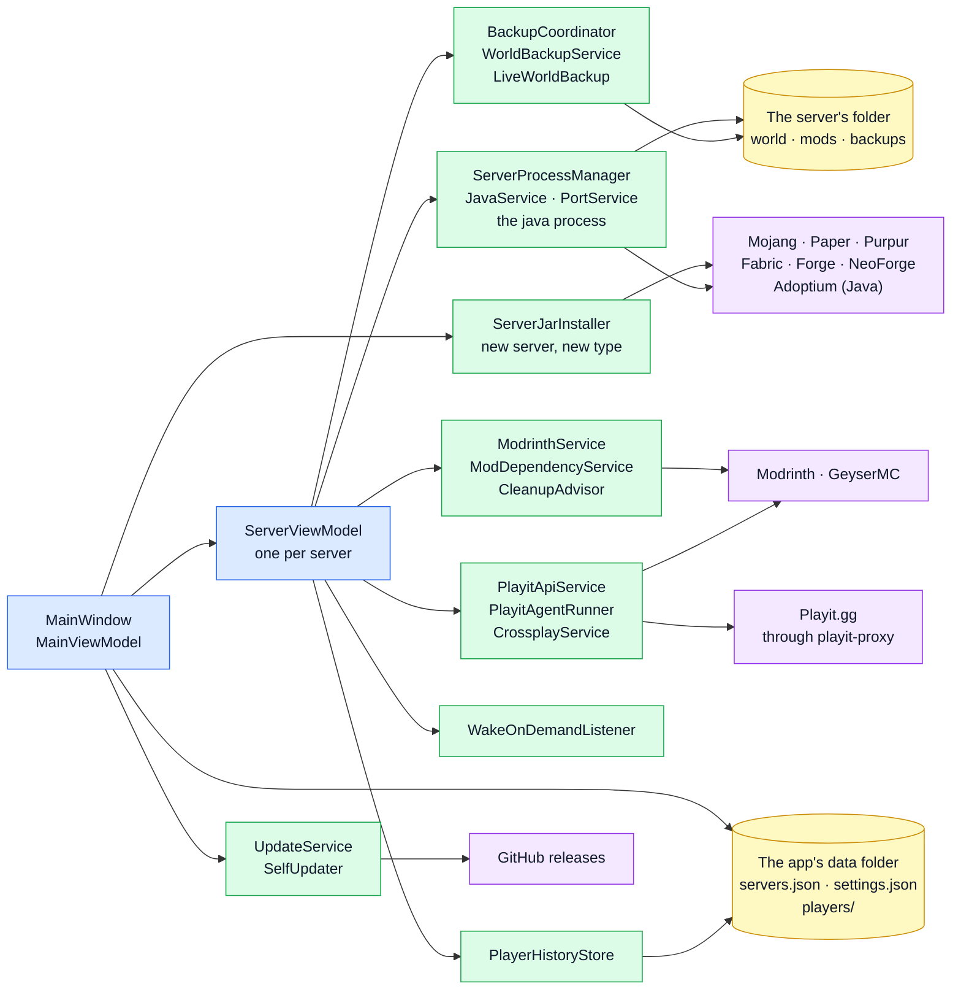
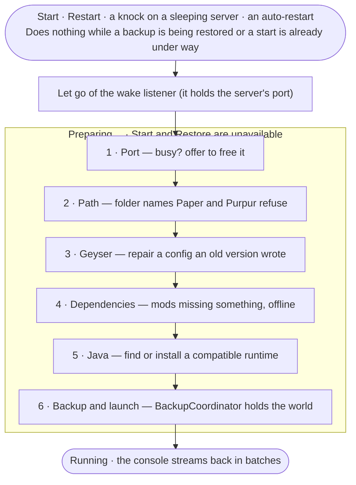

# Architecture

> ¿Prefieres español? Lee la versión en [español](architecture.es.md).

MC Server Launcher is a **Avalonia / .NET 9** desktop app that follows the **MVVM** pattern
(using [CommunityToolkit.Mvvm](https://learn.microsoft.com/dotnet/communitytoolkit/mvvm/)) with the
[Avalonia](https://avaloniaui.net/) Fluent theme (cross-platform). It manages one or more Minecraft servers without
`.bat` files, console windows or editing config files by hand.

## The big picture

How the pieces fit. An arrow reads *uses*, and each box names the real classes that do that job, so
every name is something you can search for. Blue is the window, green the services, yellow what is
kept on disk and purple the internet. The sections below explain the pieces one by one.

The first map started from the one [GitDiagram](https://gitdiagram.com/juanp-g/mc-serverlauncher) generated
by itself; the wiring it left out was filled in and every arrow checked against the code. What happens
when a server is started has its own map under [Starting a server](#starting-a-server).

## Layers

The project (`McServerLauncher/`) is organized by responsibility:

| Folder | Responsibility |
|---|---|
| `Models/` | Plain data: persisted config (`ServerConfig`), settings (`AppSettings`), enums (`ServerState`, `PlayitState`). Two subfolders hold the shapes that come from elsewhere: `Modrinth/` (what the API returns) and `Store/` (what the store shows, independent of where it came from). |
| `Services/` | All the logic with no UI: processes, files, network, Java, Playit, ports, etc. Each service is a small, focused class. |
| `ViewModels/` | The state and commands the UI binds to (`MainViewModel`, `ServerViewModel`, one per panel: `ServerModsViewModel`, `ServerBackupsViewModel`, `ModDetailsViewModel`, and one per section of the window: `TunnelsViewModel`, `SettingsViewModel`). Bindable state and `RelayCommand`s, not Avalonia controls. |
| `Views/` | The `.axaml` windows, dialogs and sections of the main window (Avalonia XAML) and their thin code-behind. |
| `Localization/` | The translation system (`Localizer` + `{loc:Loc}` markup extension). |
| `Behaviors/` | Attached behaviors: `AutoScrollBehavior` (the console follows the tail), `ResetScrollBehavior` (a list goes back to the top when its contents are *replaced*, not appended), MOTD coloring in `MinecraftMotd` and Markdown rendering in `MarkdownBody`. |
| `Controls/` | Custom controls: `Sparkline` for the CPU/RAM mini-charts, `MarqueeText` for names that slide when they do not fit, and the sliding menu marks (`SlidingIndicator`, `TabUnderline`, `SelectionMarker`). |
| `Styles/` | `Shared.axaml`: the styles more than one view needs (`Border.card`, `Border.tile`, the stat text, the secondary buttons…), and `Motion.axaml`: all of the app's motion. Both included from `App.axaml`. |
| `Resources/` | `Strings*.resx` (translations), `app.ico`, and the store's two data files (`store-tags.json`, `store-summaries.json`). |

> **Value converters live in `ViewModels/`** — there is no `Converters/` folder. There are six:
> `BoolOpacityConverter`, `HexBrushConverter` (a hex string from the settings into a brush),
> `ConsoleBrushConverter` and `ConsoleHighlightConverter` (the colour of a console line and the
> marking of what was searched for), `NoticeBrushConverter` (the install banner's background) and
> `WholeNumberConverter` (an `int` setting to a `NumericUpDown`, whose value is a `decimal?` that is
> null while the box is empty).
>
> **The smaller view models** hang off those: `PlayerHistoryViewModel` (records what players do from the
> server's console and shows everyone who has been on it, with each profile; built by `ServerViewModel`
> as `History`), `TunnelRowViewModel` and
> `TunnelSuggestionViewModel` (one line of the Tunnels table and of its "things I can fix" panel),
> `CleanupSuggestionViewModel` (one row of the clean-up panel), `ConnectionStepViewModel` and `ProbeRow`
> (one stretch of the connection test and one row of its technical table), `ConsoleKindFilter` (a
> category of console line as a toggle with a count), `InstalledModFilter` (what the installed list's
> search box matches), `ServerIconImage` (the one place `server-icon.png` is read back as an image),
> `BulkObservableCollection` (the console lists, which raise one `Reset` instead of one event per line),
> `AddressRetry` (how long to wait between the first tunnel-address lookups) and `AppSection`
> (what fills the window next to the rail).
>
> The UI-free half of each colour decision is kept out of `ViewModels/` on purpose, so a setting
> that is serialized to `settings.json` never has to know Avalonia exists: `ConsoleColors` /
> `ConsolePalette`, `NotificationPalette` / `NotificationBrushes` and `ServerTypeCatalog` /
> `ServerTypeBrushes` are three instances of the same split — hex strings in `Services/`, brushes in
> `ViewModels/`.

> **`ServerConfig` announces its own changes, and the view models share the instance.** It and
> `NotificationSettings` are the two `Models/` types that do — both are written while something else
> is on screen showing them: a loader install, the seed read from the console, a server's settings
> being saved. They were plain objects, on the argument that a
> persisted model should not depend on MVVM; that argument does not survive contact with the fact
> that `Models/` and `ViewModels/` are folders in one assembly, so the dependency was already there,
> and what the rule actually bought was a class of bug. Everything derived from the config simply
> never recomputed: converting a server changed the disk and left the app describing what the folder
> used to be until it was restarted.
>
> **This does not change `servers.json`.** Reflection-based System.Text.Json writes public
> properties; the generated ones keep the exact names the auto-properties had; `ObservableObject`
> contributes only events, which are not serialized. The key *order* is not promised, and nothing
> reads the file positionally. `ServerConfigFormatTests` holds every part of that down — the exact
> key set, `Type` still being the integer that is the file format, the two `[JsonIgnore]` computed
> paths staying out, and a file written by an older version still opening.
>
> Never give either class a `Clone` built on `MemberwiseClone`: it copies the `PropertyChanged`
> delegate, so the copy raises changes at the original's subscribers. `NotificationSettings.Clone`
> is field-by-field, and `AppSettings` — which does use `MemberwiseClone`, to save a copy with the
> secrets encrypted — is deliberately left a plain object: nothing binds to it, because
> `SettingsViewModel` wraps the fields it shows and raises their changes itself.

> **One table says what each field of the config feeds.** `ServerConfigEffects` has a row per
> `ServerConfig` property: which `ServerViewModel` and `ServerModsViewModel` properties to announce,
> and what has to be redone that a notification cannot express — re-read the port, rescan the
> content folder, close the store's details page, search again, reopen the wake listener, reload the
> backups. `ServerViewModel` subscribes to `Config.PropertyChanged` once and applies the row, on the
> UI thread (crossplay writes the Bedrock port from a background continuation). A field nothing
> shows gets a row too, carrying the reason.
>
> **`ServerConfigEffectsTests` is what makes this hold.** Every writable property of `ServerConfig`
> must appear exactly once, and every view-model property a row names must still exist. A field
> added without a row fails on the day it is written, and a rename that misses the table fails
> instead of announcing a name nothing listens for. That is the whole point: the bug was never hard,
> it was just quiet.
>
> Persisting is deliberately not one of the effects; saving stays where it is, once, when the
> server's settings are saved.
>
> Those settings are a page in the window (`ServerSettingsView`, its pages under
> `Views/ServerSettings`), not a dialog, so they cannot edit the live config the way the old edit
> dialog did: nothing modal stops the rest of the app from looking at it half edited. The controls
> edit a copy (`ServerSettingsDraft`), and Save copies back only the fields that changed — the live
> config goes on being written meanwhile by a loader install or the seed read from the console, and
> copying the whole copy back would undo that. Leaving the page with something unsaved is refused by
> the save bar itself, not asked about in a window.
>
> What else holds for that page:
>
> - **One row per page.** `ServerSettingsPages` holds each page's icon, texts and the fields and
>   `server.properties` keys it owns; which fields the page can edit at all comes from the rows
>   (`ServerSettingsPagesTests`).
> - **Files first, live config last.** Save writes `server.properties`, the icon and Geyser's
>   config into the folder the draft names, and only then copies the changed fields into the live
>   config. A file that cannot be written leaves the server as it was; each file counts as saved as
>   soon as it is written (`ServerSettingsDraftTests`). What the window does after a save (writing
>   `servers.json`, moving the wake listener to a new port) is awaited, and a failure is said on the
>   page's bar, whose Save tries again.
> - **It follows the live config.** A field something else changes while the page is open (a failed
>   install switching multi-version back off, the Bedrock port crossplay picked) is taken in unless
>   the user edited it there (`ServerSettingsDraft.ChangedOutside`); the page stops listening when it
>   is closed (`Detach`).
> - **Ports and problems.** `PortOwners` says which other server has a Java or a Bedrock port, and
>   each `SettingsProblem` names its field, so the Network page shows it under its own box.
> - **A running server** rewrites `server.properties` from what it loaded whenever its whitelist is
>   switched; `PropertiesSavedWhileRunning` writes what was saved meanwhile back after that command.
> - **Number boxes** take whole numbers only, in any language (`WholeNumberBoxes`): with the default
>   parser, Spanish read `1.5` GB as 15.

> **A constructor assembles; `Activate()` starts.** `ServerViewModel` and `MainViewModel` each split
> in two. The constructor reads — the config, the console palette, the server's own files — and
> leaves nothing running behind it. `Activate()` is everything that reaches outside the object: the
> polling timers, the shared `PlayitManager` / `PlayitAgentRunner` subscriptions, the tunnel
> lookups, the wake-on-demand socket, the update check. `MainWindow` calls
> `MainViewModel.Activate()` from `Loaded`, and that reaches every server; a server registered later
> is activated by `Register` on the spot.
>
> `ShutdownAsync()` is the exact mirror, and both are safe to call twice — `Loaded` fires again
> every time the window comes back from the tray. This is why the two can be built in a test at all:
> before the split, constructing one started three timers, opened a socket and called the network,
> so nothing that touched them could be tested except through its pure pieces.

Data lives **per user** under `%APPDATA%\McServerLauncher\` (`~/.config/McServerLauncher/` on Linux
and macOS):

- `servers.json` — the server list and each server's config.
- `settings.json` — global settings (language, Playit agent secret key, last-seen version…).
  Both JSON files are written **atomically** (`AtomicJsonFile`): the previous version is kept as
  `.bak`, and a corrupt file is quarantined as `.bad` and recovered from the `.bak` when possible
  (the user is warned at startup instead of silently losing the list).
- `java\` — Java runtimes the app installs (Temurin/Adoptium).
- `logs\` — the persistent console log (`launcher-yyyy-MM-dd.log`, pruned after 14 days, at most 50 MB a day), and
  `crash-*.log` from `CrashLog` when an exception escapes every handler (the newest 20 are kept). It is
  hooked to the AppDomain, to unobserved tasks and to the UI dispatcher; on the dispatcher the app
  writes it down and carries on, since closing would leave every server it started running unwatched.
- `cache\images\` and `cache\store\` — the store's disk caches: project icons and gallery
  screenshots (`ImageCache`, pruned after 30 days) and the API responses (`StoreCache`). Both are
  disposable; deleting them costs a few requests and nothing else.
- `content\<serverId>\ledger.json` — what the clean-up panel remembers about each server's mods: when
  each was switched off, who last needed each library, and the "Not now"s (`ContentLedger`).
- `playit-agent\` — Playit's official `playitd` binary, downloaded once and pinned to the version
  the app registers (`PlayitAgentRunner`).
- `instance.lock` — the exclusive file lock that keeps the app to one running copy per user
  (`SingleInstance`).
- `.secret.key` — the AES-GCM key that encrypts secrets on Linux/macOS (Windows uses DPAPI, so no
  key file there).
- *(optional)* `store-tags.json` / `store-summaries.json` — if either exists it replaces the copy
  embedded in the app, so tags and plain-language summaries can be changed without a new build.

Each server's own folder also holds a `backups\` directory with the automatic world backups. There
are no hard-coded machine paths.

## Key services

- **`ServerProcessManager`** — owns the `java` process lifecycle: starts it (no console window),
  redirects stdin/stdout/stderr, re-emits each output line via an event, and stops it cleanly by
  sending `stop` (with a kill fallback). The kill waits `ServerViewModel.StopTimeout` (60 s), one
  value for the Stop button, Restart and closing or updating the app — closing used to allow fifteen
  seconds, less than a large modpack needs to save.
- **`JavaService`** — detects installed Java versions and, if none is compatible, downloads the
  right Temurin (Adoptium) JRE for the architecture. Used both when creating and when starting a
  server. Each server asks its own `JavaService`, so the download of a given Java (by major version)
  goes through one process-wide gate: two servers starting together used to share one archive path and
  one `.partial` folder and delete what the other was writing. It runs `java -version` and `which`
  through `ProcessRunner`, like everything else that runs a short command. `GetRuntime` remembers each
  Java's version, VM and word size against its file, and `AcceptsFlags` whether it takes a set of flags.
- **`MemoryProfile`**, **`JvmArgs`**, **`MemoryBudget`** — the memory a server starts with: the mode in
  effect, the ceiling and the flags for its Java, which extra arguments take the decision away from the
  app, and the ceilings of the servers already running (see *Memory: automatic or manual*).
- **`GcLogging`**, **`GcLogLine`**, **`GcLogTail`**, **`MemorySessionTracker`**, **`MemoryHistoryStore`**,
  **`ProcessMemory`** — what the app measures of a running server (see *Measuring a server's memory*).
- **`PerformanceParsers`**, **`PerformanceProbe`**, **`PerformanceMonitor`**, **`PerformanceAdvice`**,
  **`PerformancePicks`** — how a running server is coping and what to do about it (see *Performance: the
  card, the band and the solutions*).
- **`MinecraftVersionService`** — reads Mojang's version manifest, resolves the `server.jar`
  download URL and the required Java version, and downloads files.
- **`PlayitApiService`** / **`PlayitPartnerService`** / **`PlayitManager`** — talk to Playit.gg.
  `PlayitPartnerService` runs the third-party **setup-code** flow (`create_agent`) to mint a
  **per-user self-managed agent secret key** from a code the user pastes. The partner **Api-Key is
  never in the app** (it's public + open-source): the call goes through a small proxy (a Cloudflare
  Worker, see `playit-proxy/`) that injects the key server-side. The Worker only accepts the
  create-agent POST shape the desktop app sends, rejects browser-origin traffic, and can rate-limit
  per IP. The variant_id/version are public and baked in. `PlayitApiService` then uses the returned
  per-user key (as `agent-key`, set app-wide via `SetAgentKey`) to list/create/delete tunnels —
  falling back to a legacy `playit.toml` secret
  or pasted write key otherwise. `PlayitManager` queries/starts/stops the background Windows/systemd
  service. `PlayitConnection` is the shared connect/disconnect flow used by the tunnel buttons and
  the Tunnels section.
- **`PortService`** — checks which TCP ports are in use, finds a free one, and (via P/Invoke) finds
  the PID listening on a port so a stuck server can be freed.
- **`ServerPropertiesService`**, **`PlayersService`**, **`WhitelistService`** — read/write the
  server's files (`server.properties`, `ops.json`, `banned-players.json`, `whitelist.json`). A new server's
  `server.properties` is written with `white-list=false`: Minecraft 26.3 changed its own default to `true`,
  which locked every new server behind an empty list. The Players tab switches it with `whitelist on/off`
  while running and in the file while stopped, never touching `whitelist.json`, and adding a name turns it on.
  A true/false key is read with `ServerPropertiesService.ParseBool`/`GetBool`, the way the server reads
  it (only `true` is true: `online-mode=yes` is an offline server).
- **`PlayerNames`** — what a Minecraft Java name looks like (`IsValid`, and `Pattern` for picking one out
  of a line). One rule for the five places that used to keep a regex of their own; it is also what stops
  a name from carrying a line break into a console command or becoming part of a path.
- **`ByteSize`** and **`AppWindows`** — one way to write a size on disk (powers of 1024; line speeds stay
  decimal, like the Mb/s beside them) and one place to ask for the main window.
- **`MinecraftIds`** — turns `minecraft:deepslate_diamond_ore` into "Deepslate diamond ore". Deliberately
  not translated: there are well over a thousand blocks, more with every version and every mod, and what is
  translated is the label above the list rather than the game's own vocabulary inside it. A block from a mod
  keeps its namespace, because "Source gem" on its own is a mystery.
- **`PlayerEventParser`**, **`PlayerHistoryStore`**, **`PlayerLogImporter`**, **`PlayerStatsReader`** — the
  player history. One parser turns a log line into something a player did, built from the console's own
  detectors (`NameBefore`, `ChatOf`, `DeathMessageDetector`), and serves both the live console and the
  import, so the two cannot disagree. It never reads the login line, which is the one carrying the IP, so the
  history cannot keep one — `AnIpAddressNeverReachesTheDisk` checks the bytes on disk. The store lives in
  `%APPDATA%\McServerLauncher\players\<serverId>\`, outside the server folder so it neither travels with the
  world nor fills its backups: `index.json` with one summary per player, and `events/<name>.jsonl` appended
  to and compacted in one go when it passes the limit by a quarter. Limits are `PlayerHistorySettings`
  (clamped, since settings.json is editable); old events, long-gone players and the history of removed
  servers are pruned at start-up. The store is opened only when something needs it, never by building a
  view model and not even by asking how much it takes on disk (`SizeOf` reads the folder without opening
  anything), so tests cannot write into the user's app data. **A server's history is cleared from that
  server's own configuration**, not from the app's settings: the history belongs to a server, and "forget
  all of it" from a screen with no server on it was a blunt instrument for what people actually want.
  The importer runs once per server, dates each line from its file (a `.log.gz` by its name, `latest.log`
  from its last write minus the midnights it crosses), skips `latest.log` while the server runs, and only
  closes the sessions its own files left open. Statistics are read from `<world>/stats/` or, from 26.1,
  `<world>/players/stats/`, when a profile opens — off the UI thread, because the reader now walks every
  block a player has ever broken. `minecraft:mined` is exact; `minecraft:used` is the closest thing to
  "blocks placed", since Minecraft counts using an item rather than placing it, and it is shown as it is
  with a line saying so rather than filtered against a hand-kept list of block ids that would go stale
  every release.
- **`ServerCreationService`** — writes the initial files of a new server: `eula.txt` (only once the user has
  ticked *I accept the Minecraft EULA* beside the Create button, which stays shut until then; the app used to
  accept it on their behalf),
  `run.bat`/`user_jvm_args.txt` and a minimal `server.properties` with the chosen port. (The jar
  download is done by `MinecraftVersionService`/`ModLoaderService`/`PaperService` and the port is
  picked by `PortService`, all orchestrated by `NewServerView`.) The seed typed there, if any, is
  written as `level-seed`, escaped as a Java properties value — a backslash doubled, anything outside ASCII
  as `\uXXXX` — and is asked for **only at creation**: converting the type or changing the version keeps
  the world, so there is no seed left to choose.
- **`WorldSeed`**, **`NbtReader`**, **`SeedMapLink`** — the seed shown on the World page of a server's settings.
  `level-seed` is not it: it is read once, at generation, and empty means random. The world keeps the real
  one, and has kept it in three places — `data/minecraft/world_gen_settings.dat` → `data.seed` from 26.1
  (a real 26.2 world had none in `level.dat`), `level.dat` → `Data.WorldGenSettings.seed` from 1.16, and
  `Data.RandomSeed` before. `NbtReader` reads that one long from the gzipped NBT and never throws: a
  damaged or half-written save answers "not found", with lengths and nesting bounded. Because Minecraft
  has moved it once, the server's own answer to `seed` is remembered in `ServerConfig.LastKnownSeed` as a
  fallback. `SeedMapLink` opens Chunkbase on the version that covers the server's, from a table copied
  from the site; a version newer than the table, or a snapshot, gets no `platform` and the site picks its
  newest.
- **`ServerTypeCatalog`** — one row per server type: display name, family (plugins/mods/neither), badge colour and
  its `CrossplayLevel`. The picker, the badges, the mod store, the content folder and the crossplay rules all
  read from it, so adding a type is a row rather than six `switch` statements found by hand.
  The level is three-valued rather than a yes/no, because "Geyser publishes a build" and "your friend on a phone
  can play" are different claims: `Full` for Paper, Purpur and Fabric, `Partial` for NeoForge — it connects and
  authenticates, and then any mod the client is required to have shuts Bedrock out — and `None` for Vanilla and
  Forge. `CrossplayService.CaveatKey` turns the level into the note the new-server panel and the
  Crossplay page of a server's settings show.
- **`ServerJarInstaller`** — the one place that knows how each type is obtained. The new-server panel and the
  Type and version page of a server's settings both call it; the chain used to be written out inline in both, and a type present in one and
  missing from the other silently produced a Vanilla server.
- **`ModLoaderService`** / **`PaperService`** / **`PurpurService`** — install a mod loader (Fabric/Forge/NeoForge) or a
  Paper/Purpur build. Purpur publishes only an MD5 for its builds, not a SHA-256; HTTPS authenticates the source and
  the hash is there to catch a corrupted download, which is documented in the service itself. Also
  installs a loader onto an existing server, keeping the world. Known limitation: Fabric's meta endpoint publishes no
  checksums, so its server jar can't be hash-verified like the other sources (Mojang SHA-1, Paper
  SHA-256…); instead the downloaded jar is structurally validated (its `install.properties` must
  match the requested game/loader versions) and discarded on mismatch. Forge's trust assumption:
  its maven publishes a `.sha1` next to each artifact but **from the same server** (no independent
  signatures exist in the Forge ecosystem), so the mandatory hash check protects against
  corruption, not a compromised server; since the installer is *executed*, it is additionally
  validated structurally (it must carry `install_profile.json` or an installer manifest) before
  `java -jar` ever sees it. NeoForge is the same shape with a better hash: its maven publishes a
  `.sha256` beside each artifact, so that is what is checked. The trust assumption is unchanged —
  same server as the jar — and a missing hash still means no install, because what follows is
  `java -jar`. Which build belongs to which Minecraft version is decided by `NeoForgeVersions`,
  separately from the download: NeoForge has no promotions feed, so the mapping is derived from the
  build number and is unit-tested on its own.
- **`ModrinthService`** — searches Modrinth and downloads mods/plugins (filtered by the server's type
  and version), and drives the "check for mod updates" flow.
- **`ModDependencyService`** — walks a version's *required* dependencies, transitively, and says which are
  missing. Two facts about Modrinth's data shape it: dependencies carry **no version range** (a dependency
  either pins one version id or names a project), which is why "that project is already installed" is a
  complete answer rather than an approximation; and `embedded` means the dependency is already inside the jar,
  so installing it again produces the loader's *duplicate mod* failure. The walk itself (`WalkAsync`) takes its
  lookup as a delegate, so what it decides is tested against a table rather than against Modrinth on the day
  the test runs.
- **`ContentManifest` / `ContentDependencyCheck`** — read what each jar declares about itself (what it provides
  and what it needs) and report what is missing. Three formats: `fabric.mod.json`, Bukkit's `plugin.yml` and
  Forge/NeoForge's `mods.toml`, with no YAML or TOML library — only lists of names are needed, and anything not
  understood counts as "declares nothing". **Jars inside jars count**: both loaders let a mod carry others
  (`META-INF/jars/`, `META-INF/jarjar/`), and `fabric-api` is forty-odd modules shipped that way, so what a
  nested jar provides is added to the outer one — followed a few levels down — while what it requires is not,
  since a gap inside a bundle is the loader's to report. The Mods tab's own dependency reader goes through the
  same code rather than a second copy of it; there used to be two, and only one had learnt this.
  **No network, deliberately**: this is the check that runs when Start
  is pressed, and the Modrinth calls that would answer the same question swallow their errors and return empty,
  so offline they would report nothing missing on the one screen where being wrong stops the server coming up.
  A test forbids those two files from mentioning `HttpClient` or `ModrinthService`.
- **`NotificationCatalog` / `NotificationPalette`** — which level and which icon each kind of notification
  gets, and what the default colours are. The same split as `ServerTypeCatalog` and `ServerTypeBrushes`: the
  UI-free data here, the Avalonia brushes in `NotificationBrushes`. The colours the user can change live in
  `NotificationSettings`, which is serialized to `settings.json`. The defaults were once more saturated;
  `NotificationPalette.ModerniseColours` moves a stored colour that still equals an old default to the new
  one when `settings.json` and `servers.json` are loaded, and leaves any other value alone.
- **`ConsoleLineClassifier` / `ConsoleColors`** — what each console line is about and what colour it is drawn
  in. The source outranks the text: the app's own messages are tagged where they are raised, because their text
  is localized — the `[Launcher]`, `[Error]` and `[Players]` prefixes live *inside* the resx values — so a
  classifier keyed on them would work in Spanish and quietly stop working in German. `stderr` arrives tagged
  from `ServerProcessManager`, which used to merge it with standard output in one handler, and is red except
  for the JVM's own `WARNING:` lines, whose format Java fixes. Only `stdout` is read: vanilla's bracket (level
  in the **second** one, not the first) and Paper's. **A line with no log prefix belongs to the entry above
  it** — Fabric's list of mods, the lines under a multi-line warning, the message of an exception — so it
  takes that entry's level rather than being judged alone; the view model passes the previous stdout line's
  kind in. Stack frames are recognised by their shape (`at x.y(File:1)`, `Caused by:`, `... 12 more`), never
  by indentation: the loader indents its mod list with tabs, and a tab used to paint every mod red.
  **Chat is every shape a message takes** (`ChatOf`), not only `<name>`: `[Not Secure] <name>` (unsigned chat),
  `[Server]`/`[Rcon]`/`[@]` (`say` from the console, RCON or a command block), and a player's `/say` and `/me`
  (`[Alice] …`, `* Alice …`). Those last two count only when that player is connected — the view model hands
  in a copy of who is — because on Paper every plugin logs as `[PluginName] …`, and a plugin name is a valid
  player name.
  **Nothing a player types is taken for an event.** Every detector that reads one — a join or a leave, the
  `Saved the game` a live backup waits for, the answer to `seed`, a player's UUID — matches the *whole*
  message from `MessageBody`, the text after the **first** `]: `, which is where the server's own prefix
  ends; everything after it can be typed. Searching the line for the sentence was not enough: chat such as
  `<Bob> x: Bob left the game` or `<Bob> x]: Saved the game` carries a prefix-shaped piece of its own, and
  was taken off the player list (and the idle timer then stopped a server with people on it) or cut a
  backup short. On top of that, `ServerViewModel` reacts to nothing in a line classified as chat except
  recording it in the history, and only listens for Paper's path refusal before the server is running.
  `ConsoleSpoofingTests` holds each of those lines down.
- **`BlueMapConsent`** and `ServerProcessManager.ImpliedJvmFlags` — the two start-up warnings the app
  answers itself, because they are its to answer. From Java 22 it adds `--enable-native-access=ALL-UNNAMED`
  to the command line it builds: JNA-based mods trigger a warning that says a future Java will *block* the
  call, and an unrecognised option would stop an older JVM from starting, hence the version gate.
  `--sun-misc-unsafe-memory-access` is deliberately not added — its accepted values are changing release by
  release. And when BlueMap prints that its download has not been accepted, the app **asks** — it is consent
  to fetch Mojang's client files — and on a yes flips that one value in `core.conf` and sends
  `bluemap reload`. The other warnings a modded start prints (refmaps, mixins aimed at absent mods, a Windows
  registry value, Distant Horizons recommending ZGC for client FPS) are not the app's to change.
- **`ServerDetectionService`** / **`ExistingServer`** — tell what a folder holds and take it over.
  `Detect(folder)` returns a `ServerDetection` without touching anything: the type, the Minecraft and
  loader versions, what to launch (a jar, or the Forge/NeoForge args file), the port from
  `server.properties`, the memory from `user_jvm_args.txt` or the start scripts (skipping comments —
  Forge's file is mostly an example `-Xmx4G` nobody chose), whether there is a world, and the root
  jars for picking one by hand. The new-server panel's *add one I already have* shows it, locks
  what was found and asks only for the rest; this replaced the separate *Add* button, whose dialog
  asked for a jar name by hand and skipped the tunnel, crossplay and start options. `ExistingServer`
  builds the config from the detection and the form (the detection wins) and never writes to the
  folder, except `server-port` when the user changed it and `eula.txt` when the folder had not accepted
  the EULA and the user ticks the box the panel shows for it. `DetectAndFill` is a thin layer over
  `Detect` that fills in servers saved before the type and version were recorded, at startup; it
  fills nothing in a config that already names its version. Purpur is checked before Paper — it used
  to match nothing, even for servers this app created.
- **`ServerIconService`** — generates a server's `server-icon.png`: takes any user image, crops it to
  a centered square and scales it to 64×64 with SkiaSharp. (`ServerViewModel.LoadIcon` is what reads
  it back for the Minecraft-style view.)
- **`WorldBackupService`** — creates and restores zip backups of a server's world folder
  (`<server>/backups/`) — with the Nether and the End a Bukkit server keeps beside it — pruning old
  ones past the retention.
- **`BackupCoordinator`** — the order in which backups, restores and the JVM starting and stopping
  touch the world; see *World backups* below. Talks to its server through `IBackupHost`, so the
  protocol is tested without Avalonia (`BackupCoordinatorTests`).
- **`LiveWorldBackup`** / **`SaveConfirmation`** / **`BackupSchedule`** — backing up a world the
  server is still playing on: pausing saves, recognising the flush, and deciding when it is due
- **`CrashReportService`** — reads `crash-reports/*.txt` to pull out the `Description:` line and show
  a human-readable reason for a crash. (The unexpected-exit detection is `ServerProcessManager`'s
  `UnexpectedExit` event; the auto-restart logic lives in `ServerViewModel`.)
- **`ConsoleLogService`** — mirrors every console line to `%APPDATA%\McServerLauncher\logs\` so the
  history survives restarts (14-day retention, checked each time the day changes and not only at
  start-up, since the app can live in the tray for weeks; and a 50 MB ceiling per day, past which one
  line says so and nothing more is written until the next — `ConsoleLogLimitsTests`).
- **`ProcessStatsService`** — samples CPU/RAM of the running `java` process for the live stats and the
  `Sparkline` mini-charts.
- **`ToastService`** — shows the app's own pop-up notifications — always-on-top Avalonia windows in
  the bottom-right corner, shown only when the app isn't in focus; they work even without OS notification
  support. A card has an icon in a ring, what happened as a coloured heading, the server's name in small print
  beside the time, and a bar along the bottom that empties as the toast runs out. **`ToastLifetime`** is its
  clock, with no window in it: how long it stays (longer for errors), the pause while the pointer is on the
  card, and the fade at each end. A test checks it without a UI.
- **`NotificationPreferences`** — decides which notifications are shown, combining the global
  settings (master switch + per-kind: join, leave, death/kill, crash, auto-restart-gave-up) with an
  optional per-server override (`ServerConfig.UseCustomNotifications`). Per-server overrides are
  cloned field-by-field from the global defaults so later changes don't share mutable state.
  `DeathMessageDetector` spots death/kill lines in the console for the deaths notification, requiring
  a valid player-name subject followed immediately by a known vanilla death phrase to reduce chat or
  plugin false positives.
- **`SecretProtector`** — encrypts secrets at rest (DPAPI on Windows, AES-GCM + `.secret.key` on
  Linux/macOS), used for the Playit per-user agent secret key (and the legacy write key). If encryption ever fails, the key is **not**
  persisted (plaintext never lands on disk): it keeps working for the session, the failure goes to
  the daily log, and the user is warned once.
- **`DownloadVerifier`** — the shared checksum verifier for downloads (Mojang SHA-1, Adoptium/Paper
  SHA-256, Modrinth SHA-512/SHA-1), deleting the file on mismatch.
- **`Changelog`** — the per-version "what's new" notes shown after an update (see the flow below).
- **`UpdateService`** / **`SelfUpdater`** — `UpdateService` asks GitHub for a newer release and picks
  the asset for *this* platform and architecture (the Windows installer, the Linux AppImage, the
  macOS `.dmg`); `SelfUpdater` is what applies it. It reads the release **list**, not
  `/releases/latest`, because GitHub leaves pre-releases out of the latter and a beta published that
  way would be invisible to the app. Betas are only offered with **Settings → General → Receive beta
  versions** on (`AppSettings.ReceiveBetas`, off by default); with it off, somebody already on a beta
  keeps it until the next stable, which outranks it. Switching it re-checks at once, and a check that
  finds nothing newer takes back an offer already in the banner. Verification against the release's `SHA256SUMS.txt` asset is
  **mandatory**: if the checksum is missing or unreadable, the in-place update is refused and the
  release page opens instead. So is the **signature** (`UpdateSignature`): the checksum comes from
  the same release as the package and only proves the download is whole, while the `<package>.sig2`
  asset is checked against public keys built into the app and made with a private key that does not
  live on GitHub. See [Signed updates](signing.md).
- **`ServerAccessCatalog` / `ServerAccessRules`** — who may do what on a *shared* server, with no network
  and no screen yet (phase 1 of [shared access](shared-access.md)). `ServerGrant` (in `Models/`) is
  what is stored for a person: a role plus the permissions added or removed for them. What they can
  really do is computed by `Effective`, never stored. The catalog is the one table of permissions
  (stable wire ids, a risk level, each role's template) and `Check` answers whether one person may
  change another's access, returning the reason (`GrantDenial`). Mods and free commands are in no
  role but the owner's, because both end in code on the host PC. The cloud will have to reach the same
  answers in its own code, which is why `ServerAccessTests` reads as a specification.

### Supporting services

- **`ConnectionProbe`** — the measurements behind the connection test: a Minecraft status ping, a
  RakNet ping, a TCP round trip, a timed download and upload, and the SRV lookup over DNS over
  HTTPS. See *Connection test* below.
- **`AppSettingsService`** / **`ServerStorageService`** — the two owners of the app's JSON:
  `settings.json` and `servers.json`. Both go through `AtomicJsonFile` and both report what happened
  on load, so a corrupt file is surfaced at startup instead of showing an empty server list. Both
  take an optional data folder, and `MainViewModel` takes one too and hands it to both: without it a
  test that goes near either file reads and rewrites the real one belonging to whoever ran it.
- **`AtomicDownload`** / **`AtomicTextFile`** — the same guarantee for the other two kinds of write.
  A download lands in `<dest>.part` and is verified there, so an interrupted one can never replace a
  working file with half of one; a config file the app owns is written only when it actually changed,
  and never half-written.
- **`ErrorMessages`** / **`UserFacingException`** — what a failure says on screen. A
  `UserFacingException` carries a sentence from the .resx files and is shown as it is; any other
  exception becomes a sentence of the app's own (a file in use, no permission, a full disk, no
  connection, an HTTP code, or "something failed unexpectedly"), and the exception itself goes to the
  day's log. `ErrorMessagesTests` fails if code puts `ex.Message` in front of the user again.
- **`SingleInstance`** — one running copy per user, with a second launch bringing the first one to
  the front. A correctness guard, not a nicety: two copies each start their own server processes and
  wake listeners, and two JVMs on one world folder is how worlds get corrupted. A lock file answers
  "is anyone else running?" (the OS releases it even on a hard kill, unlike a PID file) and a named
  pipe carries the "come to the front" nudge.
- **`ServerNameRule`** / **`BukkitPathRule`** — a server's folder name, checked before it becomes a
  server that will not start: what Windows forbids outright (illegal characters, reserved device
  names, a trailing dot or space) and, separately, the two characters Paper and Purpur refuse to run
  from — including when they are in a folder *above* the server's own, which is not ours to rename.
- **`LoaderPaths`** — where each loader leaves the files that have to be found again (the version
  directory and the args file Forge/NeoForge are launched through). In one place because the
  installer, the launcher and the detector all need it, and a loader missing from one of them
  installs perfectly and then cannot be started.
- **`VerifiedJarDownload`** — announce the size, download atomically, verify, say it is done. Shared
  by Paper and Purpur, which differ only in the hash algorithm they publish.
- **`FileHashCache`** — a file's SHA-1, remembered while the file is unchanged (the key is path +
  size + write time). The Mods tab hashes every jar twice per click otherwise, once for the update
  check and once to see what is already installed.
- **`ContentMigrationService`** — what happens to installed content when a server changes family:
  the old `mods/` or `plugins/` folder is moved aside rather than left to be loaded by something
  that cannot read it.
- **`MultiVersionService`** — ViaVersion *and* ViaBackwards, which are not interchangeable: the first
  admits clients newer than the server, the second older ones, and installing only one looks like the
  feature is broken for half the people who try it. Plugin servers only, and deliberately independent
  of crossplay.
- **`DesktopShortcutService`** — the "Add to desktop" button. Three different things by platform (a
  `.lnk`, a `.desktop` entry that has to be executable and GNOME-trusted, a symlink to the bundle),
  all pointing at whatever this copy is really running from rather than a guessed install path.
- **`WindowBehavior`** — what minimize and close do, as chosen in Settings. App-wide state applied
  without a restart, the same shape as `NotificationPreferences.Global` and `ConsolePreferences`.
- **`BrowserLauncher`** — the one way a link is opened. Only absolute http(s) URLs get through,
  because in the store the URL comes from a mod author rather than from us.
- **`AppLinks`** — the places the app points people at (the repository, the releases, a new issue, the
  licence, the website, the Playit tunnels page, Mojang's EULA), in one list. The repository address
  used to appear only inside request headers and the update check, so the About screen had nowhere to
  take it from.
- **`MarkdownParser`** / **`MarkdownBody`** — a deliberately partial Markdown reader for the long
  descriptions Modrinth returns, and the behavior that turns its blocks into controls.
- **`MinecraftRange`** — whether a Minecraft version satisfies the range a mod declares.

## Important flows

### Starting a server

`ServerViewModel.Start` → `StartInternalAsync`, which refuses while a backup is being restored and
otherwise lets go of the wake-on-demand listener first (it holds the server's port), then:

1. **Port** — refresh port/info; if the port is busy, offer to free it (`PortService` +
   `TryFreePortAsync`). An auto-restart does not ask: it gives up and says so in the console.
2. **Path** — `TryFixRejectedPathAsync`: Paper and Purpur refuse to start from a folder whose path
   has a character they cannot handle (`BukkitPathRule`), and the app offers to rename the folder
   rather than let it fail.
3. **Geyser** — with crossplay on, `CrossplayService.RepairConfig` corrects a Geyser config written by
   an older version of the app.
4. **Dependencies** — `CheckContentDependenciesAsync`: mods or plugins missing something they need are
   reported before the server starts, not as a crash afterwards.
5. **Java** — `EnsureCompatibleJavaAsync` (uses `JavaService` to read the required Java from the jar
   and install it if needed).
6. **Memory, backup and launch** — off the UI thread, `PlanMemory` asks the Java what it is and
   decides the memory flags (see *Memory: automatic or manual* below), then
   `BackupCoordinator.StartAsync` takes the world (waiting for any copy still reading it), makes the
   start backup when backups are on and the world is not the last backup's, reserves the ceiling in
   `MemoryBudget` and calls `ServerProcessManager.Start` **while still holding it**, so no copy slips
   in between. A backup that fails is said in the console and the server starts anyway. The command
   line is the memory flags, the flags the app adds itself (`ImpliedJvmFlags`), the server's
   `ExtraJvmArgs` and the jar (or a modern Forge/NeoForge args file); the extra arguments come after
   the app's, so the user's own values win. A start still getting ready when the app begins closing
   does not launch at all.

All of it can take minutes with a big world to back up, and the state is still Stopped meanwhile, so
`IsPreparing` is on from the first step to the last: the list and the header say *Preparing…* in
amber, Start and Restore are unavailable, and a second
start (another knock while waking on demand, an auto-restart) does nothing (`StartPreparationTests`).
If any step stops the start, the wake-on-demand listener is put back up (`finally`). Console output
streams back through the `OutputReceived` event into `ConsoleLines`, **in batches**: lines from the
process's threads are queued and one dispatcher job takes all that arrived before it ran, appending them
with a single `AddRange` (a loading modpack prints thousands, and one job per line made the window
stutter). The app's own lines are written on the UI thread and appear at once (`ConsoleBatchingTests`).

### Memory: automatic or manual
Each server has a `MemoryMode`. **Automatic** (the default) lets the app size the heap; **Manual** passes
`-Xms{MinRamGb}G -Xmx{MaxRamGb}G` exactly as the app always did. The decision is
`MemoryProfile.Plan`, a pure function, gathered by `ServerViewModel.PlanMemory` before each start.

- **Why.** A fixed `-Xms`/`-Xmx` commits whatever the heap ever reached and keeps it: measured with bots
  on 26.2, an empty server sat on 3.5-4.7 GB. With a small initial heap, G1's periodic collection and low
  free-heap margins, the same servers came back to 0.9-1.1 GB with the same tick time.
- **The flags**, each only from the Java where it is final, because a JVM refuses to start over an
  option it does not know:

  | Java | Automatic adds |
  |---|---|
  | unknown, 8-11, OpenJ9 | `-Xms128M -Xmx{C}M` |
  | 12-24 | + `-XX:G1PeriodicGCInterval=15000 -XX:MinHeapFreeRatio=10 -XX:MaxHeapFreeRatio=30` |
  | 25+ | + `-XX:+UseCompactObjectHeaders` |

  `JavaService.GetRuntime` reads the version, the VM (OpenJ9 gets only the heap size) and whether it is
  32-bit (capped at 1 GB, said in the console). `JavaService.AcceptsFlags` runs `java <flags> -version`
  once per Java and set of flags; if it refuses, compact headers go first, then the G1 options, and the
  console says so.
- **The ceiling** (`C`) is a limit, not a reservation: only what is used is committed. It is generous on
  purpose (at 768 MB the test server ran out of memory, at 1 GB its tick suffered): 4 GB for up to 30 mods
  (Vanilla, Paper and Purpur count as none), 6 GB up to 100, 8 GB beyond. A server moved over by the update
  keeps its old `MaxRamGb` when that is larger.
- **The budget.** `MemoryBudget` holds the ceilings of the servers running now; together they may use half
  the machine (`SystemMemory.TotalMb`), or all but 2 GB with *This PC is only for servers* in Settings
  (`MemoryPreferences.DedicatedMachine`). A server that does not fit gets what is left, never less than a
  floor (1.5 GB, 2.5 GB with mods), and is never refused. Manual servers reserve their `MaxRamGb`.
- **Migration.** `MemoryMode` is nullable: null is a server saved before the choice existed. It runs
  Automatic and shows a one-line band in its header (`ShowMemoryNotice`) with *Got it* and *Back to manual
  (min–max GB)*; Automatic never writes `MinRamGb`/`MaxRamGb`, so the way back is just the mode.
- **The user's arguments outrank the mode.** `JvmArgs.SetsMemory` finds extra arguments that size the heap,
  pick a collector other than G1 or tune how memory is returned (`-Xmx`, `-XX:+UseZGC`, Aikar's
  `-XX:+AlwaysPreTouch`…); such a server runs Manual whatever it says, and the Performance page says why.
  `-XX:+UseG1GC` alone does not count. `run.bat` and `user_jvm_args.txt` keep the Manual numbers for
  launching outside the app.
- **The ceiling learns.** The estimate is only where a server starts. `MemoryLearner` (pure) reads the
  server's last runs from its memory history and works out the next ceiling: a run counts when it lasted 20
  minutes, had a player on and its live heap stayed under 85 % of its ceiling (one that reached 85 % was held
  back by the ceiling, so it shows the ceiling and not the need, and counts as pressure); the next ceiling is
  1.6 × the p95 of the peak live heap of the last ten that count, rounded up to 512 MB and never below the
  floor. It goes **down** only with at least three counting runs and by at most 1 GB per start; it goes
  **up** at once: ×1.5 after running out of memory, 1 GB or ×1.25 (the larger) after any other pressure,
  including the restart after a crash (the next start waits for the history of the run that just ended to be
  written). Only Automatic runs are learned from, and the budget still has the last word. A one-off raise from
  the Performance page goes on top.
- **Pressure.** `MemoryPressure` (pure, with the time given by the caller) says a server is short of memory
  from the GC log, after 3 minutes of grace: over 75 % of the ceiling alive after every collection for 2
  minutes (at least three), the collector pausing the server for over 10 % of the last 2 minutes, a full
  collection nobody asked for (held for 5 minutes), or running out of memory. A forced `System.gc()` counts
  for nothing. It feeds the Performance card and the band, which says how much memory the server will have
  after a restart (the same plan the start will use), and the run is saved as `Pressured`, which the learner
  reads.
- **The memory agent.** Under 15 % of the PC's memory free, an Automatic server can be asked to give memory
  back sooner. `agent/` holds a dependency-free Java 8 agent (one class, about 10 KB) that the app embeds as
  `Resources/agent/mcsl-agent.jar` and copies into the server's hidden memory folder
  (`MemoryAgent.Install`, which checks its SHA-256) and loads with the relative flag
  `-javaagent:.mcserverlauncher-memory/mcsl-agent.jar=.mcserverlauncher-memory`. **The app decides, the agent
  only carries out:** every 10 s `MemoryAgentPolicy` (pure) compares the machine's free memory with 15 % and
  25 % and writes `control` (at most 1 KB of `key=value`; only `MinHeapFreeRatio`, `MaxHeapFreeRatio` and
  `G1PeriodicGCInterval`, each validated, and a maximum below the minimum drops both). A server with nobody on
  tightens under 15 % free (5/15 % margins, a periodic collection every 5 s); one with players waits until
  10 %; everything goes back to 10/30 % and 15 s above 25 %. The agent reads `control` every 5 s, applies it
  with `HotSpotDiagnosticMXBean.setVMOption` (by reflection, through the exported interface, so it also loads
  where that module is missing) and writes `status.json` (heap held and in use, what was alive after the last
  collections, the options in effect, the last error) by writing a temporary file and renaming it; the RAM
  card prefers that report to the GC log when it is recent. It opens no socket, never calls `System.gc()`,
  and `premain` catches every `Throwable`, because one escaping would stop the server from starting.
  **It can be turned off three ways:** a Manual server (or one whose own arguments size the memory) never
  gets it, nor does a Java that is not HotSpot or is older than 12; the setting *Adjust memory live* in
  Settings; and `MCSL_NO_AGENT=1` in the environment. If the JVM cannot load it (the three messages it prints
  are matched at the start of the line, which a player's chat never is) and the server dies within a minute,
  the pair of that Java and this agent is written to `%APPDATA%\McServerLauncher\memory-agent-failures.json`,
  the console says so, and the server starts again without it, now and at every later start.
- **Building the agent.** `python agent/build.py` (or `agent/build.ps1`, `agent/build.sh`) compiles with
  `--release 8` and writes the jar with a small deterministic zip (stored, fixed dates and permissions,
  entries in a fixed order): the JDK's own `jar` writes a `Created-By` line with its version, so two JDKs gave
  two jars. The class file itself is byte-identical on JDK 21 and 25. The jar and its SHA-256 are committed,
  `.github/workflows/agent.yml` rebuilds it and fails if the bytes differ, and a test compares the copy
  embedded in the app with `agent/mcsl-agent.jar.sha256`; so neither `publish.ps1` nor the release workflows
  need a JDK.

### Measuring a server's memory
A process seen from outside says how much memory it holds, not how much it needs: between collections the
heap is full of garbage. Only the collector knows what survived, so the app asks the JVM for a GC log and
reads it as the run goes. Nothing here changes how a server starts; it is the evidence the later phases
size the ceiling with.

- **The log.** `GcLogging.FlagsFor` adds `-Xlog:gc:file=.mcserverlauncher-memory/gc.log:uptime,level,tags:
  filecount=2,filesize=8M` for a HotSpot from Java 11, in Automatic and Manual alike, unless the extra
  arguments already configure `-Xlog`. The path is relative to the server's folder (`-Xlog` splits its parts
  on colons, so a drive letter would break it), the folder is made first and the last run's files cleared,
  and if it cannot be made the flag is simply not given: a log that cannot be opened stops the JVM from
  starting. The hidden folder is outside the world, so backups never read it.
- **Reading it.** `GcLogLine` is a pure parser for the pauses of G1, Serial and Parallel and ZGC's major
  collections. Only young, mixed, full and major collections say what is alive; Remark and Cleanup only cost
  time, and a `System.gc()` is recorded but never counted as need. `GcLogTail` follows the file as the JVM
  writes it: a line half written waits, a rotation or a shorter file starts again at the top, and one call
  reads 256 KB at most, off the UI thread.
- **The figure.** The RAM card shows the process's private memory (`ProcessMemory`: private bytes on
  Windows, the private pages of `smaps_rollup` on Linux, the working set elsewhere and for ZGC, whose heap
  private bytes do not count), not Task Manager's working set. Under it, *Java: X of Y* is what is in use
  after the latest collection and what Java holds from the system.
- **The history.** `MemorySessionTracker` is pure and takes its times as arguments. It starts when the
  process does, so start-up peaks count, and keeps the peak and the p95 of what stayed alive (a histogram in
  1 MB steps, not a list), the most committed and the most private memory, time in collection, full and
  forced collections, evacuation failures, players, distances, mods, the ceiling and how the run ended. When
  the server stops, `MemoryHistoryStore` keeps the latest 30 runs of each server in
  `%APPDATA%\McServerLauncher\memory\<id>\history.json`, pruned with the servers like the content
  ledger. A run with no collections and no out-of-memory is not kept.

### Performance: the card, the band and the solutions
The fifth status card says how the server is coping; a one-line band appears under the header only while
something is wrong for a while; *See solutions* in the band opens a page that replaces the tabs.

- **Reading the console.** `PerformanceParsers` reads the server's own `Can't keep up!` warning and the
  answers of `spark tps`, vanilla's `tick query` and Paper's `tps`. Everything is anchored on the start of
  the message (`ConsoleLineClassifier.MessageBody`), so a player typing the same words in chat counts for
  nothing. The formats were fixed from real output (Fabric with spark 1.10, Paper 26.2) and three things in
  it are traps: spark's `[⚡]` tag arrives as `?` or as scrambled bytes on Windows, Paper colours its console
  with ANSI escapes inside the line, and decimals follow the machine's locale (`20,0`). Vanilla prints the
  later lines of `tick query` with no log prefix at all, and spark prints TPS with one *or* two decimals.
- **Asking.** `PerformanceProbe.Candidates` picks the commands that can work for the server, best first:
  spark (installed, or bundled in Paper and Purpur from 1.21), `tick query` (1.20.3 and later), Paper's
  `tps`. Every 30 s (one tick in 15 of the 2 s stats timer, counted before the tray throttle) the view model
  types the command, and for five seconds `OnServerLine` offers every line to the probe *first*: the lines
  that are the answer are swallowed, so they reach neither the console, nor the log on disk, nor the player
  history. An unknown command, or three asks with no answer, moves on to the next; something the owner types
  disarms the probe so they see what they asked for. The answers go to the console sender, so operators in
  the game do not see them (checked with an operator connected to Paper).
- **Judging.** `PerformanceMonitor` is pure and takes the time as an argument. It only reports problems that
  last: nothing in the 3 minutes after `Done`, nor while a backup runs (`BackupCoordinator.CopyingChanged`)
  and 30 s after. TPS under 18 or MSPT over 50 is Saturated, under 19.5 or over 40 Tight, after two bad
  readings from spark and three from the others; three `Can't keep up!` in 5 minutes is Saturated, one or two
  Tight, and a delay over a minute is a clock jump (the PC waking up) and is ignored; CPU at 90 % for 2
  minutes is Saturated and 75 % for 3 Tight; running out of memory is Saturated at once. Memory is judged
  from the GC log by `MemoryPressure` (see *Memory: automatic or manual*), never from the working set, and
  alone is only Tight.
- **The card and the band.** `ServerViewModel.Performance.cs` feeds the monitor with the same sample that
  feeds the CPU and RAM cards (sampling twice would break the CPU figure). The card shows TPS when they can
  be measured and a word (Good, Tight, Overloaded) otherwise; the band is one 26 px line with an ellipsis, in
  amber or red, closable until the next start.
- **The solutions page.** `PerformanceSolutionsViewModel` replaces the server's tabs (so it also works on
  Vanilla, which has no Mods tab) and offers, each with one button and a note that it applies on restart:
  `PerformanceAdvice` (a pure function) lowers the simulation distance to 6 (4 when saturated) and the view
  distance to 10 (8), never below the simulation distance; more memory only when memory is the cause and the
  machine can spare it (2 GB more, 2 GB of free memory left, at most three quarters of the machine and 32 GB;
  `SystemMemory.AvailableMb` reads `GlobalMemoryStatusEx` or `/proc/meminfo`). On a Manual server the raise
  becomes its maximum; on an Automatic one it is a one-off for the next start, kept in the memory history
  (`NextStartBoostMb`) and never in the server's settings. If `spigot.yml` fixes a distance on Paper,
  `PaperDistanceOverride` says so instead of offering a change that would do nothing. The mods come from
  `Resources/performance-picks.json` (lithium, ferrite-core, modernfix, krypton, scalablelux, canary, chunky
  and spark; nothing that changes how the game plays, and no C2ME), filtered by loader, by what is installed
  and by conflicts, and kept only if Modrinth has a build for the server's loader and version. Installing goes
  through `ServerModsViewModel.InstallModAsync`, like every other install.

### The window: sections, the new-server panel and motion
The main window is a **rail** of four sections — Servers, Tunnels, Settings, About — sharing one cell
of `MainWindow` and switched by `IsVisible` (`MainViewModel.Section`), so a section keeps its state
(the console its scroll, a half-typed form its text) while another is on screen.

- **Servers** is the list and the selected server's detail. **"+ New"** opens `NewServerView` in the
  detail area instead of a dialog: one click on a card picks where the server comes from (made here, or
  a folder that already holds one) and goes on to a single form in two columns. It raises
  `Completed(NewServerResult)` or `Cancelled`, and `MainViewModel.FinishNewServerAsync` runs the same
  steps after either origin. Picking a server while the panel is open shows that server and keeps the
  panel as a draft (`HasNewServerDraft`); a download already started goes on and the server joins the
  list when it ends. The card at the top of a server (`ServerCardView`) is also the preview on
  the **Appearance** page of its settings (`AppearanceSection`), which edits the image, the name and
  the MOTD as two lines styled character by character (`MotdDocument`); `WakeSign` writes the "join
  to start it" line that both the sleeping listener and that preview show. The card's pencil opens
  that page and the detail's **Configure** opens the settings where they were last left: one page
  for what used to be three dialogs.
  - **The MOTD's colours** (`AppearanceSection.Colors.cs`). The format bar reads back what the text
    at the caret has — its colour by name, its formats pressed — and opens, inside the card, the 16
    codes, the recent ones, a two-colour ramp spread letter by letter (`MotdDocument.SetGradient`)
    and, where `MotdDocument.HexWorksOn` says the server shows it (Paper and Purpur from 1.16), a free
    RGB colour written in the long `§x§R§R§G§G§B§B` form; elsewhere the ramp falls back to the
    nearest of the 16. The bar is updated with `Dispatcher.UIThread.Post`, never from inside the text
    box's own events: while a key is handled the box moves its caret before it reports the new text,
    and reading the document then — caret past its end — threw from inside the keystroke and left
    letters lost or doubled.
- **Tunnels** (`TunnelsViewModel`/`TunnelsView`) reads every Playit key the app can find at once —
  the app's agent, an installed agent's `playit.toml`, a saved key — merges what each sees
  (`TunnelInventory`) and offers the fixes it can make. The account is read once shortly after start
  (`PrefetchAsync`) so the screen is filled the first time it opens, and again each time it is opened.
- **Settings** (`SettingsViewModel`/`SettingsView`) saves as it changes; there is no dialog. Its pages
  are General, Notifications, Colours and Players (the player history). A colour is edited with
  `Views/ColorChooser`: a palette picked to read well on the dark surfaces (`Services/ColorPalette`),
  the spectrum and hue bar of `Avalonia.Controls.ColorPicker` on request, and a line saying whether
  the colour will be readable — WCAG contrast against the console's background, 4.5 for console text
  and 3 for the notification colours. The `#RRGGBB` box stays, and a half-typed code never reaches
  the setting.
- **About** (`AboutView`) shows the version, the update check and the links. `UpdateCheck` keeps
  apart the answers a press of *Check for updates* can get — up to date, a newer version, could not
  ask — which used to read the same.

**Motion** lives in one file, `Styles/Motion.axaml`, and a test keeps views from declaring any of
their own. Menus have a single mark that slides to what was picked instead of one per item:
`Controls/SlidingIndicator` places a `Border` and lets a transition move it, and its two subclasses
say where — `TabUnderline` under the picked tab's title, `SelectionMarker` beside or behind the child
of a panel carrying the class `on` (the rail, the Settings pages). `Behaviors/BeaconBehavior` gives
"+ New" its periodic reminder by toggling two classes that start a short style animation.

> **Keyframes must not depend on the culture.** Avalonia parses `Cue` and `KeySpline` with the system's
> culture: on a Spanish system `Cue="96.4%"` and `KeySpline="0.45,0,0.25,1"` do not parse and the
> animation silently stays on its first frame. Whole-number cues only, no `KeySpline` (draw the curve
> with more keyframes); `MotionTests` checks it.

### Java auto-install
At **create** time, `NewServerView` asks `MinecraftVersionService` for the required Java major
and calls `JavaService.EnsureJavaAsync`. At **start** time, `ServerViewModel` reads the Java version
embedded in `server.jar` (`version.json`) and installs/uses a compatible runtime, saving the path in
`ServerConfig.JavaPath`.

Two gaps in what Adoptium publishes shape the rules (`JavaCompatibilityTests`, `ArmPlatformTests`).
There is **no Java 16**, which is what Minecraft 1.17 and 1.17.1 declare, so 17 counts as compatible
with 16 and is what gets downloaded. And there is **no ARM JRE** for Java 8, 16 or 17 on Windows, nor
for 8 on macOS: on those two systems an ARM machine asks for `aarch64` first and falls back to `x64`,
which Windows 11 emulates and macOS runs through Rosetta; Linux has no such fallback. The Playit
agent follows the same reasoning on Windows ARM and uses the x64 build.

### Playit tunnel
First time the user connects Playit, `MainViewModel.EnsurePlayitAgentAsync` shows the setup-code
dialog (opens `playit.gg/l/setup-third-party` only on a click), exchanges the pasted code via
`PlayitPartnerService.CreateAgentAsync` for a per-user agent secret key, and stores it encrypted.
When creating a server (or via the "Create tunnel" button), `MainViewModel` calls
`PlayitApiService.EnsureMinecraftTunnelAsync` with that key. The public address is detected
periodically by `ServerViewModel` via `GetTunnelAsync`, matching by local port **and
protocol**: a crossplay server has two tunnels, so every lookup goes through
`PlayitApiService.Match`, the one definition of "the same tunnel". The tunnel list is shared between
servers behind a 25-second cache so that N servers polling do not make N calls; the short burst of
lookups that follows creating a tunnel passes `fresh: true` to skip it, because playit takes a few
seconds to publish an address and otherwise the empty first answer would be served back to the
retries; creating a tunnel starts the same burst on the Java side, which used to wait for the
30-second timer. The address box is read-only — it shows what playit assigned, not a preference —
and the line under it is `TunnelAddressState` (`Waiting` / `NoTunnel` / `Ready` / `Failed`), the
sibling of `BedrockAddressState`: three different situations used to render as one empty box.
When the account answers and the tunnel is not in it, the address is cleared rather than kept
(`TunnelAddressSync`): a crossplay server whose Bedrock port had moved went on showing the address
of the tunnel it had left, which by then led to another server. Only a request that failed keeps the
last address. A key read from an installed agent's `playit.toml` can read the account but not change
it — rename and delete answer `NotAllowedWithReadOnly` whatever the authentication scheme — so
`PlayitApiService.CanManageTunnelsAsync` finds out without changing anything (it renames an id that
does not exist), and Tunnels sends those changes to playit.gg instead of failing at them.
Compliance
with Playit's third-party rules: the browser only opens on an explicit click, a disclaimer states
the app is not affiliated with Playit, and the user can always reach their Playit account directly.
A self-managed agent forwards traffic only while the agent process runs, so `PlayitAgentRunner`
downloads Playit's official `playitd` binary (once, pinned to the registered version) and runs it as
a hidden child process while the app is open and connected — the user installs nothing. The key goes
in a file passed as `--secret-path`, never on the command line (where other processes and logging tools
can read it); the file is created readable by its owner only (0600 on Unix, from birth rather than
narrowed afterwards) and deleted as soon as the agent stops, whether it was stopped or died on its own. Since that native binary is the highest-privilege code the app fetches, it is
**verified against a hard-coded SHA-256** (of the exact pinned version) before it ever runs — on
download and when reusing a cached copy — and deleted/failed on mismatch, just like every other
download (`DownloadVerifier`). One agent serves all the user's tunnels. Not available on macOS
(Playit ships no macOS binary); there the user runs Playit themselves.

### Connection test
The network page of a server's settings (and **Test connection** on the detail's Playit card, which
opens it and runs it) measures each stretch a player's packets cross on its own, through
`ConnectionProbe`, and `ConnectionTestViewModel` turns the numbers into a sentence per step and a
verdict:

- **the server alone** — a server-list ping (SLP) to `127.0.0.1`;
- **this machine's internet** — a bare TCP round trip to Cloudflare, then a download and an upload
  timed against `speed.cloudflare.com` (no account, random bytes up);
- **the Java tunnel** — SLP to the public address, its port taken from the `_minecraft._tcp` SRV
  record asked of Cloudflare's DNS over HTTPS, since .NET has no SRV lookup;
- **the Bedrock tunnel** — a RakNet unconnected ping, with crossplay on. The name is resolved once,
  asynchronously (`ConnectionProbe.ResolveAsync`): `UdpClient.Connect` with a name looks it up
  synchronously on the UI thread, once per ping.

Only the ping's echo is timed, as the game does: the status JSON carries the favicon and through a
tunnel it measures transfer, not latency. **Every handshake carries a real protocol number, never
the `-1` status tools send**: measured against a live tunnel, Playit's Minecraft edge reads the
handshake and resets the connection within milliseconds when the protocol is `-1` or the host is an
IP. A server asked with protocol N may report N back as its own, so the report does not show it.
With the server off only the internet is measured; the test says so and offers to start the server
and run again, and never starts it by itself. That offer waits while the server is getting ready
(`IsPreparing`, when its state still reads Stopped), and a start already under way is waited for, not
repeated. A speed test that measured nothing says so rather than blaming lag. The test stops when the
network page goes away and when the server is shut down, and each step goes back to its own name. The
report it copies is in the app's language.

### In-app update + what's-new
On startup `MainViewModel.CheckForUpdatesAsync` asks `UpdateService` for the newest release and the
asset for this platform. The **Update** button (`UpdateNowCommand`) downloads it, verifies it against
the release's `SHA256SUMS.txt` **and** the publisher's signature (`UpdateSignature`, see
[Signed updates](signing.md)), stops the servers and hands it to `SelfUpdater`.

**Every platform updates itself; only the mechanism differs.** Windows runs the silent installer,
Linux swaps the AppImage file the app is running from, and macOS mounts the `.dmg` and replaces the
`.app` bundle. What they share is the shape: nothing is touched until a complete, checksum- and
signature-verified package is on disk, and any failure leaves the current install working. Some installs cannot replace
themselves at all — an AppImage moved into `/opt` by root, a bundle in a read-only location, the app
started from `dotnet run` — and `SelfUpdater.Blocker` says so; those, and a release that ships nothing
for this platform, fall back to opening the release page.

After an update, `MainWindow.Loaded` calls `ShowWhatsNewIfUpdated`, which compares the running version
with `AppSettings.LastVersionSeen` and shows `WhatsNewDialog` (localized) with the notes from
`Changelog` for every version the user hadn't seen yet.

### World backups
`WorldBackupService` zips a server's world into `<server>/backups/` on demand and automatically:
before every start (the main safety net — it also covers Restart and auto-restart after a crash),
after a manual clean stop, before a restore, and at intervals while the server is running.
`ServerBackupsView` lists them and can restore any backup (taking a safety backup first); restoring
still requires the server to be stopped, because it deletes the world folder and unpacks another one
in its place.

Vanilla and the modded loaders keep every dimension inside the world folder. **Paper and Purpur**, like
every Bukkit server, keep the Nether and the End beside it, in `<world>_nether` and `<world>_the_end`,
and those used to be left out of every backup. `WorldBackupService.DimensionsBeside` finds them on disk
(not by server type: a server converted away from Paper still has them), and they go into the zip
under a reserved folder, `.mcserverlauncher-dimensions/_nether|_the_end/`, with the world itself
still at the root — so every older zip restores exactly as before, and leaves the dimensions on disk
alone (`BukkitDimensionBackupTests`).

A zip is written as `<name>.zip.tmp` and only renamed to `.zip` once complete: a copy cut short (the
app closing, a failure the retry does not cover) used to stay in the list as a backup. Any failure
deletes the temporary file, and leftovers of a crashed run are swept by the next copy. File dates
outside what the zip format holds (1980–2107) are clamped, as `ZipFile.CreateFromDirectory` did: one
file dated 1970 used to fail every backup, and with it every start.

Which folder that is comes from `level-name`, a value in a file the app did not write, so
`WorldBackupService.WorldFolderFor` only accepts one that resolves **strictly inside the server's
folder and outside `backups/`** (`worlds/survival` is fine). With `level-name=.` a restore used to
delete the whole server, the zip it was about to read included; `..` or an absolute path reached
outside it. A restore with such a value refuses before touching anything, and a backup says why in
the console and is skipped rather than keeping the server from starting (`BackupLevelNameTests`).

The swap itself is all or nothing (`WorldBackupService.ReplaceWorld`): the zip is unpacked beside the
world as `<world>.restoring`, and only a complete copy takes its place, by renaming. It used to delete
the world first and unpack into the empty folder, so a damaged zip or a full disk left half a world.
The world and its sibling dimensions are swapped as one unit: if one cannot be put in place, every one
already swapped goes back. Whatever happens, no `.restoring` folder is left behind.

**Who touches the world, and when** is `BackupCoordinator`'s job, with one rule: whatever reads or
replaces the world, or makes the JVM start or stop writing to it, holds the same gate from beginning to
end. Each command used to take the gate only for "the backup" part, and that left holes:

- **Stop, Restart, the idle stop and closing the app** sent `stop` while a backup by the clock was
  still zipping. The server wrote the world on its way down into a copy being read, the stop's own
  backup was refused as "already running", and the torn zip was recorded as matching the world. Now a
  stop takes the gate first (a copy by the clock is cut short, since the stop's own replaces it; one
  made by hand is waited for, with a line in the console), sends `stop`, notes the world and makes its
  backup inside the same hold. A crash while it waits is not restarted.
- **A start** holds it from its backup until the JVM is launched (see *Starting a server*).
- **A restore** asks again, inside the gate, whether the server is still stopped and not getting
  ready: the confirmation can stay open while a knock on a sleeping server, or a restart after a
  crash, starts it. Then it sets `IsRestoring`, which closes the wake listener and keeps every start
  out — the button, a wake, an auto-restart (`RestoreSafetyTests`).
- **Closing the app** cuts only the copy in progress short. A failed update brings the app back with
  the same servers, which must still back up.
- **A stop nobody asked for** (a crash, `stop` typed) notes the world once nothing else is reading it.

Backing up a **running** server goes through `LiveWorldBackup`, because zipping a world the JVM is
writing to gives a torn copy. It asks Minecraft to let go of it first — `save-off`, `save-all flush`,
wait for the server to say `Saved the game` (recognised by `SaveConfirmation`, anchored after the log
prefix so a player cannot fake it in chat), zip, `save-on`. The last step is in a `finally`: a failed
backup is an annoyance, but a server left with saving switched off loses everything played until
somebody restarts it.

`BackupSchedule` decides when the next automatic one is due, and answers `Skip` when the interval has
run out but nobody has played since the last one — a server left running overnight barely changes, so
copying it every hour would only fill the disk. A backup asked for while another holds the world is
refused, not queued, and the tab says the world is busy (it used to say there was no world yet).

The start's and the stop's backups are skipped too when **nobody has touched the world since the last
one**. A server that sleeps when empty is woken by anybody pressing Join, and each sleep and wake used
to leave a `--stop` and a `--start` copy of the same world even when nobody came back in — a few of
those and the retention had deleted every copy anybody had played in. Comparing files alone cannot
tell: a running server writes its world with nobody on it (`level.dat` keeps `LastPlayed`, spawn
chunks tick), so after any session the files differ. Two signals are used instead:

- **While it runs**, `BackupCoordinator.PlayedSinceBackup` says whether the world may have changed:
  somebody joined, or a command typed into the console that `WorldCommand.Touches` does not know to
  be harmless (`list`, `say`, bans, ops and the whitelist are; anything else, a plugin's included, is
  not). It starts true and goes back to true after every stop; only a start whose backup was made or
  found up to date clears it, and a live backup clears it for everyone not still on.
- **On disk**, every backup writes `backups/last-backup.json`: the zip's name and a fingerprint of the
  world (path, size and write time of every file but `session.lock`, the Bukkit dimensions included,
  plus the folders' own paths), taken **before** the zip, so it describes what the zip holds and not a
  world the running server wrote again meanwhile. `WorldBackupService.IsUpToDate` is true only if
  that zip still exists and the world still matches, so editing the world by hand while it is
  stopped, or pointing `level-name` elsewhere, still gets a copy. After a stop with nobody playing,
  `MarkUnchanged` re-fingerprints the world against the same zip — what the server wrote on its way
  down does not count. It never stands in for a backup that does not exist, and never runs for a
  server with RCON on (`enable-rcon=true`), where a `/fill` can arrive with nobody joining.

What this cannot see: a farm in the spawn chunks, which tick with nobody near, or a plugin on a
timer. Those changes wait for the next time somebody plays. The check and the copy happen inside the
same hold, and the console says *Backup skipped* when it skips (`UnchangedWorldBackupTests`,
`SkipUnchangedBackupTests`, `WorldCommandTests`).

Retention counts the automatic backups (`start`, `stop`, `auto`) and the user's own (`manual`,
`before-restore`) **separately**. One shared count stopped working the day backups started happening
by the clock: overnight the hourly copies would fill the whole allowance, and the backup somebody
took by hand before trying something would be the first to go. Zips the app did not write are never
deleted at all.

The backups tab says so, because a flat list did not: it read as "five of each kind" half missing
when it was the automatic pile, full. `ServerBackupsViewModel` shows each pile against its limit, the
space they take and when the next one is due (`ServerViewModel.NextAutoBackupUtc`, only once the
server is up: the clock starts then), lists them by day in the app's language
under a filter, and marks the oldest of a full pile as the one its next backup will delete. The
retention and timer fields feed it through `ConfigEffect.ReloadBackups`.

### Auto-restart after a crash
When a server exits unexpectedly, `ServerProcessManager` raises its `UnexpectedExit` event and
`ServerViewModel` restarts it within a budget (a few attempts inside a stability window) to avoid
crash loops. `CrashReportService` reads the server's crash report for a human-readable reason, which
goes to the **console** with the exit code; the notifications (`ToastService`, one for the crash and one
if the budget is exhausted) are generic and only show when the window is not in front.

### System tray
`App` installs a `TrayIcon`. Two settings (Settings → General) decide what the window does, both read
through `WindowBehavior`:

- **Minimize to tray** (`MinimizeToTray`, **on** by default): minimizing hides the window to the tray
  instead of leaving it on the taskbar.
- **Close to tray** (`CloseToTray`, **off** by default): the **X** hides the window instead of
  quitting. Off, the X quits after stopping the servers cleanly.

Next to them, **This PC is only for servers** (`DedicatedServerMachine`, **off** by default) lets the
servers in Automatic memory share all the machine's memory but 2 GB instead of half.

Either way the servers keep running while the window is hidden. Where there is no tray to come back
from (`App.TrayAvailable` is false), both are ignored. The tray menu restores the window (**Show**) or
really quits (**Exit** → `MainWindow.RequestExit`, which runs the clean shutdown).

### Playing from Bedrock (crossplay)
One checkbox, three things that have to line up — which is why doing it by hand goes wrong.
`CrossplayService.InstallAsync` puts **Geyser** on the server (from Modrinth, through the same
verified install path as any other mod or plugin) so it understands Bedrock clients at all, and
**Floodgate** so those players don't each have to own Minecraft: Java. Floodgate is split by source:
Modrinth carries the Fabric and NeoForge builds, and only GeyserMC's own downloads site
(`GeyserDownloadsApi`) carries the Spigot one Paper and Purpur need.

Then the **second tunnel**: Java is TCP and Bedrock is UDP, and one cannot carry the other, so
`MainViewModel` creates a UDP tunnel alongside the Java one. `CrossplayService.PickBedrockPort`
chooses the local port (19132 is only a starting point — it is taken as soon as there are two
servers), avoiding both the ports other registered servers hold and the ones the user's Playit
account already has. A crossplay server left on port 0 really uses 19132, and
`CrossplayService.EffectiveBedrockPort` counts it that way: counting it as free is how two servers
ended up behind one Bedrock tunnel. The port can be changed in *Configure*, which refuses one another
server holds and rewrites `servers.json` and Geyser's config together, and Tunnels offers to move a
server off a Bedrock tunnel it shares.

Finally `GeyserConfigService` writes what Geyser cannot work out for itself: `auth-type` (a server
with Floodgate left on `online` turns every Bedrock player away), the local UDP port, and
**`broadcast-port`** — behind a tunnel the port players connect to is the tunnel's public one, and
the launcher is the only component that knows both numbers because it created the tunnel.
`RepairConfig` re-applies this when a reinstall resets the file.

How well any of it works is a property of the server type, not a promise: `ServerTypeCatalog` carries
a three-valued `CrossplayLevel` and the new-server panel and the Crossplay settings page show the caveat before the
checkbox is ticked. On
Fabric, a further checkbox installs **Hydraulic** (`HydraulicService`) so the blocks and items mods
add are converted for Bedrock clients; it is Fabric-only because Hydraulic stopped publishing
NeoForge builds in February 2026. The one failure that cannot be prevented — a NeoForge server
rejecting Geyser's mod-less connection — is at least recognised in the console and explained in the
user's language by `CrossplayDiagnostics`.

### Sleeping when empty, waking when someone joins
Two halves, both per server and both off by default.

**Sleeping** is `ServerViewModel.CheckIdleShutdown`, run off the same tick that refreshes the player
list: once a running server has had nobody on it for `ServerConfig.IdleShutdownMinutes` it stops
itself, announcing it in the console and as a notification. The window shows a live countdown
(`IdleCountdownText`), and a server that has just been woken gets a grace period so it can never be
stopped before anyone has had time to get in.

**Waking** is `WakeOnDemandListener`, which takes over the server's port while the server is stopped
and speaks the small, stable part of the Minecraft protocol needed to be honest about it: the
handshake, the server-list status (so the list shows *"Off · join to start it"* with the real icon
and player cap) and the login disconnect (so whoever presses Join gets a message while it boots).
**Pressing Join is what wakes it**, not being pinged — the client re-pings every few seconds while
the multiplayer screen is open, so waking on a status request would start the server over and over
for people who are not even playing. With a Playit tunnel this socket is reachable from the internet,
so everything it reads is treated as hostile: bounded lengths, a deadline per connection, and a cap
on how many there are at once.

**Who may wake it** is `WakePolicy`. The listener reads the name from the client's Login Start and
asks; with the server's whitelist on, only somebody on it or in `ops.json` wakes it, and anybody else
is told the server only starts for its whitelist. Scanners that look for Minecraft servers log in as a
matter of routine, and each of them used to start the server and the backup in front of the start.
The name is the one the client claims: Mojang only verifies it once the real server handles the
login, so somebody who knows a listed name can still wake the server, and is then turned away by it.
The rule stops the scanners, which is what it is for; it is not access control. Without a whitelist
nothing changes, and `ServerConfig.WakeOnlyForWhitelist` (on by default, a box
under *Start it when someone tries to join*) lets the owner open it to anyone anyway.

A sleep and a wake with nobody coming in leave **no backups**: the stop sees nobody played and the
start finds the world still the last backup's (see *World backups*).

### The store: search, tags and plain language
`ServerModsViewModel` asks `ModrinthService` for results already filtered by the server's loader and
game version — a result the server cannot run is worse than no result, because it installs and then
the server does not come up. Where a project runs is *not* a hidden filter: the store lists the
client-only mods too (Sodium, MaLiLib, a minimap — about a third of Fabric's for 26.2, which an old
`server_side` facet used to drop without a word), badges them, and offers a *Where it runs* choice
(everything, for the server, client only) built on Modrinth's `environment` facet. Excluding the two
client-only words instead of listing the rest keeps the projects that say nothing. Each hit is converted to a `StoreItem`, the source-independent shape the
rest of the store works on, and then two things Modrinth does not provide are added:

- **`StoreTagService`** turns it into the app's own tags. Modrinth's categories are coarse (nearly
  half the top server mods are filed under "utility") and they don't answer the question a server
  owner cares most about — whether players have to install it too — so categories, keyword rules and
  the client/server side are combined through `Resources/store-tags.json`. Every rule adds to a score
  and a tag applies from 2 points: a category is worth 3 (1.5 when the author ticked more than four
  topics, because those authors tick everything), a keyword 3 in the title or 2 in the description.
  Keywords are **whole words** (`optimiz*` takes any ending), never substrings — the substring
  version found "sword" in "password" and "tps" in "https" — and Modrinth's `equipment` is a tag of
  its own, not "combat". A library goes first and leaves room for one more tag, plugin-only tags are
  not given to mods, and a project that scores nothing gets no tags and shows the author's own line
  instead of a guess (`StoreTagServiceTests` holds the real projects that went wrong).
- **`StoreSummaryService`** answers "what does this do to my server?" in the user's language, from a
  hand-written catalogue (`Resources/store-summaries.json`, generated by
  `tools/generate-store-summaries.py`) with a fallback sentence built from what Modrinth does say.
  It is a local lookup: no request, no key, and it works offline.

A client-only mod does nothing on a server (Fabric skips it; Forge and NeoForge can refuse to start
over it), so installing one goes to the **players' pack** instead: `ClientPack` keeps it in
`%APPDATA%\McServerLauncher\content\<serverId>\client`, next to the server's ledger and for the same
reason — the server never reads it, backups never carry it, and `ContentLedgerStore.PruneOrphans`
removes it with the server. The same installer does the download, the checksum and the dependencies
(a library already in `mods/` satisfies a pack mod and is not downloaded twice), and the export adds
the pack's jars to the zip under `mods/`, past the server-only table, which is about the server's
jars and not about what somebody put there for the players.

Rules that read a title and one line of description cannot tell a backpack mod from an armour mod, so
beyond them there is a **catalogue made outside the app**. `tools/store-catalog/build_catalog.py` lists
the most downloaded Modrinth projects for the newest Minecraft versions and, for each new or changed
one, asks a *decision model* (Cloudflare's Clef, or anything speaking the same protocol, Jev included)
one closed question — which of the app's topics is this about? — and a small text model for a sentence
in five languages, which the decision model then checks against the text (is anything in it unsupported,
is each translation the same sentence). It never calls from the app: a daily workflow on the free
Workers AI allowance publishes `store-catalog.json.gz` on the `catalog` branch, and
`StoreCatalogService` downloads it at most once a day, with its ETag, to `cache\store-catalog.json.gz`.
It is the same kind of request as the update check — anonymous, read-only, nothing about the user or
the server in it — and the store works offline on the last copy. What it says never beats a person
(`store-summaries.json` comes first) or the app's own idea of a tag (an unknown or wrong-kind topic is
skipped), and a file that is too big, from a newer format or half broken is ignored whole. A change of
model or of questions is first measured against 190 hand-labelled projects
(`tools/store-catalog/golden_set.json`) and publishes nothing below 80 %.

Both files can be overridden by a copy in the user's data folder, so tags and summaries can change
without a new build. Opening a result shows `ModDetailsViewModel` — gallery, versions, dependencies,
links and related projects — painted in two passes, so what the search result already carried appears
at once and the rest arrives as its requests come back. `StoreCache` (memory, then disk, then the
network) and `ImageCache` are what make going back and opening something again cost nothing, and what
make a project already seen open with no connection. `ImageCache` decodes each image at the size it is
drawn — icons and thumbnails 256 px on their longest side at most, screenshots 1600 — reading the dimensions from the
header first, so an image claiming tens of thousands of pixels a side is refused instead of decoded, and
its memory cache has a 96 MB budget as well as a count (`ImageCacheBudgetTests`).

### Changing a server's type
The **Type and version** page of a server's settings (`LoaderSection`) converts it in place, **keeping the world**: Vanilla into a
loader or a plugin server, one loader into another, or any of them back to Vanilla. It offers the
same list as the new-server panel (the shared `ServerTypePicker`) and installs through the same
`ServerJarInstaller`, so the two cannot drift apart — they used to, and a type present in one and
missing from the other silently produced a Vanilla server. The warning above the button is keyed on
the *direction* of the change, because the directions are not equally safe: gaining a loader is
additive, while dropping to Vanilla or crossing between families is not. Content that the new family
cannot read is moved aside by `ContentMigrationService` rather than left to fail at load.

The conversion writes into the `ServerConfig` the app is already showing, and **nothing then asks
for a refresh**. The config announces each field it changed, `ServerConfigEffects` says what that
field costs, and the badge, the version, the Mods tab, its filter chips, the installed list — the
old family's folder has just been moved aside — and the store search all follow on their own. The
settings page takes the installed fields as saved (`ServerSettingsDraft.Adopt`), so a later Discard
cannot put the old jar back.

The page is not modal, so the install says so itself: it is unavailable while the server runs or is
getting ready to, the server cannot start while it installs (`ServerViewModel.IsConverting`), and the
settings cannot be saved or left until it is done. The folder and the RAM are read once, when Install
is pressed.

It used to rebuild the whole view model instead, and only when the *type* had changed and the server
was stopped. Converting Fabric 1.21.1 to Fabric 1.21.4 therefore changed nothing on screen, and the
browser went on offering mods picked for a version the server no longer ran — which is what made an
install fail minutes later, far from the conversion that caused it. A blanket refresh on closing the
old edit dialog was the first fix; it is gone too, because leaving it would mean the app never exercised the
mechanism that replaced it.

### Handing the mod list to your players
`ServerModsViewModel.ExportModpack` is the file picker and nothing else; `BuildModpackAsync` takes a
path, so the part worth testing runs without a window. `ModpackWriter` builds the zip entry by entry,
reading each jar where it already sits — it used to assemble a copy of the whole pack under `%TEMP%`
first — and writing each text file with its own line endings. The pack carries the jars and a
localized instructions file naming the server, its type, its Minecraft version and the steps for that
type. It is the answer to "what do I send my friends so they can join?", which otherwise means
explaining a loader install over chat.

**What the pack leaves out.** A modded server usually carries jars a player has no use for — Geyser
and Floodgate for Bedrock crossplay, a permissions plugin, a world-backup mod — which are megabytes
downloaded and copied into a mods folder for nothing. `ExportSelection` decides, from two sources
that are each insufficient alone: what the jar declares (`ContentManifest.ContentSide`, read from
`fabric.mod.json`'s `environment` or `mods.toml`'s `side`) and Modrinth's `client_side`. The rule is
asymmetric and fits in a sentence: **a jar leaves the pack when either source says it is server-only
and neither says a client needs it.** A jar declaring itself client-side can never be dropped.
Declaring *both* counts for nothing, and finding that out cost a real modpack: the first folder this
was tried on had eleven mods and all eleven wrote `environment: "*"`, Floodgate among them — a
Bedrock authentication plugin with nothing to do on a client. It is what the template writes, so
reading it as an author's claim left the feature unable to exclude anything at all. Three rules sit
above the table — metadata claiming a
project runs on neither side is ignored as broken, anything a kept jar depends on is put back
transitively, and an export is never emptied. The store gets four seconds and then the pack is built
on the jars alone, which excludes strictly less; the notice says so. Nothing in `ExportSelection`
touches the network, and a test checks that against the file.

Afterwards a dismissable notice under the installed list names what was left out, with one button
that rebuilds the same zip including everything. Deliberately after the fact: a dialog beforehand
would charge a click to the normal case in order to serve the rare one, and the instructions inside
the pack carry the same note, because the pack has to explain itself to whoever receives it. The
button is hidden on plugin servers, where a pack is a zip a player can do nothing with.

**The scripts in the pack.** Beside the jars go `install-mods-windows.bat` and
`install-mods-unix.sh`, so receiving a pack is not four manual steps, the third of which is where
somebody's mods get deleted. `InstallScriptBuilder` fills a template held as an `EmbeddedResource`
(`Resources/scripts/*.in`) with messages from the .resx files: the shape is code and the wording is
translated, so each sentence inherits the parity checks and the logic inherits none of them. Every
placeholder becomes a whole finished message — nothing is ever a format string — so no translation
can smuggle in a shell metacharacter, and `ShellSafe`/`BatchSafe` escaping backs that up.

The scripts **move aside and never delete anything of the player's** — the one file they remove is
the loader installer they downloaded themselves, see below. Existing jars go to a `mods-backup-<stamp>` folder
beside the mods folder (a sibling, so the loader does not rescan it), a failed move stops everything
rather than leaving a half-install, and the timestamp is worked out at export time because `%DATE%`
in a .bat comes out in the machine's local format — which in much of Europe puts slashes in a folder
name. They **list the folders that actually exist** and let the player pick one: finding `.minecraft`
proves the official launcher was installed once, never that it is the one about to be used, so every
Prism, MultiMC, CurseForge and Modrinth App instance found is offered by its own name. The `.sh`
draws that list as an arrow-key menu; batch cannot read arrow keys at all — that needs PowerShell,
which mail providers block just as hard and which trips over the execution policy — so the `.bat`
uses `choice.exe`: one keypress, no Enter, every option on screen. Both colour their output, the
`.bat` only on console builds new enough to act on the escape codes rather than print them. Every
`choice` carries a timeout and a default, because batch has no way to ask whether anything is
listening and would otherwise wait for a keypress that cannot come. `MCSL_MODS_DIR` overrides the
whole thing, and the `.sh` never asks without a terminal — which is what keeps it from hanging under
a pipe, and what makes it testable.

**Installing the loader.** When the profile is missing, the script offers to install it rather than
only naming a website. `ClientLoaderInstall` resolves the installer and its published hash at export
time from the loader's own maven, so the script has no version to work out: Fabric through its
`client` CLI, Forge and NeoForge through `--installClient`. It finds Java on the `PATH` or, failing
that, inside Minecraft's own `runtime` folder, which is where the official launcher keeps a JRE that
most players do not know they have. **The download is verified against that hash before it is ever
handed to Java**, and deleted on a mismatch — the one thing these scripts are allowed to delete, and
a test states the rule that precisely. If the installer cannot be resolved when the pack is built,
the plan is simply absent and the script falls back to warning, which is a worse pack rather than a
broken one.
`InstallScriptSmokeTests` runs the real script over a planted `old.jar` and checks it still exists
afterwards. The execute bit is set but nothing depends on it: the documented invocation is
`bash install-mods-unix.sh`, which needs no bit and sidesteps macOS quarantine.

### One running copy
`Program.Main` acquires `SingleInstance` before anything else. If another copy already holds the
lock, this one nudges it to the front through the named pipe and exits without ever creating a
window. That is a correctness guard rather than tidiness: a second copy starts its own server
processes, wake listeners and idle timers, shows a server as stopped while the first has it running,
and pressing Start then means two JVMs writing one world folder.

### Checking mods/plugins for updates
`ServerModsViewModel` asks `ModrinthService` to identify each installed file on Modrinth and flag the
ones with a newer version; the user updates each with one click (checksum-verified download via
`DownloadVerifier`, preserving its enabled/disabled state).

The same scan answers a second question off the same hashes: which **library mods are missing**.
`GetVersionsByHashAsync` says what each jar *is* (project id and declared dependencies, unlike the update
endpoint, which says what could replace it), `ModDependencyService` works out what is required and absent, and
the panel offers to install it. Installing a mod resolves its dependencies the same way, in the same click —
which is the fix for a Fabric loader refusing to start over a `fabric-api` nobody was ever asked to install.

Three details that each hid a bug for a long time, and each has a test now:

- **Hashes go to Modrinth in lower case**, through `ModrinthService.ApiHashes`. The app computes
  them in upper case and Modrinth matches them literally, answering `{}` with a healthy `200 OK`; until
  1.12.3 the update check had never found an update and the missing-library panel had never shown.
- **"Everything is up to date" means the store said so.** `GetLatestVersionsByHashAsync` returns `null`
  when Modrinth could not be asked, and the tab then says it could not check — instead of passing a
  failure off as good news, which is what it used to do.
- **What is already in the folder includes what is inside its jars.** `ModIdsProvidedIn` counts the
  modules nested in `fabric-api` and the libraries other mods carry, and skips disabled jars, so the
  scan and the install never offer a second copy of something already loaded.

**The updates a check finds are kept by the panel, not by the rows.** The list is rebuilt from disk
after every update, toggle and delete, and the newer versions used to live only on the rows being
thrown away — so updating one mod out of five made the other four disappear until the next check.
They are kept keyed by the jar's enabled path (so disabling a mod keeps its update) and stamped with
the size and write time the check saw (so a jar replaced by hand is not offered an update found for
the file it used to be), and dropped if the server's loader or Minecraft version changes, since every
answer was for something else. **Update all** walks them one after another through the same code the
row's button uses, with the list disabled meanwhile; a jar in use stops the batch, because it means
the server is running and every other one would fail the same way.

**Updating or reinstalling leaves one copy of the mod: the new one.** `ContentReplacement` decides which other
jars are the same mod: those Modrinth puts in the same project, those that give themselves the same id
(`ContentManifest.Manifest.Id`: Fabric's `id`, the first `modId` in `mods.toml`, a plugin's `name`; not
`provides` aliases or anything nested, because a mod carrying `fabric-api` inside is not `fabric-api`) and the
new name with `.disabled`. The id is read from the file itself, so it works offline and for jars the store does
not know; before, when `GetVersionsByHashAsync` did not answer, the old version silently stayed. They go **all
or none**: each is first renamed to `*.mcsl-removing`, and if one is in use (the server holds it open) the rest
are put back and the new download is withdrawn — unless it overwrote a file of the same name, or one of them
could not be put back, since it is then the only copy in place. Anything left renamed is swept on the next
refresh (`SweepLeftovers`). Paths are compared the way the system does (`FilePaths`): Linux tells `Sodium.jar`
from `sodium.jar`.

What the store says each jar is comes from one place, `ServerModsViewModel.Identify.cs`: one answer per SHA-1
for the session, "unknown" remembered only when the store did answer, and a jar counts as its project only when
it is that version's main file — a module or a sources jar published beside it would otherwise be deleted by
installing the main one. The notice only says
it was updated: taking the old copies out is what updating means, not news. The Crossplay, Hydraulic and MultiVersion installers go through the same thing
(`ContentInstall.InstallReplacingAsync`), by id only, because Floodgate for Paper and Hydraulic come from
GeyserMC and Modrinth does not know them; Hydraulic also skips Fabric API when an enabled one is there. They
fetch through one path each — `ContentInstall.InstallFromModrinthAsync`, which takes the version's main file
as the store does, and `InstallFromGeyserAsync`, verified by the SHA-256 GeyserMC publishes — and the Mods tab
reloads whether they succeed or not.
`ContentManifestCache` keeps what was read from each jar by path, size and write time, like `FileHashCache`, so
**Update all** does not reopen the whole folder for every mod.

### Suggested clean-up
An amber panel above the installed list offers to remove what the server no longer needs. **It only
suggests**: rows come ticked and wait for the button — except "nothing installed needs it", the weakest
reason, which comes unticked — and "Not now" hides it for 30 days. It folds to its title line. A row removes
its file only if it is still the one the scan saw (same size and write time), and nothing is removed while
**Update all** runs.
`CleanupAdvisor` decides (pure, tested without a network); the panel half (`ServerModsViewModel.Cleanup.cs`)
gathers the facts and shows the answer.

- **Libraries nothing uses.** A library is what is on a hand-written list (`KnownLibraryIds`) or what Modrinth
  files *only* under `library`. The category alone will not do: JEI and malilib are both "library, utility",
  and offering to remove JEI because "no mod needs it" is exactly the suggestion that loses people's trust.
  What still needs it is everything that is not a library, **enabled or not** (a disabled mod may be turned
  back on), through any way of naming it — `ContentManifest.Manifest.References`: dependencies,
  `recommends`/`suggests`, `softdepend`, optional ones, the `dependencies:` block of `paper-plugin.yml` — and
  through Modrinth's dependency list, following chains of libraries. A reference is resolved first to the
  library that *is* that id (`OwnProvides`), then to the one it stands for (a `fabric-*-vN` module is
  fabric-api), and only last to one that carries it inside: malilib bundles three Fabric API modules and
  otherwise looked used by every mod using them. Without an answer from Modrinth no library is suggested.
- **Mods switched off for over 30 days.** Disabling renames the jar and keeps its dates, so the day is written down.
- **`ContentLedger`**, in `%APPDATA%\McServerLauncher\content\<id>\ledger.json`, keeps that: when each jar
  was switched off (ones already off count from when first seen, and the panel says "at least since"), who
  used each library last time — which is what lets it say "only Litematica used it" — and the "Not now"s.
  **None of it is read or written until the tab is opened**: the panel is built for every server and in tests,
  and has no business touching the user's data or asking Modrinth. It is written only when something changed,
  and the ledgers of removed servers are deleted at start-up.

## Localization

All user-facing text lives in `Resources/Strings.resx` (Spanish, the neutral/base language) plus
satellite files `Strings.en.resx`, `Strings.pt.resx`, `Strings.fr.resx`, `Strings.de.resx`. Code
reads them with `Localizer.Get("Key")` (and `string.Format` for parameters); XAML uses the
`{loc:Loc Key}` markup extension. The active language comes from `AppSettings.Language` and is
applied in `App.OnFrameworkInitializationCompleted` before any window is created, so changing the
language requires a restart. See [Contributing](contributing.md) for how to add a language or a new string.
