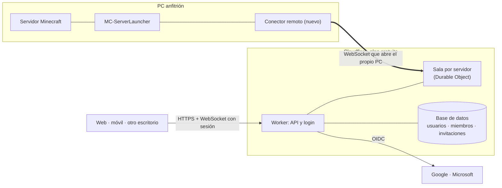

# Acceso compartido

> Prefer English? Read the [English version](shared-access.md).

Este documento recoge las decisiones de diseño para que varias personas gestionen los mismos
servidores desde distintos dispositivos: la app de escritorio, una web y, más adelante, el móvil. Es un
registro de decisiones, no una descripción de lo que ya existe. Lo único que existe hoy son los tipos
de permisos de la [última sección](#lo-que-ya-existe); el resto es el plan, y cada decisión dice
por qué se tomó para poder revisarla cuando cambie lo que la justificaba.

**Estado:** fase 1 de 7 (diseño y modelo de permisos). Decidido el 2026-10-17.

## Qué hay que conseguir

- Compartir un servidor con otras personas, con permisos distintos para cada una.
- Que web, móvil y escritorio muestren lo mismo y apliquen las mismas reglas.
- Coste de funcionamiento de 0 € mientras sea viable.
- Que la app de escritorio siga funcionando sola, sin red y sin cuenta, exactamente como ahora.
- Separar tres cosas que se confunden con facilidad: la **cuenta** (una persona), los **permisos
  sobre un servidor** y el **equipo** que lo ejecuta.

## Arquitectura

**El PC anfitrión nunca recibe conexiones: las abre él.** El conector remoto mantiene un WebSocket
hacia una sala en la nube y por ahí recibe órdenes y envía estado. Es el mismo principio que usa el
agente de Playit y no obliga a abrir puertos, publicar la IP ni configurar el router. Cada servidor
tiene su propia sala, que es quien decide si una orden se acepta.

Descartado: un túnel hacia una API en el propio PC. También evita abrir puertos, pero convierte el PC en
un servidor web público que hay que blindar, y con el PC apagado la web ni siquiera puede decir
«desconectado».

## Decisiones

### 1. Quién opera el servicio

**Modelo mixto.** Se empieza con un único servicio operado por el autor, porque es lo más fácil
para quien instala la app. El código del backend vive en este repositorio y no depende de una cuenta
concreta de Cloudflare, para que cualquier comunidad pueda desplegar el suyo, como ya ocurre con
`playit-proxy/`.

*Por qué:* con un solo servicio la cuota gratuita (unas 100 000 peticiones diarias en Workers, a
confirmar en la página oficial) se reparte entre todos los usuarios y, si crece, se agota. Poder
alojarlo por separado es la salida, y centralizarlo más adelante, incluso con un plan de pago para
quien lo quiera, sigue abierto.

*Consecuencia:* el servicio guardará datos de personas (cuenta e identidad externa). Hay que decidir su
política de privacidad antes de abrirlo a gente que no sea el autor.

### 2. Identidad

**Google y Microsoft por OIDC**, sin contraseñas propias. Una cuenta puede tener varias
identidades, de modo que añadir un método después no obliga a migrar nada. Microsoft es además la
forma de autenticar una cuenta de Minecraft Java, lo que abre la puerta a enlazar a cada persona con
su jugador.

*Descartado por ahora:* correo y contraseña. Exige custodiar hashes, verificación, bloqueos y
recuperación, y un servicio de envío de correo.

Las sesiones serán cortas, renovables y revocables. Emparejar un PC reutiliza lo que ya se conoce del flujo
de Playit: la web muestra un código de un solo uso, se pega en el launcher y este recibe una clave
propia del equipo, guardada con `SecretProtector` y revocable.

### 3. Permisos

**Roles de plantilla más ajustes sueltos por persona.** Cinco roles, ordenados de menos a más:
Observador, Operador, Moderador, Administrador y Propietario. A una persona se le puede activar o
quitar un permiso concreto sin inventar un rol nuevo.

| Permiso | Observador | Operador | Moderador | Admin | Propietario |
|---|:-:|:-:|:-:|:-:|:-:|
| Ver estado y jugadores | ● | ● | ● | ● | ● |
| Ver la consola | | ● | ● | ● | ● |
| Iniciar, parar y reiniciar | | ● | | ● | ● |
| Gestionar jugadores | | | ● | ● | ● |
| Copias de seguridad | | | | ● | ● |
| Cambiar la configuración | | | | ● | ● |
| Invitar y cambiar accesos | | | | ● | ● |
| **Crítico:** comandos libres | | | | | ● |
| **Crítico:** instalar o quitar mods y plugins | | | | | ● |
| Transferir o eliminar el servidor | | | | | ● |

Los dos permisos críticos terminan, de un modo u otro, en código ejecutándose en el PC anfitrión: un
`.jar` malicioso corre con los permisos del usuario del sistema. Por eso **no están en ningún rol salvo
el del propietario** y solo él puede concederlos como ajuste, quedando constancia de quién lo decidió.

Reglas de quién puede cambiar el acceso de quién, todas sobre conjuntos de permisos y no sobre rangos,
porque Moderador y Operador no son comparables:

1. Solo quien tiene «Invitar y cambiar accesos» cambia accesos.
2. El acceso del propietario no se cambia aquí, y nadie se hace propietario cambiando un rol: eso es una
   transferencia.
3. No se edita a quien puede hacer algo que uno no puede. Los iguales sí se pueden editar entre sí.
4. Un permiso crítico que el destinatario aún no tiene solo lo concede el propietario.
5. Nadie concede más de lo que tiene.

**Invitaciones:** enlace de un solo uso que caduca, con el secreto guardado como hash. Al aceptarlo se
une a la cuenta que lo abre y deja de valer. El rol va escrito en la invitación y rige la regla 5.
**Transferir** es una acción en dos pasos (propone el propietario, acepta el destinatario) y el
propietario anterior pasa a Administrador, para no quedarse fuera de su propio servidor.

### 4. Órdenes simultáneas

**El cliente envía intenciones con la versión que veía**, no «alterna el estado». La sala las numera por
orden de llegada; una orden apoyada en una versión que ya no es la actual se rechaza y se devuelve el
estado nuevo. El anfitrión es el único que ejecuta, así que nunca recibe dos órdenes contradictorias, y
el resultado no depende de qué dispositivo tenía mejor conexión.

Ejemplo: Ana pide parar y Bruno iniciar, ambos viendo la versión 7. Gana la que llega primero (v8);
la de Bruno se rechaza con «ahora: Parando» y, si sigue queriendo, la repite viendo la versión nueva.

Si el PC se desconecta, la sala lo marca y rechaza órdenes. Un cliente que vuelve pide el estado
actual, no reproduce lo que se perdió.

### 5. Qué se comparte y qué no

Se comparte: estado del servidor, miembros y roles, órdenes en curso, un resumen de jugadores y las
últimas líneas de consola. Sigue siendo local de cada instalación: los ajustes de la app, las
notificaciones locales, los túneles de Playit, las rutas de carpeta y la clave del equipo.

### 6. La API es un conjunto cerrado de acciones

Iniciar, parar, enviar un comando, instalar un contenido desde Modrinth… Nunca «ejecuta esto» ni acceso
genérico a archivos. Los permisos se comprueban **en la nube, en cada mensaje**; ocultar un botón no
detiene a quien habla con la API directamente. Conocer una dirección, un identificador de servidor o un
enlace de invitación no basta para entrar.

### 7. Primera entrega: solo lectura

Estado, jugadores y consola desde la web, con login e invitaciones. Valida toda la cadena (identidad,
emparejamiento, conector, sala) sin que nadie pueda romper un servidor. Las órdenes llegan después.

### 8. Móvil

Una aplicación web instalable (PWA) primero: cuesta 0 €. Una aplicación nativa para iPhone y Android
exige cuotas de Apple y de Google, así que choca con el objetivo de coste.

## Consecuencias

- **Las reglas existirán dos veces.** La nube se escribe en TypeScript, porque Cloudflare Workers no
  ejecuta C#, y la app en C#. Los tipos de esta fase son la especificación; cuando exista la nube, los
  mismos casos de prueba tendrán que ejecutarse contra las dos implementaciones. Una diferencia entre
  ambas es un fallo de seguridad, no estético.
- **El modo local no cambia.** Sin cuenta la app se comporta exactamente como hoy.
- **Las cifras de planes gratuitos hay que confirmarlas** en las páginas oficiales antes de
  comprometer la escala del servicio.

## Preguntas abiertas

- Si la consola se comparte entera: en algunas versiones puede contener direcciones IP de jugadores.
- Caducidad de las invitaciones y si el propietario aprueba cada alta.
- Qué avisos llegan al móvil.
- Idiomas de la web.
- Dónde se guardan las copias cuando varios equipos puedan ejecutar el mismo servidor (fase 7).

## Fases

| Fase | Contenido |
|---|---|
| 1 | Diseño y modelo de permisos (este documento y los tipos). |
| 2 | Identidad, invitaciones y compartición. |
| 3 | Acceso remoto y API de control, primero solo lectura. |
| 4 | Interfaz web. |
| 5 | Sincronización, órdenes simultáneas y errores. |
| 6 | Móvil. |
| 7 | Varios equipos anfitriones: investigación. |

## Lo que ya existe

Tres piezas, sin red ni interfaz y con pruebas en `ServerAccessTests`:

- **`ServerPermission`, `ServerRole` y `ServerGrant`** (`Models/ServerAccess.cs`): un permiso es un bit, un
  rol es una plantilla y un `ServerGrant` es lo que se guarda de una persona (su rol y los permisos
  añadidos o quitados). Lo que puede hacer de verdad se calcula, nunca se guarda, de modo que cambiar
  lo que significa un rol surte efecto en todos sin tocar un registro.
- **`ServerAccessCatalog`** (`Services/`): una fila por permiso con su identificador estable para la red,
  su nivel de riesgo y las plantillas de cada rol. Los identificadores y los nombres de rol son el
  formato de intercambio y una prueba los fija. Un identificador desconocido se ignora, no da permiso:
  una versión nueva de la nube no puede conceder nada a una app vieja.
- **`ServerAccessRules`** (`Services/`): `Effective`, `Has` y `Check`, que devuelve el motivo por el que se
  rechaza un cambio de acceso (`GrantDenial`) para que la pantalla pueda explicarlo.

Las etiquetas que verá la gente llegarán con la pantalla que las muestre, en los `.resx` como todo lo
demás.
