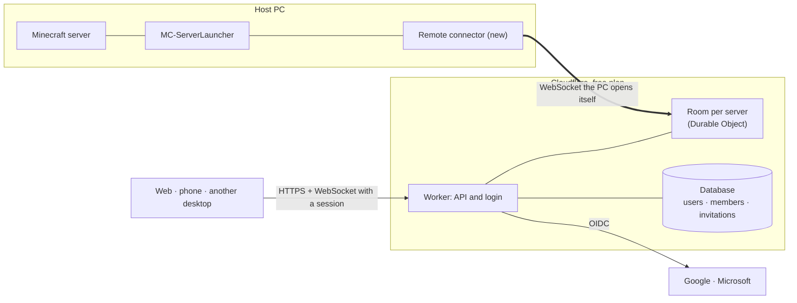

# Shared access

> ¿Prefieres español? Lee la versión en [español](shared-access.es.md).

This page records the design decisions for letting several people manage the same servers from
different devices: the desktop app, a website and, later, a phone. It is a decision log, not a
description of what already exists. The only code that exists today is the permission types in
[the last section](#what-exists-today); everything else is the plan, and each decision says why it was
taken so it can be revisited when the thing that justified it changes.

**Status:** phase 1 of 7 (design and permission model). Decided 2026-10-17.

## What it has to achieve

- Share a server with other people, with different permissions for each.
- Web, phone and desktop show the same thing and apply the same rules.
- Running cost of €0 for as long as that is viable.
- The desktop app keeps working on its own, offline and without an account, exactly as it does now.
- Keep three easily confused things apart: the **account** (a person), the **permissions on a
  server**, and the **machine** that runs it.

## Architecture

**The host PC never accepts connections: it opens them.** The remote connector keeps a WebSocket open
to a room in the cloud and receives orders and sends state through it. It is the same principle the
Playit agent uses, and it needs no open ports, no published IP and no router setup. Each server has its
own room, and the room is what decides whether an order is accepted.

Rejected: a tunnel to an API running on the PC itself. It also avoids opening ports, but it turns the
PC into a public web server that has to be hardened, and with the PC off the website cannot even say
"offline".

## Decisions

### 1. Who runs the service

**Mixed model.** Start with a single service run by the author, because that is easiest for whoever
installs the app. The backend code lives in this repository and does not depend on one particular
Cloudflare account, so any community can deploy its own, as is already the case with `playit-proxy/`.

*Why:* with one service the free quota (around 100,000 Workers requests a day, to be confirmed on the
official page) is shared by every user and runs out if it grows. Being able to host it separately is the
way out, and centralising it later, perhaps with a paid plan for those who want it, stays open.

*Consequence:* the service will hold personal data (an account and an external identity). Its privacy
policy has to be settled before it is opened to anyone but the author.

### 2. Identity

**Google and Microsoft through OIDC**, with no passwords of our own. An account can have several
identities, so adding a method later does not force a migration. Microsoft is also how a Minecraft Java
account is authenticated, which opens the door to linking each person to their player.

*Rejected for now:* email and password. It means custodying hashes, verification, lockouts and recovery,
and an email-sending service.

Sessions will be short, renewable and revocable. Pairing a PC reuses what is already familiar from the
Playit flow: the website shows a one-time code, it is pasted into the launcher, and the launcher
receives a key of its own for that machine, stored with `SecretProtector` and revocable.

### 3. Permissions

**Role templates plus per-person adjustments.** Five roles, from least to most: Observer, Operator,
Moderator, Admin and Owner. A single permission can be switched on or off for one person without
inventing a new role.

| Permission | Observer | Operator | Moderator | Admin | Owner |
|---|:-:|:-:|:-:|:-:|:-:|
| See status and players | ● | ● | ● | ● | ● |
| Read the console | | ● | ● | ● | ● |
| Start, stop and restart | | ● | | ● | ● |
| Manage players | | | ● | ● | ● |
| Backups | | | | ● | ● |
| Change the configuration | | | | ● | ● |
| Invite and change access | | | | ● | ● |
| **Critical:** free-form commands | | | | | ● |
| **Critical:** install or remove mods and plugins | | | | | ● |
| Transfer or delete the server | | | | | ● |

Both critical permissions end, one way or another, in code running on the host PC: a malicious `.jar`
runs with the rights of the operating-system user. That is why **they are in no role but the owner's**
and only the owner can grant them as an adjustment, which leaves a record of who decided it.

The rules for who may change whose access are all about sets of permissions, not ranks, because
Moderator and Operator cannot be compared:

1. Only someone with "Invite and change access" changes access.
2. The owner's access is not changed here, and nobody becomes owner by changing a role: that is a
   transfer.
3. You cannot edit someone who can do something you cannot. Equals can edit each other.
4. A critical permission the target does not already have is granted only by the owner.
5. Nobody grants more than they hold.

**Invitations:** a single-use link that expires, with its secret stored as a hash. Accepting it binds
it to the account that opens it and it stops working. The role is written into the invitation and rule
5 applies to it. **Transferring** is a two-step action (the owner proposes, the recipient accepts) and
the previous owner becomes an Admin, so they are not locked out of their own server.

### 4. Simultaneous orders

**The client sends intents together with the version it was looking at**, never "toggle the state". The
room numbers them in order of arrival; an order based on a version that is no longer current is
rejected and the new state is returned. The host is the only one that executes, so it never receives two
contradictory orders, and the outcome does not depend on which device had the better connection.

Example: Ana asks to stop and Bruno to start, both looking at version 7. Whichever arrives first wins
(v8); Bruno's is rejected with "now: Stopping" and, if he still wants it, he repeats it against the new
version.

If the PC disconnects, the room marks it and rejects orders. A client that comes back asks for the
current state; it does not replay what it missed.

### 5. What is shared and what is not

Shared: the server's state, members and roles, orders in progress, a summary of players and the last
console lines. Still local to each installation: the app's settings, local notifications, Playit
tunnels, folder paths and the machine's key.

### 6. The API is a closed set of actions

Start, stop, send a command, install a piece of content from Modrinth… Never "run this" and never
generic file access. Permissions are checked **in the cloud, on every message**; hiding a button does
not stop someone who talks to the API directly. Knowing an address, a server id or an invitation link
is not enough to get in.

### 7. First delivery: read-only

Status, players and console from the website, with login and invitations. It validates the whole chain
(identity, pairing, connector, room) without anyone being able to break a server. Orders come after.

### 8. Phone

An installable web app (PWA) first: it costs €0. A native app for iPhone and Android requires Apple and
Google fees, so it clashes with the cost goal.

## Consequences

- **The rules will exist twice.** The cloud is written in TypeScript, because Cloudflare Workers do not
  run C#, and the app in C#. The types in this phase are the specification; once the cloud exists, the
  same test cases have to run against both implementations. A difference between them is a security
  bug, not a cosmetic one.
- **Local mode does not change.** Without an account the app behaves exactly as it does today.
- **The free-plan figures need confirming** on the official pages before the scale of the service is
  committed to.

## Open questions

- Whether the whole console is shared: in some versions it can contain players' IP addresses.
- How long an invitation lasts, and whether the owner approves each new member.
- Which alerts reach the phone.
- Languages of the website.
- Where backups live when several machines can run the same server (phase 7).

## Phases

| Phase | Content |
|---|---|
| 1 | Design and permission model (this page and the types). |
| 2 | Identity, invitations and sharing. |
| 3 | Remote access and control API, read-only first. |
| 4 | Web interface. |
| 5 | Synchronisation, simultaneous orders and errors. |
| 6 | Mobile. |
| 7 | Several host machines: research. |

## What exists today

Three pieces, with no network and no interface, tested in `ServerAccessTests`:

- **`ServerPermission`, `ServerRole` and `ServerGrant`** (`Models/ServerAccess.cs`): a permission is a
  bit, a role is a template, and a `ServerGrant` is what is stored for a person (their role plus the
  permissions added or removed). What they can really do is computed, never stored, so changing what a
  role means takes effect for everybody without touching a record.
- **`ServerAccessCatalog`** (`Services/`): one row per permission with its stable wire identifier, its
  risk level and each role's template. The identifiers and role names are the interchange format and a
  test pins them. An unknown identifier is ignored, not granted: a newer cloud cannot give an older app
  anything.
- **`ServerAccessRules`** (`Services/`): `Effective`, `Has` and `Check`, which returns the reason an
  access change is refused (`GrantDenial`) so a screen can explain it.

The labels people will read arrive with the screen that shows them, in the `.resx` files like
everything else.
